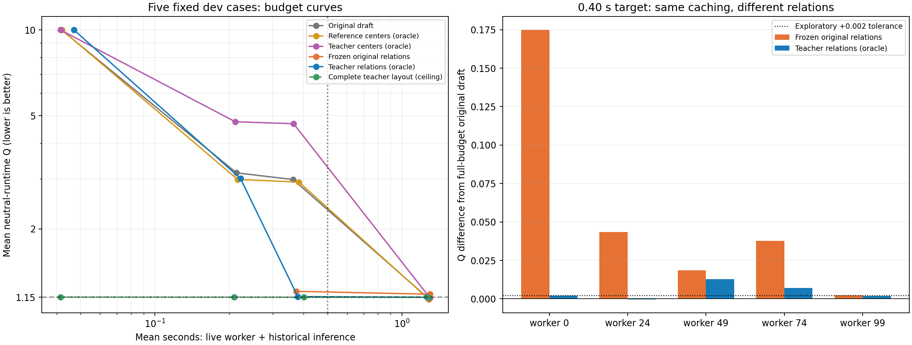

# E11：短预算机制诊断结论

2026-10-18。固定dev_quality中worker 0/24/49/74/99的5例，分别97/98/66/98/94个模块；主对照100次、必要归因10次，共110次求解，累计研究墙钟92.05秒。全部110个输出经官方与独立检查均硬合法，零求解执行错误；Q封顶的合法行排保底照常计入均值。本报告只读取已存证据，不重算布局。

**有支持关系蒸馏的机制信号，但尚未实现“0.5秒内维持当前Q”。** 原完整预算平均Q为1.151565；教师关系＋原草图在0.40秒目标下为1.156304，平均Q上升0.004739（约0.412%），记账总时间0.379秒，相对同5例完整预算约3.34倍。仅2/5例在预先固定的Q＋0.002容差内，严格不退化1/5例，不能用小幅平均退化宣称逐例质量保持。

## 1. 0.40秒目标的主结果

原完整预算指普通路径1.3秒、仅无改善时救援、整例目标5秒；本5例普通路径均完成，实际平均核心1.237秒，加通信与历史推理记账为1.264秒。其Q与既有教师成品逐例一致。

| 输入/关系 | 平均Q | 最大Q | 核心秒/例 | 通信＋历史推理记账后秒/例 | 硬合法 | Q≤原完整预算＋0.002 |
|---|---:|---:|---:|---:|---:|---:|
| 原草图，动态关系 | 2.981902 | 9.999999 | 0.335 | 0.363 | 5/5 | 0/5 |
| 原草图自身关系固定（归因对照） | 1.206911 | 1.254561 | 0.333 | 0.374 | 5/5 | 0/5 |
| 参考中心＋原宽高（诊断） | 2.921405 | 9.999999 | 0.355 | 0.383 | 5/5 | 3/5 |
| 教师中心＋原宽高（诊断） | 4.685539 | 9.999999 | 0.336 | 0.364 | 5/5 | 1/5 |
| 教师关系＋原草图（诊断） | 1.156304 | 1.209771 | 0.349 | 0.379 | 5/5 | 2/5 |
| 完整教师成品（上限校验） | 1.149843 | 1.210164 | 0.375 | 0.401 | 5/5 | 5/5 |

原草图在0.40秒目标下，worker99保留Q封顶的合法行排，其余4例也都未达到同例完整预算质量。完整教师回灌在0.10秒档就得到平均Q=1.151565、核心0.015秒；该档0次锥迭代，主要检查并接受已知答案。它仅表明合法成品的保留/检查无需约1秒，不能作为模型可达到该精度或真实推理速度的证据。0.10秒时非完整成品组也0次锥迭代：现有循环预留安全时间后不启动优化，不能据此声称锥优化数学上无法在0.10秒内工作。

## 2. 区分教师信息与固定关系的收益

teacher_relations仍从原草图的中心与宽高出发，只获得既有E10成品的全对左右/上下分离关系及组内接触树；不输入教师坐标、尺寸、参考指标。关系在循环中固定，LP投影也采用同一套关系。teacher_center仅替换中心，保留原宽高与公开锁定规格。reference_center是单独标记的标签诊断。

主对照结束后识别出缓存混杂，先固定control.py说明，再在同5例补做10次对照：把原草图自身的分离关系/接触树同样预先计算并固定。因此教师关系与固定原关系具有相同的计算复用机制，区别在关系来源。教师关系在短预算下5/5例Q均更好，均值从1.206911降到1.156304；两者核心时间0.333/0.349秒，平均锥迭代3.4/3.6次。

| worker（模块数） | 原完整预算Q | 固定原关系Q | 教师关系Q | 教师关系Q差 | 教师关系记账总秒 |
|---|---:|---:|---:|---:|---:|
| 0（97） | 1.079742 | 1.254561 | 1.081932 | +0.002190 | 0.428 |
| 24（98） | 1.210060 | 1.253448 | 1.209771 | -0.000289 | 0.393 |
| 49（66） | 1.166694 | 1.185161 | 1.179395 | +0.012701 | 0.339 |
| 74（98） | 1.128858 | 1.166688 | 1.135978 | +0.007119 | 0.353 |
| 99（94） | 1.172471 | 1.174696 | 1.174443 | +0.001972 | 0.381 |

这支持“教师结构信息有作用”，但仍不能把分离关系和接触树的贡献拆开，也不能把固定关系的收益全部归因于缓存省时：它同时改变了逐步更新拓扑的策略。原关系固定也显著改善短预算结果，却在完整预算平均Q=1.178967时劣于原动态关系的1.151565，说明固定错误结构可能限制后续优化空间。

## 3. 中心精度不等于短预算可修复性

| 输入/关系 | 完整预算平均Q | 短预算平均Q |
|---|---:|---:|
| 原草图，动态关系 | 1.151565 | 2.981902 |
| 原草图自身关系固定（归因对照） | 1.178967 | 1.206911 |
| 参考中心＋原宽高（诊断） | 1.131604 | 2.921405 |
| 教师中心＋原宽高（诊断） | 1.145733 | 4.685539 |
| 教师关系＋原草图（诊断） | 1.150498 | 1.156304 |
| 完整教师成品（上限校验） | 1.148815 | 1.149843 |

即使中心来自教师成品，保留原草图宽高后仍可能破坏整体几何兼容性。在0.40秒档，teacher_center的worker24/99没有被严格输出守卫接纳的改善候选，保留合法但Q封顶的行排。reference_center的worker99也如此。日志包含超时和重叠导致的候选拒绝；部分诊断在规范化前采集，不能据此逐项精确解释规范化后的所有拒绝原因。本实验不修改硬守卫来改善数字。

完整预算下中心替换仍能改善平均Q，表明“同预算最终质量提高”与“短预算恢复质量”是两个不同问题。此结果反对优先继续优化中心误差作为加速代理；不证明所有坐标蒸馏都无效。

## 4. 计时与证据边界

- 全部为CPU两线程，模型草图和教师成品复用既有记录，不加载模型、训练或读取封存测试。核心/通信在线实测；约0.017秒/例的原推理时间沿用来源并统一记账。所有oracle构造、数据/模型加载、预热、评分、绘图不计入表内稳态时间。未来关系预测网络的实际推理时间未知，0.379秒不能称为可部署新模型端到端时间。
- 预算是目标，不是硬实时上界。教师关系0.40秒档最大记账时间0.428秒；所有超预算计数和原始时间保留在results/cases中。进程通信使用同步持久worker，保留JSON序列化成本。
- 原完整预算中原生锥求解约0.161秒，占核心时间约13.0%；其余包含建模、拓扑、规范化、合法性检查、LP投影等，尚未进一步拆分，不能全部归因为Python开销。
- 主对照seed0随机化每例各组合顺序；补充对照晚于主对照，未重复全部方法作同步噪声估计。单次运行、仅5例，主对照分两个worker进程执行（因保存中断恢复），与补充worker各自预热。不能据此作统计显著性、泛化或排行榜结论。
- 启动时记录上游版本的类型处理错误发生在读取样例前，保存在首次目录results.json。主运行在70次求解后遇到Windows写文件OSError(22)，已完成数据保留；改为临时文件原子替换后仅补齐30次。原config/source_snapshot不改写，resume配置、源码差异与失败事实见invocations.json。

## 5. 研究取舍

本阶段停止扩测，不训练、不追加调预算。下一阶段优先考虑训练集上的E10关系蒸馏：先让模型学习有用的分离/接触结构，并保留原坐标/形状头及严格合法化；直接模仿成品中心的优先级下降。该方向尚需用户发起后续实验，当前不启动教师数据生成或训练。剩余Q退化最大的worker49/74应作为机制反例保留，不把它们剔除以满足目标。

主证据：[配置](config.json)、[恢复调用](invocations.json)、[全部统计](results.json)、[逐例坐标与轨迹](cases.jsonl)、[原源码快照](source_snapshot.zip)、[恢复源码快照](source_snapshot_resume1.zip)。归因对照：[配置](../20261018_raw_relation_control_dev5_seed0/config.json)、[结果](../20261018_raw_relation_control_dev5_seed0/results.json)、[逐例证据](../20261018_raw_relation_control_dev5_seed0/cases.jsonl)。
