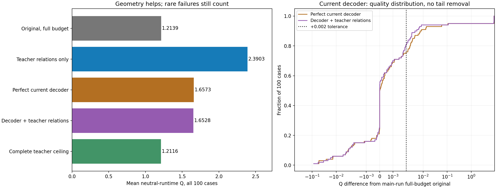

# E11扩大研究总报告：dev100结构与当前解码器

2026-10-18。在同一固定dev_quality100上完成主结构对照700次与当前解码器对照200次，共900次求解，覆盖全部100个worker；两个阶段计算累计598.42秒，未超过预先固定的900秒共同保护。官方及独立硬检查900/900合法，求解执行错误0；合法但质量很差的保底不从结果删除。没有训练、生成训练集教师库或读取封存测试。

**扩大数据后，五例上“教师关系接近原Q”的结论未能保持。** 原完整预算平均Q为1.213931；仅给教师分离/接触关系、保留原坐标和宽高时，0.40秒目标下平均Q为2.390287，12/100例保留初始合法行排。当前证据不支持直接进入“只训练关系头”的路线。

把教师中心与长宽比一起给准，并经过真实当前解码器后，大量样例改善；但两组平均Q分别为1.657280/1.652778，仍有5/5例Q≥5。**在该教师投影、当前后处理与短预算组合下，尚未达到维持原Q的目标。** 这既不是已训练模型结果，也不是证明当前输出形式中不存在更好的可学习解。

## 1. 全部100例统一比较

| 输入/流程 | 平均Q↓ | P95 Q | 合法行排保底 | 平均记账秒 | 质量容差且≤0.5秒 |
|---|---:|---:|---:|---:|---:|
| 原草图＋完整预算 | 1.213931 | 1.382808 | 0/100 | 1.261 | 1/100 |
| 原草图＋短预算 | 3.415568 | 9.999999 | 24/100 | 0.383 | 32/100 |
| 固定原草图关系＋短预算 | 2.622464 | 9.999999 | 15/100 | 0.366 | 25/100 |
| 只给教师分离关系＋短预算 | 2.073579 | 9.999999 | 8/100 | 0.367 | 43/100 |
| 给教师分离/接触关系＋短预算 | 2.390287 | 9.999999 | 12/100 | 0.369 | 52/100 |
| 完美教师中心/形状经当前解码＋短预算 | 1.657280 | 1.899005 | 5/100 | 0.388 | 73/100 |
| 同上＋教师关系＋短预算 | 1.652778 | 1.899005 | 5/100 | 0.368 | 81/100 |
| 完整教师成品回灌（已知答案） | 1.211556 | 1.382808 | 0/100 | 0.040 | 100/100 |

Q为官方中性时间质量分，越低越好，不是比赛分数。质量容差沿用运行前固定的“同例主运行完整预算Q＋0.002”；同时要求硬合法和记账时间≤0.5秒。主阶段与补充阶段依次执行，硬件、CPU两线程、后处理源码不变，时序与系统波动仍可能影响截止前迭代，不能解释为严格同步的噪声消融。

## 2. 当前模型能表达什么

现有decode预测中心与log长宽比r，并用w=√(A·exp(r))、h=√(A/exp(r))恢复宽高，r限制在[-5,5]，自由块面积固定为公开目标A；随后按E10原流程恢复fixed/preplaced规格。教师E10成品则可使用官方允许的面积浮动。

本轮补充oracle直接把既有教师中心与log长宽比作为理想网络输出，交给原冻结prepare_inference/decode，**没有用手写近似替换真实解码器**。100例共有6332个自由块，其中6325个教师块面积与目标面积相差超过0.01%（99.89%）；重新解码后的最大自由块面积相对误差约2.29e-07，符合精确面积输出特征。

因此完整教师回灌与“当前模型完美预测教师中心/形状”不同。投影同时涉及面积、浮点坐标、长宽比范围与非负裁切，尚未做逐项因果消融，不能把所有剩余失败直接归罪于面积限制。这只是从一个已知好解构造的输出投影，也不是当前输出族的最优性证书。

## 3. 剩余尾部完整保留

| worker | 原完整预算Q | 当前解码oracle Q | 再加教师关系Q | 证据 |
|---|---:|---:|---:|---|
| 20 | 1.203816 | 1.204096 | 9.999999 | [轨迹](cases/020.json) |
| 29 | 1.187423 | 9.999999 | 9.999999 | [轨迹](cases/029.json) |
| 36 | 1.127267 | 9.999999 | 1.093716 | [轨迹](cases/036.json) |
| 47 | 1.096702 | 9.999999 | 1.096702 | [轨迹](cases/047.json) |
| 52 | 1.306260 | 1.314906 | 9.999999 | [轨迹](cases/052.json) |
| 66 | 1.135924 | 9.999999 | 9.999999 | [轨迹](cases/066.json) |
| 86 | 1.215162 | 1.163596 | 9.999999 | [轨迹](cases/086.json) |
| 94 | 1.149627 | 9.999999 | 1.064494 | [轨迹](cases/094.json) |

| 方法 | HPWL gap | bbox gap | 边界违反 | 分组违反 | MIB违反 | 硬合法 |
|---|---:|---:|---:|---:|---:|---:|
| 完美教师中心/形状经当前解码＋短预算 | 0.581713 | 0.594582 | 1.870 | 1.230 | 3.920 | 100/100 |
| 同上＋教师关系＋短预算 | 0.530415 | 0.538597 | 1.580 | 1.090 | 3.920 | 100/100 |

补充阶段只给教师中心/形状时，质量容差与0.5秒同时满足73/100例；再加教师关系为81/100例。追加关系的逐例胜/平/负为[36, 37, 27]，平均Q差-0.004501。均值下降与尾部可靠性必须分开看；不能只报告中位数或剔除失败例。

## 4. 研究判断

1. 暂缓直接训练关系头。主100例说明理想化关系仍不足以稳定替代完整后处理，分离关系与接触树的收益也有耦合；完整结构消融见主报告。
2. 教师蒸馏继续值得研究，但应以**教师输出—当前解码—短预算修复**的整体为对象。标签必须与学生可表达的几何和后续修复兼容，仅模仿中心或关系都不足以作为成功代理。
3. 下一步优先查清“接近教师的输入为何仍退回差解”，再验证一个可靠、廉价的几何投影/修复入口。可以分别检查形状归一化、拓扑/接触更新、数值守卫拒绝和截止时保底；保留严格硬合法检查，不能靠放宽合法性换取加速。
4. 上述诊断完善后，再决定精确面积教师、带面积自由度的输出表示或联合中心/形状/关系蒸馏。当前没有新训练或模型改造，不能把这些建议写成已实现改进。

这轮研究从5例扩大为全100例，纠正了原先小面板的乐观解释。100例仍是已参与开发的面板，不能声称封存测试泛化；接近合法输入的具体失败原因尚待最小反例验证，不预设唯一根因。

## 5. 计时、复现与证据

核心和通信在线实测，各组统一加既有模型推理时间。oracle输出生成、结构构造、加载、预热、评分及绘图排除；未来新模型推理时间未知，表中oracle时间不是新模型部署速度。两阶段共用900秒累计保护，主阶段实际467.16秒，补充131.26秒。

[主100例结构报告](../20261018_factorial_dev100_seed0/analysis.md)、[主原始统计](../20261018_factorial_dev100_seed0/results.json)、[补充配置](config.json)、[补充统计](results.json)、[解码及配对诊断](paired_analysis.json)、[全部补充逐例证据](cases/)、[源码快照](source_snapshot.zip)。本报告及图只从已存证据生成，不重新求解或读取数据张量。
