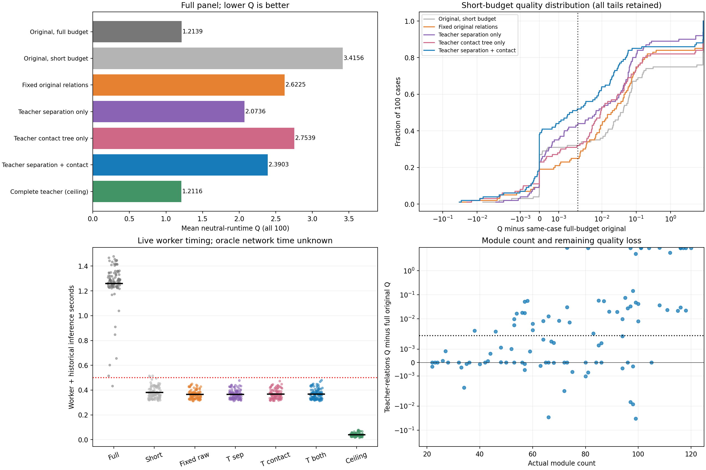

# E11 dev100：扩大样本与分离/接触结构消融

2026-10-18。用户要求扩大数据量后，在查看扩展结果前固定完整workset_v2.dev_quality100与7组对照。实际100/100例、700/700次求解完成，累计墙钟467.16秒；官方与独立硬检查700/700合法，求解执行错误0。实际模块数范围22–120，中位数73.0；worker编号不等于模块数。

**结论：尚未达到0.5秒内维持原Q。** 教师分离/接触关系组平均Q=2.390287，同例在线完整基线=1.213931，Q差+1.176356（+96.905%）；平均记账总时间0.369秒，约3.42倍加速。逐例在预定Q＋0.002容差内52/100，兼顾容差与0.5秒52/100。教师关系相对固定原关系的平均Q改善，支持进一步研究结构信号。

## 1. 全面板结果与尾部

| 方法 | 平均Q | P95 Q | 最大Q | 合法行排保底 | 记账总秒/例 | ≤Q+0.002 | 质量容差且≤0.5秒 |
|---|---:|---:|---:|---:|---:|---:|---:|
| 原草图完整预算 | 1.213931 | 1.382808 | 1.472866 | 0/100 | 1.261 | 100/100 | 1/100 |
| 原草图短预算 | 3.415568 | 9.999999 | 9.999999 | 24/100 | 0.383 | 32/100 | 32/100 |
| 固定原分离/接触结构 | 2.622464 | 9.999999 | 9.999999 | 15/100 | 0.366 | 25/100 | 25/100 |
| 教师分离＋原草图选接触树 | 2.073579 | 9.999999 | 9.999999 | 8/100 | 0.367 | 43/100 | 43/100 |
| 原分离＋教师选接触树 | 2.753891 | 9.999999 | 9.999999 | 16/100 | 0.369 | 32/100 | 32/100 |
| 教师分离/接触结构 | 2.390287 | 9.999999 | 9.999999 | 12/100 | 0.369 | 52/100 | 52/100 |
| 完整教师成品上限 | 1.211556 | 1.382808 | 1.472866 | 0/100 | 0.040 | 100/100 | 100/100 |

Q越低越好，为官方中性时间质量对照，不是比赛分数。合法但质量封顶的行排保底照常计入，不以硬合法替代质量。初始行排保留由“无被接纳的代理改善事件”识别；完整成品组若已被接受则不会被误认为未改善保底。最大Q和最差10%均值等完整统计见results.json。

## 2. 同预算分离/接触消融

四组固定关系保持原草图坐标与宽高，分离边来源为raw或teacher；接触树以选定分离方向为基础，用raw或teacher几何计算边权和选树。只把关系三元组交给worker，完整成品上限组除外。接触树与分离方向存在条件依赖，不能将该条件化2×2对照描述成互不影响的两个独立开关。

| 新−对照（同0.40秒目标） | 平均Q差↓ | 胜/平/负 | 描述性bootstrap 95%区间 |
|---|---:|---:|---|
| 教师分离/接触结构 − 固定原分离/接触结构 | -0.232177 | 63/20/17 | [-0.586377, +0.076568] |
| 教师分离＋原草图选接触树 − 固定原分离/接触结构 | -0.548885 | 53/20/27 | [-0.978420, -0.182980] |
| 原分离＋教师选接触树 − 固定原分离/接触结构 | +0.131427 | 49/27/24 | [-0.009088, +0.356765] |
| 教师分离/接触结构 − 教师分离＋原草图选接触树 | +0.316708 | 53/24/23 | [+0.051970, +0.635528] |
| 教师分离/接触结构 − 原分离＋教师选接触树 | -0.363604 | 57/22/21 | [-0.780306, +0.002005] |

条件化交互Q(T,T)−Q(T,R)−Q(R,T)＋Q(R,R)的均值为+0.185281；负值表示本次组合在Q尺度上的额外收益。Q是非线性分数，交互与单项均值差不构成损失组成的严格加和解释。bootstrap按100个已观测样例重采样，只是描述性开发面板区间，不能排除开发选择、生成家族相关性、计时波动或多重比较影响。

## 3. 五例结论的复核与反例

| 本轮子集（仅事后诊断） | 例数 | 原完整Q | 教师关系Q | Q差 |
|---|---:|---:|---:|---:|
| 此前5例重新在线运行 | 5 | 1.152189 | 1.190684 | +0.038495 |
| 本实验新增95例 | 95 | 1.217181 | 2.453424 | +1.236244 |

本轮对全部100例重新在线运行；上述5/95拆分只是按既有成员做的事后稳定性诊断，不作为两个独立测试，不根据胜负改变主面板。缓存教师Q与在线完整基线Q的最大绝对差为0.083138；教师仍来自事前冻结的旧E10结果，没有在扩展结果上重新择优教师。

教师关系相对完整预算退化最大的10例全部保留：

| worker（模块数） | 原完整Q | 教师关系Q | Q差 | 教师关系总秒 | 证据 |
|---|---:|---:|---:|---:|---|
| 77（73） | 1.086904 | 9.999999 | +8.913095 | 0.358 | [逐例](cases/077.json) |
| 62（108） | 1.090109 | 9.999999 | +8.909890 | 0.370 | [逐例](cases/062.json) |
| 12（101） | 1.108988 | 9.999999 | +8.891011 | 0.380 | [逐例](cases/012.json) |
| 36（116） | 1.127267 | 9.999999 | +8.872732 | 0.377 | [逐例](cases/036.json) |
| 75（97） | 1.127304 | 9.999999 | +8.872695 | 0.377 | [逐例](cases/075.json) |
| 66（104） | 1.135924 | 9.999999 | +8.864075 | 0.405 | [逐例](cases/066.json) |
| 82（117） | 1.148996 | 9.999999 | +8.851003 | 0.469 | [逐例](cases/082.json) |
| 94（118） | 1.149627 | 9.999999 | +8.850372 | 0.481 | [逐例](cases/094.json) |
| 65（116） | 1.166332 | 9.999999 | +8.833667 | 0.444 | [逐例](cases/065.json) |
| 71（120） | 1.210140 | 9.999999 | +8.789859 | 0.392 | [逐例](cases/071.json) |

这些样例用于解释剩余失效模式，不能从主指标删除；后续若根据其诊断改动，需要在新的明确运行中记录方案变化。

## 4. 官方质量分解与计时

| 方法 | HPWL gap均值 | bbox gap均值 | 边界违反均值 | 分组违反均值 | MIB违反均值 | 硬合法 |
|---|---:|---:|---:|---:|---:|---:|
| 原草图完整预算 | 0.002209 | -0.001319 | 0.180 | 0.170 | 3.930 | 100/100 |
| 原草图短预算 | 2.539920 | 2.665667 | 7.400 | 5.180 | 3.930 | 100/100 |
| 固定原分离/接触结构 | 1.625264 | 1.993095 | 4.910 | 3.880 | 3.920 | 100/100 |
| 教师分离＋原草图选接触树 | 0.822852 | 1.063988 | 3.300 | 2.800 | 3.930 | 100/100 |
| 原分离＋教师选接触树 | 1.727911 | 2.078075 | 5.480 | 4.200 | 3.930 | 100/100 |
| 教师分离/接触结构 | 1.230537 | 1.542873 | 4.350 | 3.170 | 3.920 | 100/100 |
| 完整教师成品上限 | 0.001806 | -0.002802 | 0.140 | 0.160 | 3.930 | 100/100 |

| 方法 | 核心秒均值 | 通信秒均值 | 总秒P95 | 总秒最大 | 总秒>0.5 | 锥迭代均值 | 原生锥秒均值 |
|---|---:|---:|---:|---:|---:|---:|---:|
| 原草图完整预算 | 1.233 | 0.010 | 1.443 | 1.478 | 99/100 | 10.45 | 0.176 |
| 原草图短预算 | 0.356 | 0.009 | 0.464 | 0.515 | 3/100 | 3.52 | 0.055 |
| 固定原分离/接触结构 | 0.335 | 0.013 | 0.432 | 0.450 | 0/100 | 4.88 | 0.081 |
| 教师分离＋原草图选接触树 | 0.337 | 0.012 | 0.433 | 0.479 | 0/100 | 4.91 | 0.079 |
| 原分离＋教师选接触树 | 0.337 | 0.014 | 0.439 | 0.474 | 0/100 | 4.69 | 0.081 |
| 教师分离/接触结构 | 0.337 | 0.013 | 0.443 | 0.481 | 0/100 | 5.01 | 0.079 |
| 完整教师成品上限 | 0.014 | 0.008 | 0.070 | 0.078 | 0/100 | 0.00 | 0.000 |

核心和通信均在线实测，原模型推理时间沿用原草图记录，对各组统一记账。数据/模型加载、预热、oracle结构构造、评分和绘图不计入稳态时间；未来预测关系的网络耗时未知，教师关系时延不是已部署模型速度。各预算是目标，非硬实时上界，超预算计数和时间尾部照实保留。原生锥秒不含其余建模、图处理、守卫和投影工作，不据此直接把剩余时间归为Python成本。

## 5. 范围与后续边界

本轮从5例扩大到100例，覆盖全部100个worker，每worker1例，包含既有5例。该面板已用于E8/E9开发；扩大覆盖不等于独立未见泛化证明。没有筛选兼容面板、读取封存local_test、改变冻结划分、训练或生成训练集教师库。原中心oracle组未扩测，本报告不能宣称100例证实中心蒸馏无效。

主对照严格使用900秒累计保护、CPU两线程、seed0逐例随机7组顺序；后处理源码冻结，官方和独立硬守卫保持不变。本报告从cases下唯一坐标池和已存metrics构建，未重新求解。是否进入关系蒸馏训练，须根据本轮尾部、单项贡献及反例另定实验；当前不自动启动长训练。

证据：[配置与固定成员](config.json)、[调用与累计预算](invocations.json)、[全部统计](results.json)、[配对分析与反例](paired_analysis.json)、[逐例坐标与轨迹](cases/)、[源码快照](source_snapshot.zip)。
