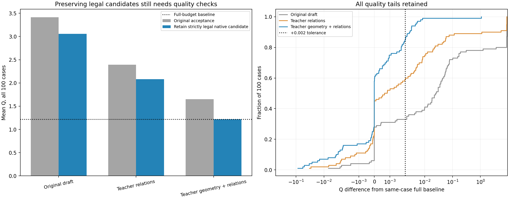

# E11研究总报告：扩大样本后，先修正蒸馏接口与几何接纳

2026-10-18。本轮同一固定dev_quality100完成700次结构消融、200次当前解码器oracle、300次最小数值修正复核，共1200次正式对照；另对5个真实失败例各重放首步以核查规范化。全部正式返回布局官方及独立硬检查1200/1200合法，执行错误0。各阶段累计计算767.55秒，共用预先固定900秒上限，没有启动训练或读取封存测试。

**扩大数据后，原先5例的乐观结论不成立。** 在线完整基线平均Q=1.213931、记账时间1.261秒。原路径只给教师关系时，短预算平均Q=2.390287；给准教师中心与形状、再经当前真实解码器和教师关系时，也有5例退回Q封顶保底。

进一步核查确认：4/5个所查反例中的原生候选已经严格硬合法，却被坐标规范化引入新重叠。这是一个具体接纳缺陷；但硬合法的原生候选仍可能有较多软违反，因此修复它不等于达成最终质量目标。

## 1. 最小修正的全100例结果

| 方法 | 原路径平均Q | 修正后平均Q | 修正后P95 Q | 修正后总秒/例 | 保底数 原→新 | 质量容差且≤0.5秒 |
|---|---:|---:|---:|---:|---:|---:|
| 原草图＋合法候选保留 | 3.415568 | 3.054064 | 9.999999 | 0.377 | 24→20 | 33/100 |
| 教师关系＋合法候选保留 | 2.390287 | 2.080439 | 9.999999 | 0.361 | 12→9 | 59/100 |
| 教师中心/形状经当前解码＋教师关系＋合法候选保留 | 1.652778 | 1.222376 | 1.424352 | 0.361 | 5→0 | 85/100 |

修正后，给准教师中心/形状、经当前解码器并配教师关系的平均Q=1.222376，平均记账时间0.361秒；同例Q＋0.002容差与0.5秒同时满足85/100例。仍未达到0.5秒内维持原Q的目标。 原草图与关系oracle的修正后均值分别为3.054064/2.080439。

这里的“平均时间”含在线实测核心/通信和统一沿用的原模型推理时间，oracle构造不计入；未来新网络时延未知。所有组总目标0.40秒，不把实际超时隐藏为硬实时保证。不按Q挑选样例，合法但很差的布局仍完整计入。

## 2. 数值反例与修正边界

| worker | 原候选硬合法 | 规范化后硬合法 | 规范化后重叠对数 | 最大坐标改变量 | 原候选官方Q |
|---|---:|---:|---:|---:|---:|
| 20 | True | False | 3 | 4.69e-06 | 2.451843 |
| 29 | True | False | 4 | 7.57e-06 | 2.268276 |
| 52 | False | False | 1 | 7.89e-07 | 未评分：硬不可行 |
| 66 | True | False | 1 | 1.82e-06 | 2.211455 |
| 86 | True | False | 12 | 9.83e-06 | 2.482065 |

以上是按原组全部Q≥5例选出的事后反例，不是随机代表面板。首步重放给原生求解1秒保护以检查数值，不用其耗时宣称加速；规范化前后比较使用同一份候选。4例新重叠来自规范化，worker52在规范化前已存在重叠，不能把它也归为同一根因。所有候选均经原严格hard_valid；硬合法原候选又通过官方及独立检查，Q仍约2.2–2.5，说明硬合法和软接触质量需要分开。

修正只保存在E11独立conic_geometry_safe/robust_safe/worker_safe：仍先使用原规范化结果；该结果不合法时，才检查原候选经原有微小负坐标裁切后是否严格硬合法。容差、重叠阈值、面积约束、公开规格与官方评分均未改。原E10、原E11路径及历史结果保持不变。该候选不自动提升为基线。

## 3. 质量组成、尾部与时间

| 方法 | 最大Q | 最差10% Q | HPWL gap | bbox gap | B/G/M违反均值 | 使用保留分支例数 | 硬合法 |
|---|---:|---:|---:|---:|---|---:|---:|
| 原草图＋合法候选保留 | 9.999999 | 9.999999 | 2.145960 | 2.361144 | 6.30/4.68/3.93 | 7 | 100/100 |
| 教师关系＋合法候选保留 | 9.999999 | 9.668473 | 0.949356 | 1.248976 | 3.27/2.50/3.93 | 13 | 100/100 |
| 教师中心/形状经当前解码＋教师关系＋合法候选保留 | 2.268276 | 1.502511 | 0.003167 | -0.003475 | 0.14/0.38/3.93 | 13 | 100/100 |

| 方法 | 核心秒均值 | 总秒P95 | 总秒最大 | >0.5秒 | 锥迭代均值 |
|---|---:|---:|---:|---:|---:|
| 原草图＋合法候选保留 | 0.351 | 0.500 | 0.529 | 5/100 | 4.26 |
| 教师关系＋合法候选保留 | 0.331 | 0.431 | 0.491 | 0/100 | 5.69 |
| 教师中心/形状经当前解码＋教师关系＋合法候选保留 | 0.332 | 0.427 | 0.480 | 0/100 | 5.74 |

保留原候选可能改善某例，也可能因软接触未恢复、代理权衡或截止前迭代差异而劣于原路径；各组配对胜平负及平均差均保存在paired_analysis.json，不声称逐例单调改善。软违反统计B/G/M分别为边界/分组/MIB，不能用“全部硬合法”替代这些质量指标。

修正后几何oracle退化最大的10例：

| worker | 完整基线Q | 几何oracle修正后Q | Q差 | 证据 |
|---|---:|---:|---:|---|
| 29 | 1.187423 | 2.268276 | +1.080853 | [逐例](cases/029.json) |
| 44 | 1.079175 | 1.087560 | +0.008385 | [逐例](cases/044.json) |
| 19 | 1.109936 | 1.117045 | +0.007109 | [逐例](cases/019.json) |
| 43 | 1.156417 | 1.161876 | +0.005459 | [逐例](cases/043.json) |
| 87 | 1.291062 | 1.296030 | +0.004968 | [逐例](cases/087.json) |
| 70 | 1.281099 | 1.285670 | +0.004570 | [逐例](cases/070.json) |
| 30 | 1.157885 | 1.161260 | +0.003376 | [逐例](cases/030.json) |
| 85 | 1.193428 | 1.196765 | +0.003337 | [逐例](cases/085.json) |
| 23 | 1.202766 | 1.206095 | +0.003329 | [逐例](cases/023.json) |
| 42 | 1.178137 | 1.181144 | +0.003007 | [逐例](cases/042.json) |

## 4. 对下一阶段的判断

- 教师蒸馏仍有价值，但单独的关系头不是已获充分支持的方案。分离与接触的完整消融和失败率见主报告，不能沿用5例中约0.4%的平均退化推断全100例。
- 必须把教师目标、学生输出形式和轻量修复共同设计。当前解码自由块面积固定为A，而教师成品通常使用允许的面积容差；补充oracle经过了真实decode，仍暴露几何兼容与数值接触问题。这个教师投影不是当前输出族的最优解，不能据此断言网络表达能力不足。
- 优先验证一个能可靠接纳、修复接近合法草图的廉价的几何入口，例如一次有明确约束的投影，或生成本身就符合学生输出形式的教师标签。然后再训练联合中心/形状/结构预测，避免把数值接纳问题当成模型容量问题。
- 本轮不再扩大参数或启动训练；保留E10完整基线，E11安全接纳作为实验候选及最小反例证据。下一轮方案应先证明在理想化输入下能保持质量，再投入训练。

## 5. 证据强度与复现

100例覆盖全部100个worker，每worker1例，仍为已参与开发的面板。后两阶段由前序结果触发，属于自适应开发，不能作为独立未见泛化证明。单seed、分阶段顺序执行、墙钟截止会影响末次迭代；正负结果均保留，不以时间噪声为由择优重跑。全部失败仍计入均值与尾部。

研究计算累计包含主阶段、解码阶段、5例审计和本修正复核；没有拆分规避900秒上限。原冻结split/workset、E10源码与权重未改，数据处理、官方评分及独立检查复用公共模块。所有图和本报告只读取已保存证据。

本阶段：[配置](config.json)、[结果](results.json)、[配对统计](paired_analysis.json)、[逐例坐标与轨迹](cases/)、[源码快照](source_snapshot.zip)。此前阶段：[完整结构消融](../20261018_factorial_dev100_seed0/analysis.md)、[当前解码器诊断](../20261018_decoder_oracle_dev100_seed0/analysis.md)、[5例接纳审计](../20261018_canonical_acceptance_audit5_seed0/results.json)。
