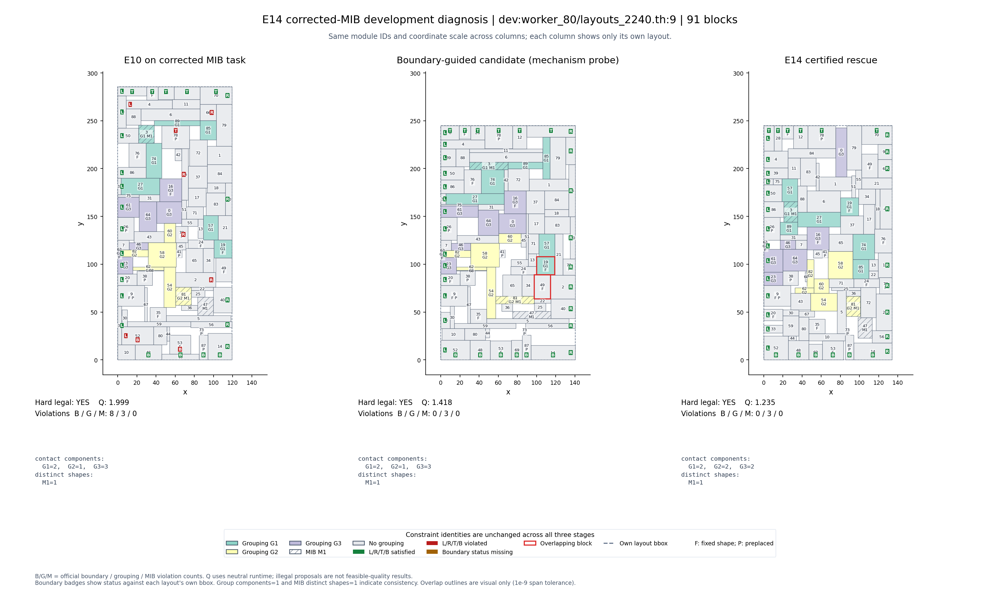

# E14：尾部稳定性与教师任务更新

状态：开发100例与冻结后的另500例均完成并通过全部预先约定的验收门槛。合计600例硬合法、零Q>1.8、零质量退化；17例改善、583例持平。旧一万例不纳入新版教师监督。

## 问题、方法与比较

旧一万例审计显示：硬合法不等于质量稳定，救援组可退化到Q约10。MIB面积矛盾与求解路径失败是两个问题。本轮先按固定公开规则修正MIB面积，再在**同一修正输入**上比较原E10与E14，避免把任务变化收益归因于算法。

普通E10路径保留。公开输入检测救援触发、软违反比例、bbox膨胀和原代理异常；仅风险例增加边界/接触引导的拓扑优化、等面积形状重构和草稿形状重构。所有候选保留硬合法底解，禁止参考分母或自由块答案进入求解器。

最终候选接纳使用[中性时间Q非退化的充分条件](certificate_proof.md)。这允许减少软违反补偿少量几何代价，但拒绝无法证明不退化的改动。该条件可能保守拒绝真实更好的候选，实际收益仍由官方配对评分核验。

原网络权重不变。本轮改进来自完整求解流程，不是新的网络训练结果，也没有证明相对外部方法的全球最优或正式比赛领先。新训练未启动。

## 开发100例结果

| 指标 | E10 | E14 |
|---|---:|---:|
| 平均Q | 1.047532507 | 1.038615343 |
| 模块数加权Q | 1.057374085 | 1.050296959 |
| 最大Q | 1.998933 | 1.235056 |
| Q>1.8 / Q>2 | 1 / 0 | 0 / 0 |
| 硬合法 | 100/100 | 100/100 |
| 推理＋后处理平均秒 | 1.246158 | 1.655684 |

3例改善、97例持平、零退化。主记录是[runs/20261019_certified_v2_dev100_seed0](runs/20261019_certified_v2_dev100_seed0/config.json)。对照底解复用此前同成员E10输出，新增救援重新执行，避免重复跑未改变的对照。当前100例原E10均值与旧MIB诊断略有不同，是时间预算造成迭代数差异；主结论始终使用本轮共享底解的配对结果。

## 机制反例

已暴露的`worker_80/layouts_2240.th:9`有91个模块，MIB已无违反，旧解仍Q=1.998933。直接修复草稿失败；强制沿用原拓扑仍约1.998933；边界引导的关系调整约1.418353；加等面积形状重构的候选约1.235056。故这个反例的关键是改变失败的关系和种子，而非简单加严原拓扑或只消除MIB罚项。

机制探针还产生明显差于原解的候选，例如一个正常例从约1.231变成约1.919。它证明不能无条件接纳重构候选，不表示未做保护的某个完整算法一定会选中该坏候选。此处是最小机制对照，不冒充全面消融。

图像通过公共visualization绘制；中栏是独立机制探针候选，并非另一个任务或参考答案。所有图复用已有坐标，无新增推理。

## 冻结与另500例

500成员在读取评分前固定：原dev每worker5例，排除开发100全部成员。源码与权重在[冻结记录](runs/20261019_policy_freeze.json)登记，局部验证后没有根据500的成绩调整求解策略。因文件占用，第一次写盘在第312例中断：311已提交，第312完整临时文件经校验恢复，随后从313继续。详见[恢复记录](runs/20261019_frozen_confirmation500_seed0/resume_operation.json)。它是同一冻结评价的续跑，不是更换方案或删掉失败样例。

完整500例：[汇总及逐例指标](runs/20261019_frozen_confirmation500_seed0/summary.json)、[实际配置](runs/20261019_frozen_confirmation500_seed0/config.json)。14例改善、486例持平，正常例退化和超过1%退化均为零。

| 指标 | E10 | E14 |
|---|---:|---:|
| 平均Q | 1.054594056 | 1.039376245 |
| 模块数加权Q | 1.052761925 | 1.038804730 |
| P95 Q | 1.136249 | 1.133682 |
| 最大Q | 2.648058 | 1.458786 |
| Q>1.8 / Q>2 | 5 / 4 | 0 / 0 |
| 硬合法 | 500/500 | 500/500 |
| 推理＋后处理平均秒 | 1.273853 | 1.652711 |
| 平均HPWL gap | 0.021999 | 0.017576 |
| 平均bbox面积gap | 0.013852 | 0.013458 |
| 平均边界 / 分组 / MIB违反 | 0.406 / 0.268 / 0 | 0.242 / 0.236 / 0 |

平均Q下降1.44%，加权Q下降1.33%；平均求解时间增加约29.74%。21/500例触发新增救援，14例接纳候选，7例仍保留原底解。此处是新增预算下的稳定性改进，不是同预算加速。

成员可能来自相同原分片，不能把500条记录当500个完全独立的生成家族；观察到零严重尾部也不证明全体分布永不失败。历史dev曾参与前期研究，500只承担冻结E14的开发复核，不包装成从未接触过的正式盲测。

完整冻结评价结束并核对源码后，仅补充运行工程：Windows文件占用时重试原子替换；按确切索引重建本机缓存；教师入口核验规范成员；机制探针显式调用旧对照。求解、触发、候选选择和权重未改变，操作补充另存记录，不改写原冻结源码快照或原始运行事实。

## 数据与教师库

[derived_workset_v3.json](../../protocol/derived_workset_v3.json)登记确切train16,000/dev2,000成员与固定监测500；两个集合来自原split_v1的不同分片，没有交叉。目标local_test2,000只登记规则，内容保持封存。旧split_v1/workset_v2字节不改。MIB局部兼容不是所有软约束联合可满足的证明。

本次顺序配额扫描检查train33,543例接纳16,000例，dev10,522例接纳2,000例，均覆盖100个worker（各160/20例）。这不是完整原池的兼容率。入选MIB成员面积相对变化平均约93.90%/91.33%，因此确实是明显的任务与分布变换，不能把与原任务的分数差都归因于算法。详见[数据审计](runs/data_v1/summary.json)。

新库只使用新任务输入，标签同时保存input_areas和任务/schema版本。旧一万例不纳入新版监督。教师生成只做train16,000与验证监测500，不读取测试、不启动学生训练；完整生成前不能声称全库达标。后续新例出现硬失败或Q>2会保留拒绝候选并停止。

## 质量口径与限制

所有Q来自未修改官方公式，runtime=median_runtime=1，沿用原HPWL/bbox参考分母。新面积任务的原自由块reference未必合法，因此这些是反事实诊断分数，不是重新标定的新任务比赛成绩。实测时间另报；额外预算带来的质量收益不称同预算加速或网络能力提升。

逐例统计包括异常/不可行（按Q=10），报告HPWL、面积、三类软违反、尾部、回退和计时；最终表格从完整运行JSON生成。完整坐标/数值输入缓存只保留本机，Git保存规则、冻结成员、代码与必要指标证据。
