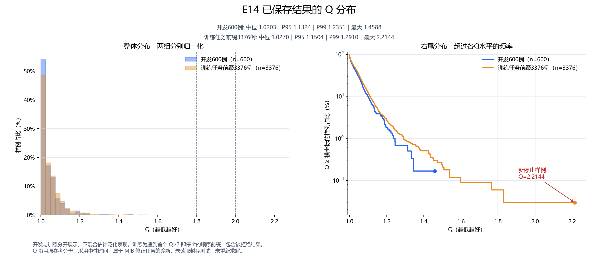
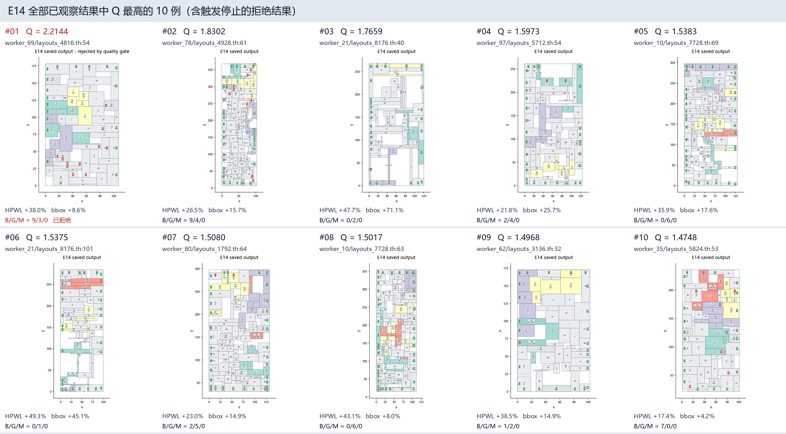

# E14：Q分布与当前最差10例

只读取已保存结果：开发600例、训练任务前缀3,376例，共3,976个不同任务；包含触发停止的拒绝候选。没有重新求解、训练或读取封存测试。

教师生成实际状态为failed：3,375份合格标签已保存；第3,376例为硬合法的Q=2.214438，触发既定Q>2质量门槛，未入库。历史600例的最大Q=1.458786不能代表后续任务的最大值。

| 范围 | 例数 | 平均Q | 中位Q | P95 | P99 | 最大Q | Q>1.8 | Q>2 |
|---|---:|---:|---:|---:|---:|---:|---:|---:|
| 开发100+500 | 600 | 1.039249 | 1.020305 | 1.132378 | 1.235147 | 1.458786 | 0 | 0 |
| 训练顺序前缀，含拒绝 | 3376 | 1.046368 | 1.026963 | 1.150415 | 1.291020 | 2.214438 | 2 | 1 |

训练前缀不是事先均衡抽样，且遇到首个Q>2即停止；两组不混合估计泛化表现。Q沿用原HPWL/bbox分母、中性时间，是MIB修正任务的诊断而非正式比赛分数。

## 当前最差10例

按全部3,976例的E14最终Q从高到低选取，10例均来自训练任务，全部硬合法、MIB违反均为0。B/G/M分别表示边界、分组连通、MIB违反。

| 排名 | 来源（点击查看高清图） | Q | HPWL gap | bbox面积gap | B/G/M | 状态 |
|---:|---|---:|---:|---:|---|---|
| 1 | [train:worker_69/layouts_4816.th:54](worst_01.png) | 2.214438 | +38.03% | +8.61% | 9/3/0 | 质量门槛拒绝 |
| 2 | [train:worker_78/layouts_4928.th:61](worst_02.png) | 1.830249 | +26.53% | +15.74% | 9/4/0 | 教师标签已保存 |
| 3 | [train:worker_21/layouts_8176.th:40](worst_03.png) | 1.765903 | +47.69% | +71.06% | 0/2/0 | 教师标签已保存 |
| 4 | [train:worker_97/layouts_5712.th:54](worst_04.png) | 1.597311 | +21.81% | +25.67% | 2/4/0 | 教师标签已保存 |
| 5 | [train:worker_10/layouts_7728.th:69](worst_05.png) | 1.538264 | +35.92% | +17.60% | 0/6/0 | 教师标签已保存 |
| 6 | [train:worker_21/layouts_8176.th:101](worst_06.png) | 1.537474 | +49.34% | +45.07% | 0/1/0 | 教师标签已保存 |
| 7 | [train:worker_80/layouts_1792.th:64](worst_07.png) | 1.508026 | +23.02% | +14.87% | 2/5/0 | 教师标签已保存 |
| 8 | [train:worker_10/layouts_7728.th:63](worst_08.png) | 1.501723 | +43.14% | +7.95% | 0/6/0 | 教师标签已保存 |
| 9 | [train:worker_62/layouts_3136.th:32](worst_09.png) | 1.496823 | +38.47% | +14.93% | 1/2/0 | 教师标签已保存 |
| 10 | [train:worker_35/layouts_5824.th:53](worst_10.png) | 1.474798 | +17.45% | +4.21% | 7/0/0 | 教师标签已保存 |

首例的几何因子约1.2332，软约束因子约1.7956，乘积形成Q=2.2144；边界9次和连通3次违反是重要来源。第三例则以线长+47.69%、bbox面积+71.06%为突出问题。说明当前尾部同时包含软约束失效与几何膨胀，不再能用MIB输入冲突统一解释。

[逐张浏览](gallery.html) · [全部Q数据](all_q.csv) · [矢量分布图](q_distribution.svg) · [精确排名与来源哈希](summary.json)

复现：`python -B -m experiments.E14_stable_teacher.q_gallery --output experiments/E14_stable_teacher/runs/<新目录>`。布局统一调用visualization；数值输入及坐标复用原NPZ/JSON，未另存坐标副本。
