# 模型1：最终Q最差的10例

从supervised_small固定验证500例已保存结果中，按后处理后的Q降序选取。只绘制已保存的最终布局，没有重新推理或后处理。

Q越高越差。颜色区分分组G，纹理区分MIB；F/P表示固定/预放置块，L/R/T/B徽记表示边界约束状态。

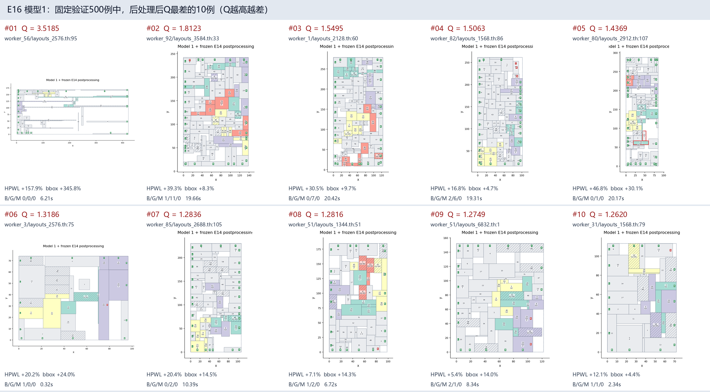

| 排名 | 样本 | Q | 线长变化 | bbox面积变化 | B/G/M | 耗时 |
|---:|---|---:|---:|---:|---|---:|
| 1 | [worker_56/layouts_2576.th:95](worst_01.png) | 3.518511 | +157.93% | +345.77% | 0/0/0 | 6.21s |
| 2 | [worker_92/layouts_3584.th:33](worst_02.png) | 1.812267 | +39.30% | +8.34% | 1/11/0 | 19.66s |
| 3 | [worker_1/layouts_2128.th:60](worst_03.png) | 1.549534 | +30.52% | +9.74% | 0/7/0 | 20.42s |
| 4 | [worker_82/layouts_1568.th:86](worst_04.png) | 1.506271 | +16.79% | +4.67% | 2/6/0 | 19.31s |
| 5 | [worker_80/layouts_2912.th:107](worst_05.png) | 1.436903 | +46.81% | +30.13% | 0/1/0 | 20.17s |
| 6 | [worker_3/layouts_2576.th:75](worst_06.png) | 1.318626 | +20.22% | +23.98% | 1/0/0 | 0.32s |
| 7 | [worker_85/layouts_2688.th:105](worst_07.png) | 1.283568 | +20.35% | +14.53% | 0/2/0 | 10.39s |
| 8 | [worker_51/layouts_1344.th:51](worst_08.png) | 1.281593 | +7.14% | +14.29% | 1/2/0 | 6.72s |
| 9 | [worker_51/layouts_6832.th:1](worst_09.png) | 1.274855 | +5.41% | +14.05% | 2/1/0 | 8.34s |
| 10 | [worker_31/layouts_1568.th:79](worst_10.png) | 1.262011 | +12.06% | +4.35% | 1/1/0 | 2.34s |

10例均硬合法；第1例软违反为零，但线长和面积明显膨胀。现有终末评价未保存网络草稿坐标或E14救援前坐标，因此这些图不能单独定位退化发生在哪个步骤。

## 第1例：Q=3.518511

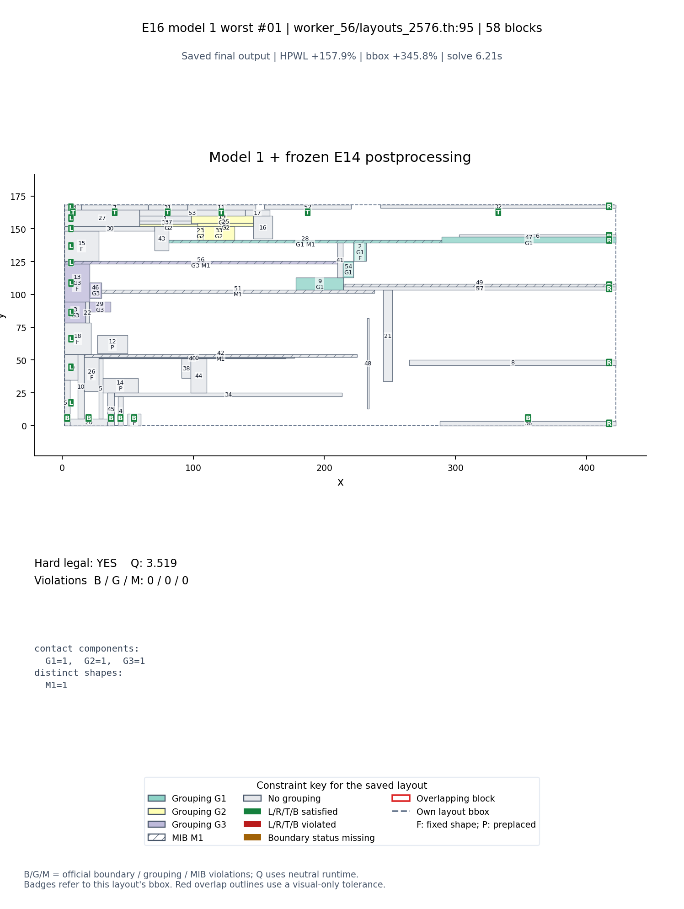

## 第2例：Q=1.812267

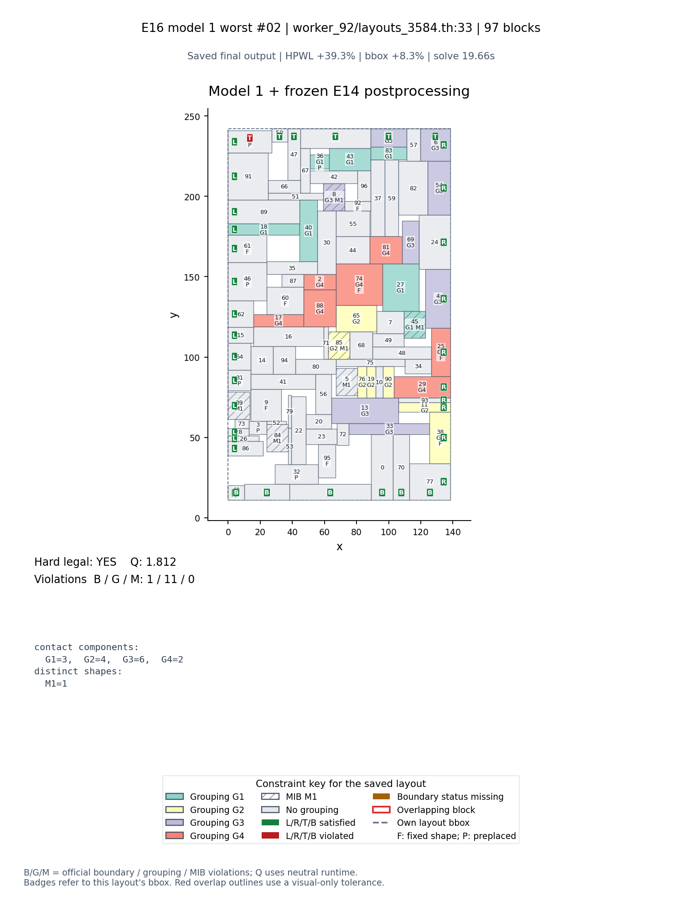

## 第3例：Q=1.549534

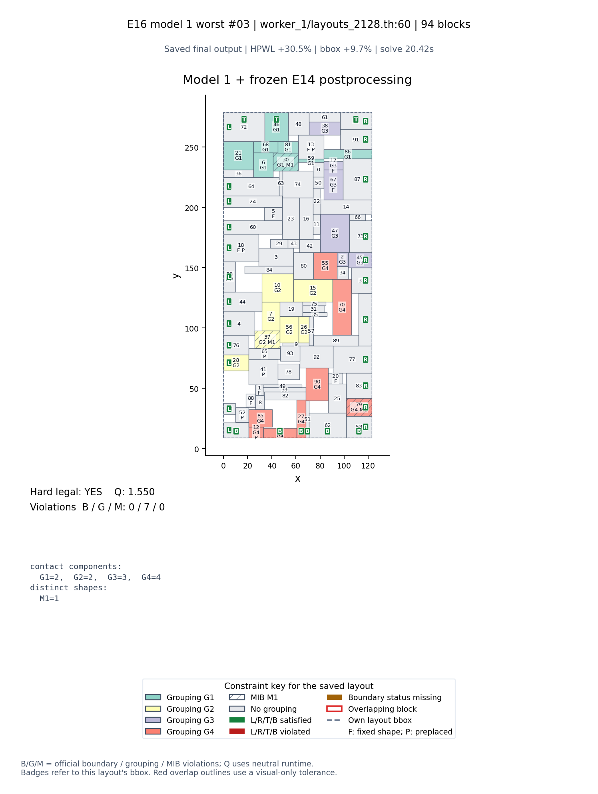

## 第4例：Q=1.506271

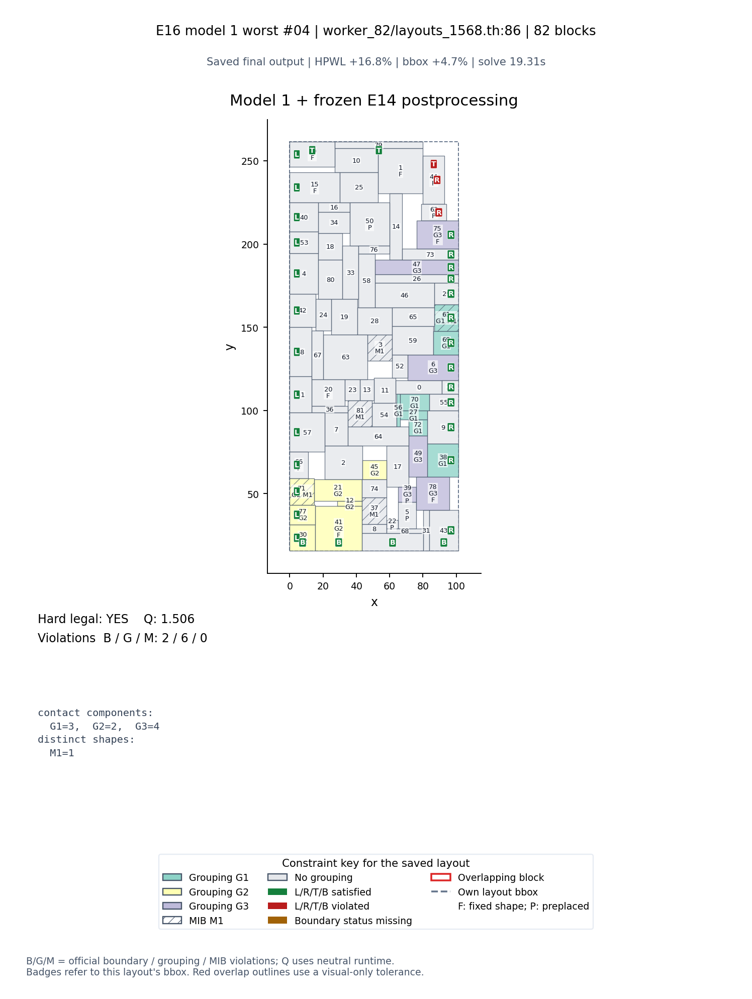

## 第5例：Q=1.436903

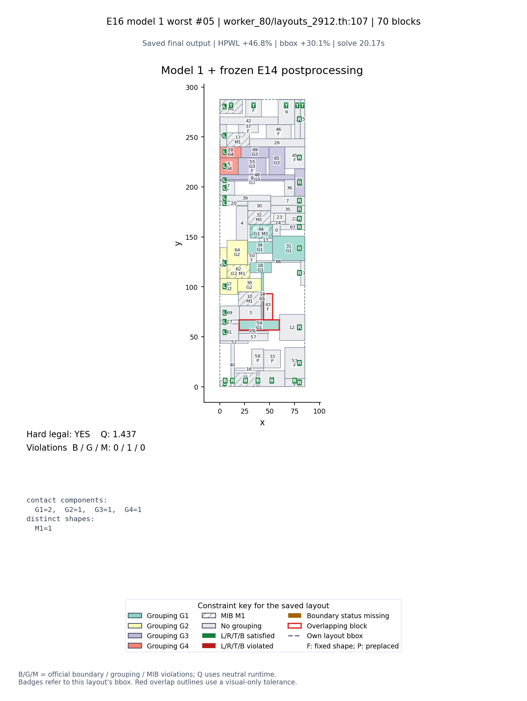

## 第6例：Q=1.318626

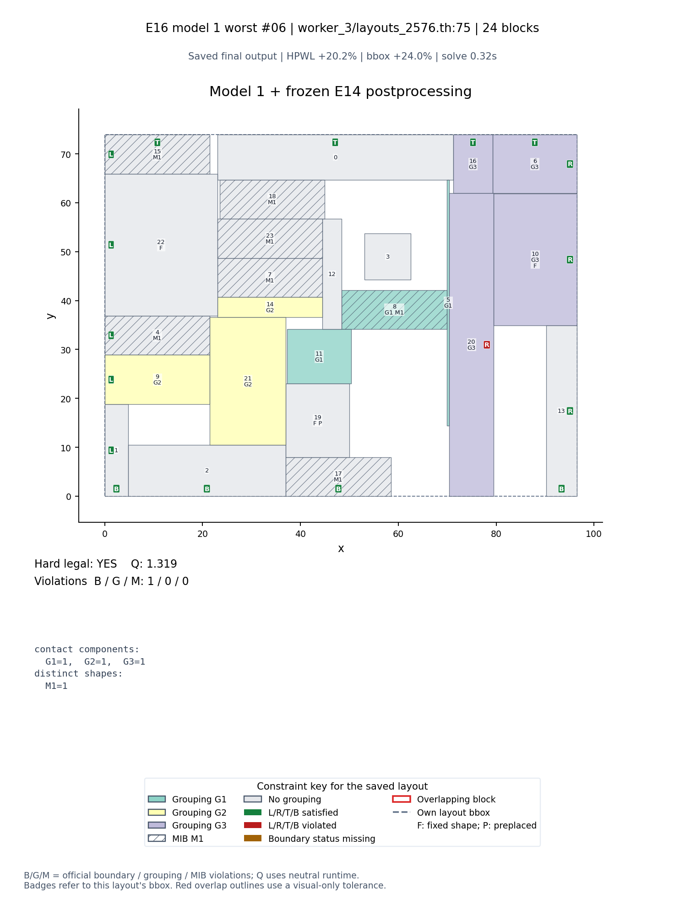

## 第7例：Q=1.283568

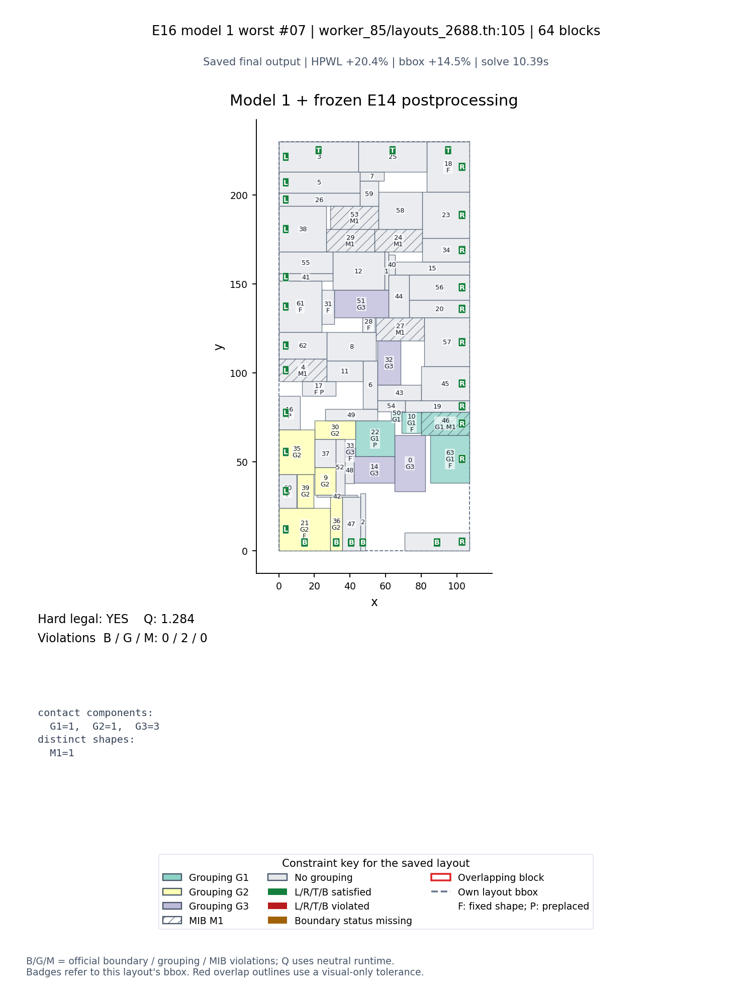

## 第8例：Q=1.281593

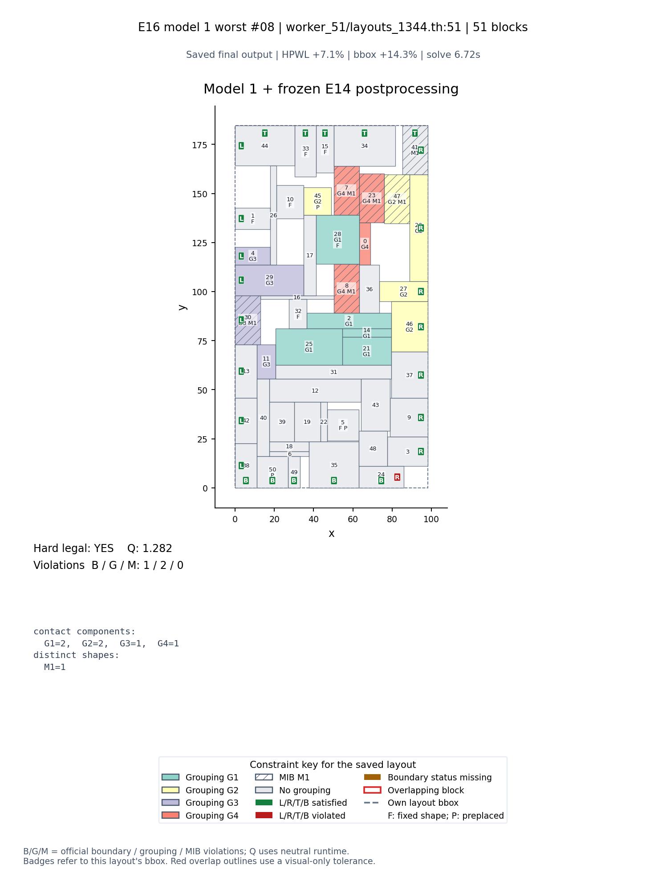

## 第9例：Q=1.274855

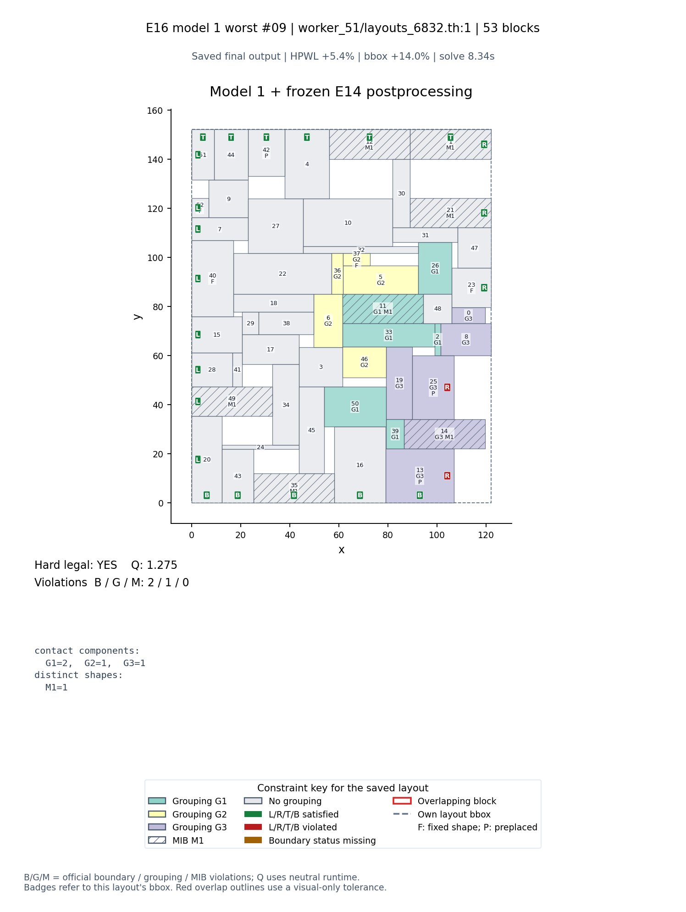

## 第10例：Q=1.262011

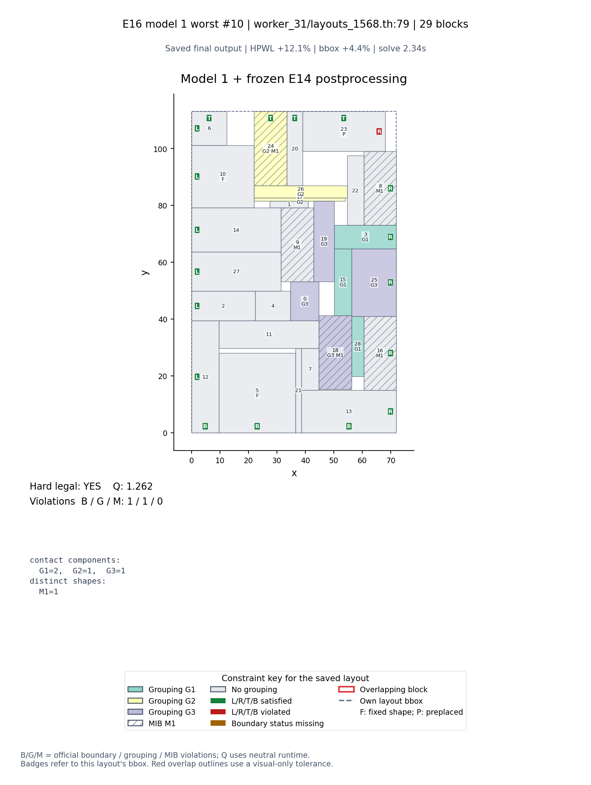
