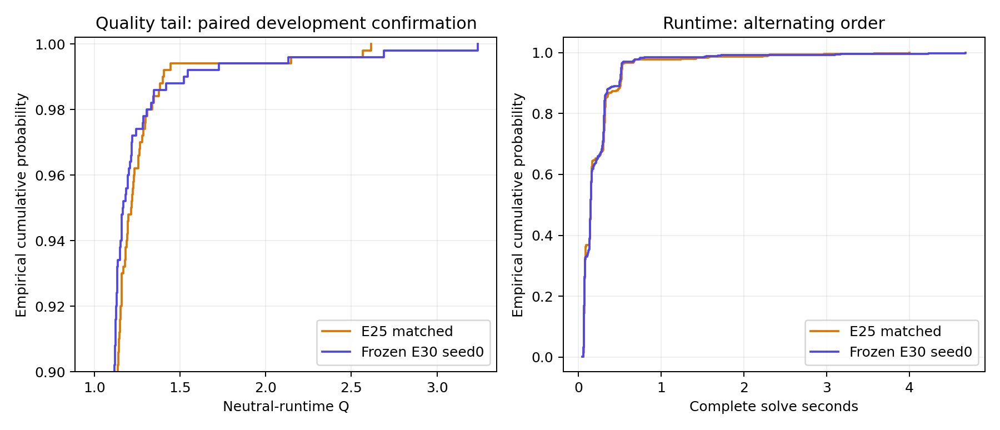
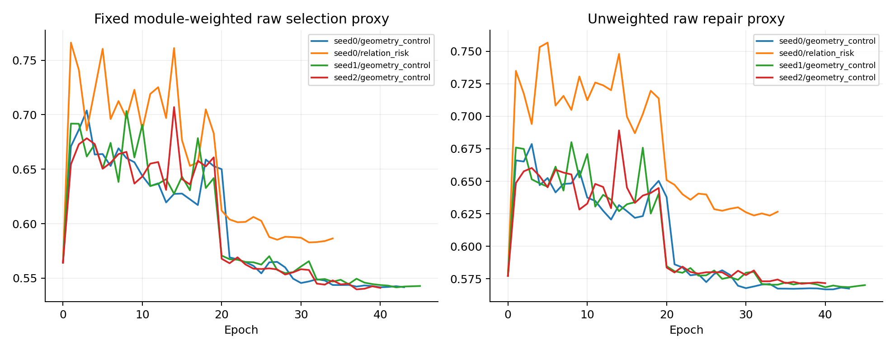

# E30研究记录（已完成，未替换E25）

2026-10-22；用户授权8小时上限，CPU总计最多两线程，允许长训练和模型/后处理修改。完成四次微调（普通几何三个种子、关系/风险一组）、后处理机制对照、冻结候选的一次额外开发确认，以及E31五例数值可行性检查。训练均已早停结束，当前没有运行中的研究任务；未耗尽预算。E25原件冻结，测试封存。

## 最终结论

**保留E25，不将E30升级为新基线。** 普通几何seed0在monitor500上将加权Q从1.038010降到1.033994、平均完整求解时间从0.251149降到0.243967秒，但补种子只在2/3次复现联合改善，且三次极端延迟均变差。一次额外配对确认中平均指标仍改善，质量最坏5%和最大值却恶化，均值差的配对区间跨零，未满足本轮“更快、更好且尾部稳定”的联合要求。

这个结果区分两件事：几何微调值得保留为候选，已有证据不足以支持稳定升级。关系/风险损失组best0未改变父权重；工作区缓存SDK有效但真实主流程0/33命中，均已停止。不通过继续选种子、重复同一确认面板或调整确认反例参数来制造通过结果。

## 一次冻结开发确认

候选在补种子和确认前锁定为seed0/best40、tail＋JIT，不按后续分数换权重。额外500个成员与monitor成员不交叉；逐例随机平衡先后顺序，两种顺序各250例，所有步骤在同一进程顺序执行。

| 额外dev确认500 | 同资源E25 | 冻结E30候选 |
|---|---:|---:|
| 硬合法 | 500/500 | 500/500 |
| 加权Q | 1.051866 | 1.046393 |
| 平均完整求解秒 | 0.247792 | 0.241181 |
| P95 Q | 1.213426 | 1.165418 |
| CVaR95 Q（最差25例均值） | 1.435881 | 1.465133 |
| 最大Q | 2.614867 | 3.237856 |
| P95求解秒 | 0.529638 | 0.519587 |
| 最慢单例秒 | 3.999647 | 4.681135 |
| Q>2 | 3 | 3 |
| 最终行布局保留/错误 | 0/0 | 0/0 |

加权Q差-0.005473，按329个源分片聚类bootstrap95%区间[-0.016817,+0.003071]；平均秒差-0.006611，区间[-0.027123,+0.013589]。254例改善、220例退化，最大逐例Q退化0.681187。候选确认Q仍高于1.04；CVaR95约恶化2.04%，最大Q约恶化23.83%，不能将P95改善推广为整体尾部改善。两种方法都使用了打包救援，最终未保留行布局不代表没有回退。

确认成员可能与monitor共享源分片，并包含在此前完整dev2000的原始代理诊断中；这是额外开发确认，**不是封存测试、分片独立测试或完全未见数据**。冻结确认已执行一次，未依据其结果重新训练、改参数或挑种子。



保存的反例布局经目视检查，使用相同模块ID、坐标尺度和各自布局外框。候选最差index338（59模块）的Q为3.237856；两方法均合法，但候选边界/分组违反为12/5，基线为11/3。最大退化index266（87模块）从1.045452升至1.726638，边界仍全满足，分组违反由0增至6。这支持“硬合法掩盖软约束尾部”的解释；不能据单例确定训练路径或拓扑选择的唯一原因。

- [最差候选布局](../20261022_frozen_confirmation500/layout_01.png)
- [最大逐例退化布局](../20261022_frozen_confirmation500/layout_02.png)
- [完整确认数值、坐标与配对分析](../20261022_frozen_confirmation500/results.json)

## 对下一步研究的约束

当前原始代理排序与最终Q排序不一致，所有草稿仍依赖后处理。下一轮应先建立能预测后处理失败/分组断裂的公开输入诊断，固定开发划分后再考察训练目标；不建议直接增加相同几何微调的种子或继续缩短时间预算。若研究显式分组结构，需另设机制对照、固定选模代理及开发确认方案，避免用这次确认反例不断调参。此处为后续建议，本轮未启动该训练方向。

[E31独立记录](../../../E31_conic_workspace_reuse/README.md)：重复同题初始化2.558→0.722毫秒，但五例实际外层主几何0/33命中缓存，停止扩大评价。数学目标相同也不保证有限精度解逐位一致，重复题最大坐标绝对差0.000364。没有用这一微基准宣称端到端收益。

## 比较边界

使用冻结v5、固定dev_monitor500、相同官方评分和硬约束复核。Q是MIB平均面积派生任务上的中性时间开发质量，不是比赛成绩。CPU评价一进程、两库线程、亲和性限于逻辑CPU0/2；GPU训练也使用同一CPU上限，无数据加载子进程。全部数值阶段顺序执行。

逐例时间包含公开特征、CPU推理、解码、全部几何优化、救援与最终合法性检查；加载、一次性JIT和评分单列。E25历史2进程×2库线程的0.259487秒不能直接作为本轮速度对照，重新建立了同资源基线。运行版本、命令、成员、哈希与源码快照以各运行config为准。

## 首轮候选

| 固定monitor500 | 同资源E25 | E25模型＋tail/JIT | 普通几何微调＋tail/JIT |
|---|---:|---:|---:|
| 硬合法 | 500/500 | 500/500 | 500/500 |
| 加权Q | 1.038010 | 1.037132 | 1.033994 |
| 算术Q | 1.061042 | 1.056473 | 1.049116 |
| 平均完整求解秒 | 0.251149 | 0.254446 | 0.243967 |
| P95求解秒 | 0.663797 | 0.660817 | 0.563071 |
| 最慢单例秒 | 3.099517 | 3.202735 | 3.493692 |
| P95 Q | 1.213863 | 1.177630 | 1.150550 |
| CVaR95 Q（最差25例均值） | 1.325744 | 1.323715 | 1.257612 |
| 最大Q | 2.525082 | 2.525082 | 1.938749 |
| Q>2例数 | 1 | 1 | 0 |
| 行布局保留/错误 | 0/0 | 0/0 | 0/0 |

候选同时改善开发面板的Q、平均时间和质量尾部，但最慢单例时间变差；不能把平均与P95改善解释成每例或最坏延迟均改善。此处为首轮开发证据，最终取舍以本文前述种子复核和额外确认为准。

## 已完成的机制对照

100例固定初筛中，缩短预算、预投影、提前合法化/进展停止均有质量代价。进展停止快约25%，但加权Q增加约0.01190，CVaR95恶化，未采用。原生传递约简通过精确边顺序与跨64节点检查；与推理图优化组合保留原质量预算，500例平均0.245462秒，但Q略高于同资源E25，不能单独声称质量改进。

公开风险触发的tail修复45/500例触发、16例接受，改善P95但增加时间；推动修复的最大Q反而升高，未采用。已知最差开发例的常数惩罚、边界方向和原快速几何三个反例均没有得到优于行布局的结果，只能说明这些局部替换不足以解决这个反例，不能作总体性能判断。

普通几何组从E25 best51权重开始，重新建立优化器；原父模型已见过全部train16000。新阶段43轮、21500步、1667.27秒后验证早停，best40；三次学习率下降发生于20/28/33轮，最低档完成后续完整训练验证。固定加权原始代理0.564228→0.541631；完整dev2000代理0.541519，原始硬合法0/2000，仍依赖后处理。模型保持497299参数。

该best在评价前冻结，只执行一次终末500例。原先最差例index164的Q从2.525082降到1.785143；相同tail政策下也由2.525082降到1.785143，支持草稿更新对这一尾部反例有益。尚未隔离具体种子顺序、形状或哪条相对关系的贡献，不能将改善归因于某个新增架构。

关系＋规模权重＋尾部风险组已于34轮验证早停，best0与父权重逐张量完全相同；未接受任何模型更新。固定加权原始代理始终未优于起点。其终末结果不用于宣称新模型收益，主模型对照保留第一次E25＋tail结果。所有组使用相同固定原始代理选best；不比较不同定义的训练总loss，不根据终末Q重选checkpoint、续训或挑最好种子。

## 固定种子复核

首轮配对加权Q差为-0.004016，分片bootstrap95%区间[-0.009812,+0.001192]；平均时间差为-0.007183秒，配对区间[-0.023347,+0.008855]。两者均跨零。最大逐例Q退化0.724851，不能宣称所有样本均改善。

在补种子与额外确认之前，已冻结普通几何seed0/best40，checkpoint SHA256为`694a01006ddd916151e10ea2c08af0d19d56264cf5b33a9c9d9b494445a80e6c`。不会按补种子终末Q更换确认权重。

| 微调种子 | best/停止轮 | 加权Q | 平均秒 | CVaR95 Q | 最大Q | 硬合法 |
|---|---|---:|---:|---:|---:|---|
| 0 | 40/43 | 1.033994 | 0.243967 | 1.257612 | 1.938749 | 500/500 |
| 1 | 42/45 | 1.036057 | 0.248017 | 1.318406 | 2.528597 | 500/500 |
| 2 | 37/40 | 1.038090 | 0.252498 | 1.310120 | 2.031698 | 500/500 |

seed1复现了Q/平均时间的联合点估计改善，极端尾部改善没有完整复现。三次微调均固定同一个E25父权重，只改变新阶段的随机状态和排列；不是三次独立从零预训练。固定面板相同，不能把各次500例相加称作不同样本。

三次中2次同时降低Q和平均时间并满足Q<1.04/平均秒<0.25；seed2平均时间与加权Q略差于同资源E25。三次加权Q均值1.036047、样本标准差0.002048；平均秒的跨种子均值0.248160、标准差0.004267。这些是同父权重、同开发面板的描述性复核，混合了微调路径与墙钟求解噪声，不能当作独立模型总体的置信区间。三次最慢单例都比基线更慢，尚未解决极端延迟。

raw代理排序并不等同于最终Q排序：seed2原始代理最低，却在三次中有最高的加权Q和平均时间。相同tail流程下，seed0草稿更新后几何步骤3362→3184、提前投影36→28；风险修复触发45→46，并没有减少。速度点估计与更少的主几何步骤一致，不能笼统归因于“少做尾部修复”，也不构成严格的耗时归因消融。

[seed_summary.json](seed_summary.json)保存完整数值、来源SHA256与源码一致性核验；三次训练源码一致。额外确认已完成，结果见本文开头。

## 证据入口

配置/命令/源码SHA256和源快照保存在对应运行目录。完整逐例坐标、权重与缓存留本机，Git只保存源码、标量汇总、配置和图；历史运行记录没有改写。四次训练已验证全部early_stop，冻结方法64个源文件哈希未变，见[最终审计](final_audit.json)。



候选权重保留于`runs/20261022_training_seed0/geometry_control/checkpoints/best.pt`，SHA256为`694a01006ddd916151e10ea2c08af0d19d56264cf5b33a9c9d9b494445a80e6c`。这是一份开发候选，不替代E25默认入口。现有完成记录不可覆盖；确需重现时使用新的tag，计时受墙钟预算影响，不要求逐例坐标完全一致。例如从项目根目录手动执行：

```powershell
.\.conda\envs\iccad2026\python.exe -u -B -m experiments.E30_stable_fast_geometry.run --tag reproduce_seed0 --configs tail --count 500 --jit --checkpoint experiments/E30_stable_fast_geometry/runs/20261022_training_seed0/geometry_control/checkpoints/best.pt
```

这是monitor开发复现，不是新增测试确认。此处仅提供命令，本轮已经结束，不在后台执行。

- [同资源E25](../20261022_matched_steady_monitor500/results.json)
- [固定tail模型对照](../20261022_full_tail_monitor500/results.json)
- [普通几何训练](../20261022_training_seed0/geometry_control/results.json)
- [普通几何一次终末评价](../20261022_geometry_control_seed0_terminal_tail_monitor500/results.json)
- [后处理冻结决策](../20261022_postprocess_stage/decision.json)
- [反例诊断](../20261022_tail_counterexample/results.json)
- [seed1训练](../20261022_training_seed1/geometry_control/results.json)
- [seed1终末500例](../20261022_geometry_control_seed1_terminal_tail_monitor500/results.json)
- [seed2训练](../20261022_training_seed2/geometry_control/results.json)
- [seed2终末500例](../20261022_geometry_control_seed2_terminal_tail_monitor500/results.json)
- [冻结候选与验证约定](../frozen_candidate.json)
- [额外确认标量汇总](../20261022_frozen_confirmation500/summary.json)
- [额外确认完整记录](../20261022_frozen_confirmation500/results.json)
