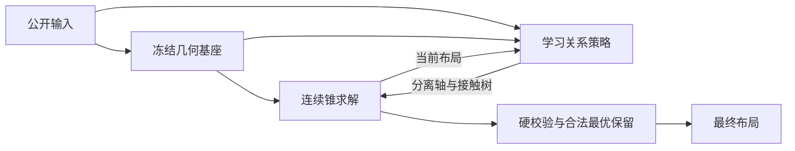

# E32：学习关系决策与锥求解器反馈

2026-10-22新研究。用户授权更大规模、自主设计和执行，允许改变单向草稿/后处理架构；本轮总墙钟12小时，从07:39至19:39（UTC+8），CPU总计最多两线程，GPU允许训练。全部数值任务顺序运行，测试继续封存；不修改E25/E30/E31原件、冻结索引或评分。不是恢复E28网络、权重或未跑矩阵，也不恢复已删除E29或暂停E26。

## 研究设计（运行前登记）

上一轮几何代理排序没有预测最终Q排序，额外确认的尾部退化主要表现为分组断裂。因此本轮把学习对象从坐标直接回归改为**求解过程中离散结构的选择**：模型读取合法公开图、初始草稿和当前锥子问题返回的中间布局，预测分离轴与分组接触边；选择的结构重新进入下一步锥求解，形成反馈。连续尺寸/位置、硬合法校验与合法incumbent仍由数值求解器负责。模型错误不能跳过合法性检查。

事前四个可证伪假设：

1. **学习接触树**能比当前草稿的距离排序更好恢复组内接触；若五例参考结构诊断没有改善空间，或训练后接触检索不优于距离，停止扩大此项。
2. **状态相关分离轴**能减少不合理非重叠拓扑；只改变不确定/近邻对的轴，方向按当前中心排序保持每轴DAG。若关系代理改善但终末Q/尾部无收益，不能接受该代理作为充分证据。
3. **闭环反馈**比同一模型仅初始预测更有效；固定同一best比较静态/反馈，预测次数与在线CPU开销计入完整时间。若增益不足抵消开销，保留更简单流程。
4. **学习分配计算**可减少昂贵救援；先检查训练轨迹中的公开风险是否有可预测性。若训练轨迹无法支持分片留出验证，则停止，不用开发集拟合路由器。此项先为备选，不默认训练或扩大数据。

主方案是独立的小型关系网络（不通过扩大草稿参数制造容量混淆），E25几何基座冻结。先最多五个train/dev成员检查数据隔离、梯度、初始行为、真实结构接口及参考关系的诊断上界。参考关系仅作训练监督和明确标注的oracle诊断，绝不进入正式求解器。所有模型输入从公开输入及实际求解状态重建，不含自由参考位置、标签、Q、分母、worker或文件ID。

## 数据与训练

冻结v5 train16000/dev2000，固定train/dev_monitor500。直接复用E25已核验的张量缓存；额外轨迹缓存只保存相同公开输入运行冻结E25基座及最多三步锥几何所得状态，按成员对齐、不改标签。准备阶段可运行求解器，训练/每轮监测不运行求解器。所有路线共用该一次性状态缓存，记录创建源版本、每例预算、成员及停止状态，原子写入可恢复。

结构模型没有原始布局输出，因此选模采用事前固定的**关系负对数似然与组内接触检索损失**，替代坐标草稿的raw repair proxy；该变化仅限本实验，登记原因，不修改通用协议。监测固定500，额外全dev原始结构代理核对；最终Q只在训练结束冻结唯一best后评价一次，不按终末Q换checkpoint或续训。

batch32，AdamW，固定学习率1e-3→2.5e-4→1e-4→5e-5；前14轮保护，第15轮起每3轮无明显改善下降一档，三次下降且最低档至少完成两轮后方可早停。每组200轮/最多2小时，先seed0，有足以影响取舍的结果再固定seed1/2。主关系模型与必要消融在同一冻结终末评价入口联合记录，不能分批观察Q再改流程。

首轮固定两个训练组：`replay`每个样例随机取三个已缓存状态之一；`draft_only`只训练初始状态。网络、优化器、种子、数据成员及选模指标相同，唯一区别是当前状态的训练分布。每个样例的结构损失固定为分离轴允许集合NLL＋0.5倍平衡接触BCE；无可分离轴的参考对屏蔽（不伪造标签）。选模先平均三个固定状态，再取0.5模块权重均值＋0.25算术均值＋0.25最差5%均值，各轮/各组相同。训练样本均匀，不再次引入E30未成功的规模/风险loss加权。

每个唯一best的**一次联合终末500**同时保存五种预定方法：E25原入口；相同冻结基座＋JIT/原生约简的实现对照；学习接触树仅初始预测；每三次关系调用更新的接触树反馈；接触树＋分离轴反馈。以同best的静态/反馈区分闭环贡献、接触/全反馈区分轴贡献，实现对照区分纯实现加速。所有方法每例先后顺序循环平衡，各占每个位置100次；不观察部分Q后更换配置、checkpoint或续训。

分离轴只对当前两个归一化净空差<0.5、最大净空<0.5的近邻不确定对，在预测概率≥0.8时替换；方向仍按当前中心排序。接触树按预测接触分数Kruskal构造，轴来自本轮完整分离关系，不给软接触增加硬约束。反馈只参与外层主几何/投影，既有递归救援保持原算法。网络输入图/初始草稿只构建一次，每次状态推理和结构选择均计时。

## 评价与停止

全部方法同一进程、两个CPU亲和性槽、Torch intraop2/interop1、BLAS/OpenMP/Numba/HiGHS/Clarabel最多2线程。完整时间包含公开特征、冻结基座、关系模型每次推理、全部求解/救援与最终检查。一次性加载/JIT单列。复用E30已保存结果作历史参考；正式候选必须有同入口新配对基线，先后顺序平衡，不将旧历史时间与新候选直接相减。

至少报告全部硬合法、模块加权Q、算术Q、HPWL/面积gap、边界/分组/MIB违反、P95/CVaR95/max Q及延迟、救援/保留行布局、逐例退化与分片配对区间。不可行Q=10进入主分数。所有分数均为自适应开发与MIB派生任务中性时间Q，不是正式比赛成绩。

monitor500已有开发暴露。额外确认面板须在候选冻结前，从dev剩余1000例中用固定哈希选500，排除monitor及E30旧确认成员；其成员属于既有完整dev原始代理诊断，仍不称完全未见/封存测试。未冻结候选不读取该面板结果，确认只做一次，不据此调参。

首轮候选筛选在终末分数读取前固定：只考虑真实更新的学习策略，要求500/500硬合法、加权Q比同入口E25至少低1e-4、平均时间下降，CVaR95≤基线×1.005且max Q≤基线＋0.05。多个通过者按最低加权Q、再最低均时选一个arm/方法，立即冻结seed0；追加种子不换方法或挑种子，确认仍用seed0。若无通过者，停止E32扩种子/确认，将剩余预算用于独立E33机制。最终须同时报告相对改善、Q<1.04/均时<0.25目标、尾部和不确定性，不能以其中一项通过替代联合目标。

E34数值实现对照在本轮第一个正式终末结果读取前登记。两组训练和预定E34机制检查/终末都完成后，对E32家族统一作一次候选筛选，再冻结最终方法；E32与E34共享一份额外确认，不分别确认后挑优。E34若用历史dense/E25计时作比较，不能以此替代最终同期确认。

预算建议：设计与机制检查≤1小时，一次性轨迹准备≤2小时，主模型/对照≤6小时，终末/种子/确认及整理≤3小时；19:39总上限优先。允许假设失败提前停止，不为耗尽预算重复试验。

## 运行证据

五例接口检查已通过（[证据](runs/20261022_interface_check5/results.json)）：44,611参数关系模型，有限梯度、监督污染输入不变，所有返回布局硬合法。参考结构诊断的Q在21/45/70模块上分别退化0.0157/0.0143/0.1920，在96/120模块改善0.0074/0.0296；只能说明存在条件性改善空间，不是部署收益或总体上界。

08:17轨迹准备完成，train16000/dev2000、累计1850.79秒；缓存生成不使用自由参考几何。原五例的batch32反传/精确恢复/调度检查通过，[CPU联合入口检查](runs/20261022_cpu_smoke5/summary.json)五模式均5/5硬合法、无错误；检查权重不作为正式候选，检查分数不用于性能取舍。08:19开始seed0两组正式训练及各自一次联合终末评价，源码在启动时固定并保存快照。

replay主组28轮早停、best17、575.9秒；原始结构代理0.764568→0.312062。一次联合终末500中E25为Q1.040045/0.260256秒；静态接触1.041865/0.257275秒，接触反馈1.043311/0.266953秒，完整反馈1.060684/0.273733秒，均500/500硬合法。完整反馈的CVaR95=1.317888、max=2.094497低于E25的1.340645/2.525082，但不能抵消加权Q与均时的退化。

draft_only对照27轮早停、best1、552.8秒，最佳结构代理0.421581。同入口E25为Q1.039050/0.259926秒，静态接触1.041942/0.256052秒、接触反馈1.043401/0.265708秒、完整反馈1.044268/0.258179秒，均500/500硬合法、错误0。两组与E34稀疏实现都没有通过联合要求，停止本家族的扩种子与额外确认，不替换E25。所有方法仍可能调用打包救援，不能把最终合法性解释为无回退。完整布局保留本机；额外确认Q未读。

[本轮预算和两份预留开发面板](runs/research_contract.json) · [实际环境](runs/environment.json) · [replay终末标量汇总](runs/20261022_replay_seed0_terminal500/summary.json)

一次性轨迹准备：`.\.conda\envs\iccad2026\python.exe -u -B -m experiments.E32_learned_relation_feedback.prepare --resume`。输出`runs/prepared_relation_replay_v1`，按128例分块，原子写入；`STOP`放在该目录，移除后相同命令恢复，累计2小时准备保护与19:39总截止均保持。正式状态数为初始/第一步/第三步，单子问题最多0.10秒；失败保留上一步，轨迹包含失败状态用于稳健训练。预计20–90分钟，未全量测量。

轨迹完成后，使用相同五个train成员执行`training_check`（有限反传、优化器/随机状态精确恢复、三次学习率下降与最低档两轮），再用其检查权重执行`evaluate --panel smoke`确认五种方法的CPU接口/JIT可运行；检查权重不作为正式候选。

正式顺序入口：`.\.conda\envs\iccad2026\python.exe -u -B -m experiments.E32_learned_relation_feedback.pipeline --arms replay draft_only --seed 0`。输出各自`runs/20261022_<arm>_seed0`和`_terminal500`，主流水线`runs/20261022_pipeline_seed0`。放置流水线`STOP`后通知当前阶段在batch/样例边界原子停止；移除流水线及子阶段STOP后同命令恢复，身份、优化器、随机状态、累计预算不变。已结束训练不因恢复重新启动，已完成评价不重跑。

所有产物归本目录runs，权重、完整布局及轨迹缓存留本机。正式模型输入与数据语义文件一经对应运行启动即冻结；新方向另建实验，不静默放宽身份校验。

[文献定位与可迁移性限制](literature.md)只基于本轮检索的摘要，不作为实验收益证据。
