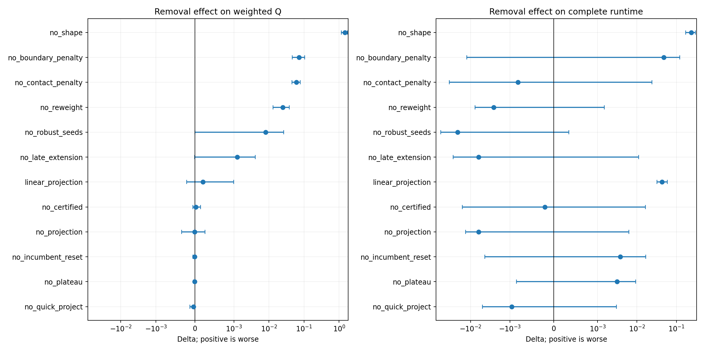

# E25功能频次与重要性：首轮结论

原始500例运行记录仍完整保存。它能回答部分触发频次，不能完整回答收益来源。因此新增E35可观测版本，在原monitor500的固定分层100例上执行原逻辑、完整观测和12种单模块消融，共1400次求解；另有相同面板中五例实现检查。全程一进程、最多两CPU执行槽，未训练模型、未读取封存测试，也未修改E25的模型、算法或旧记录。

**在当前模型和其余机制固定的条件下，形状求解是质量骨干；边界/接触惩罚和重加权是主要质量来源；打包救援是低频尾部保险；精确坐标处理与认证微调承担数值边界修复。调用频繁、移动幅度大、最后更新来源和条件必要性是不同维度。**

## 原500例能确认的频次

| 阶段 | 触发实例 | 调用数 | 可确认的效果 |
|---|---:|---:|---|
| 形状迭代 | 500/500 | 3188 | 2338个候选硬合法；未记录最佳解更新 |
| 末端投影 | 499/500 | 499 | 430个候选硬合法；未记录最佳解更新 |
| 早期投影 | 41/500 | 41 | 3个候选硬合法 |
| 打包后精修 | 10/500 | 12 | 内层轨迹及最佳解来源未展开 |
| 认证微调 | 500/500进入 | 500 | 14例实际接受移动，共15次 |

原运行2进程×2库线程。新运行总计两线程，不能把这两轮的均时直接当作纯算法加速证据。[原500例完整统计](../20261022_historical500/analysis.md)。

## 新100例：谁在实际工作

以下是完整观测臂主流程计数，递归求解另列于精确汇总，不能混为同一分母。

| 来源 | 候选次数 | 硬合法候选 | 更新最佳解 | 涉及更新的实例 |
|---|---:|---:|---:|---:|
| 原始draft | 100 | 0 | 0 | 0 |
| 形状迭代 | 630 | 454 | 423 | 97 |
| 末端投影 | 100 | 89 | 57 | 57 |
| 早期投影 | 5 | 1 | 1 | 1 |
| 打包种子 | 2 | 2 | 2 | 2 |
| 打包后精修 | 2 | 2 | 2 | 2 |
| 认证有效移动 | 2 | 2 | 2 | 2 |

首次替换行布局的来源为形状97例、早期投影1例、打包2例。最后更新来源为末端投影56例、形状41例、认证2例、打包精修1例；**最后更新来源不能解释为完整贡献归属**。

包含递归的实际几何统计中，形状求解687个返回候选均有变化，产生44,553块次超过1e-6块单位的中心位移，以及39,408块次尺寸变化，是大尺度修改的主力；“块次”累计同一模块在不同迭代中的改变，不是独立模块数。形状求解独占计时合计16.53秒，边约简1.31秒。投影保持尺寸，主要调整位置。精确微调的作用不宜用大位移阈值衡量。

## 删除模块后会怎样

所有行均为相同100例、相同冻结权重、总计两线程；全部100/100硬合法，错误0。Q为MIB派生开发中性时间质量指标，非正式比赛成绩。

| 设置 | 加权Q | 均时/秒 | 最大Q | 解释 |
|---|---:|---:|---:|---|
| E25原逻辑 | 1.026527 | 0.223550 | 1.540493 | 本次同口径参照 |
| 关闭形状迭代 | 2.486880 | 0.462828 | 3.625124 | 100例全部质量退化，其他现有模块不能补偿 |
| 关闭边界惩罚 | 1.099068 | 0.271674 | 1.639726 | 明显质量损失；不能只改被重加权覆盖的配置值 |
| 关闭接触惩罚 | 1.086642 | 0.222734 | 1.523984 | 加权质量明显退化，最大Q单项会掩盖问题 |
| 关闭惩罚重加权 | 1.051336 | 0.220986 | 1.540493 | 质量收益主要机制之一 |
| 关闭打包救援 | 1.034606 | 0.202118 | 9.999999 | 省21.43毫秒均时，两个困难实例接近Q上限 |
| 投影改线性目标 | 1.026731 | 0.266831 | 1.540493 | 质量差不确定，均时多43.28毫秒，二次形式有速度价值 |

形状、边界、接触、重加权的加权Q删除差95%配对分片bootstrap区间分别为[1.16974,1.73345]、[0.04609,0.10481]、[0.04554,0.07790]、[0.01302,0.03812]。这是开发诊断的不确定性范围，非多重比较后的正式显著性认证。[全部14臂、区间和逐例退化](analysis.md)及[精确汇总](summary.json)。

**低频救援不能按平均耗时删除。** 两个实例模块数为46和64，关闭后Q均为9.999999；它们仍硬合法。64模块反例从Q1.390355变成约10，边界违反0→20、分组违反3→11。CVaR95从1.360791变为4.774621。删除效应在其他实例可能还夹有计时波动，但这两个灾难性反例明确。[保存布局反例](mechanisms.md)。

末端投影关闭后的加权Q差仅-0.000006，区间跨零，却有一个58模块实例从1.077934退化到1.231420、分组违反1→4。预算延长只实际触发4例，关闭后一个85模块实例退化0.216509。早期投影、平台早停、最佳解重置的单次均值差也较小：目前只可列为有条件简化/调度研究对象，不能断言无用或直接删除。

## 数值模块也是布局质量的一部分

- 坐标规范化897次调用中792次改变几何，40次把候选从硬非法转为硬合法；改变量很小，却能恢复精确边接触。这是函数输入/输出的局部证据，未做关闭规范化的全流程消融。
- 微小负坐标清理改变13个候选，13次恢复硬合法；硬守卫共拒绝294次候选，最终断言也包含在守卫调用计数内。硬守卫属于正确性边界，未做关闭试验。
- 两例认证微调最大中心位移分别约5.96e-9和2.33e-12块单位，分组违反分别2→1、4→3，Q分别1.297280→1.220992、1.448892→1.385907。合计逐例Q改善0.139273；极小位移不能按“没有调整”处理。

[函数几何统计、认证前后指标及源码字节校验](mechanisms.json)。E25五个关键数值/模型源码与旧500运行记录中的SHA256全部一致，旧结果SHA256也保持不变。

## 值得继续研究的目标错位

形状更新中有23次内部目标更好、参考Q反而更坏，17次退化超过1e-4、4次超过1e-3，最大一次为0.002184。这不是巨大故障，但说明当前输入可计算目标和参考归一化评价存在小幅排序差异。后续分析应同时看内部目标、面积、线长和软约束，不能只把accepted当作最终质量奖励。[参数取值与反例清单](inventory.json)。布尔参数False不等于一个模块被完全关闭，例如relaxed=False启用保守约束、hard=False仍保留硬守卫。

## 证据边界与当前处置

完整观测相对原逻辑加权Q差为-0.000015，95%区间[-0.000053,0.000013]，直接记录开销均值约1.52毫秒/例。整体扰动较小，但个别实例差可到0.03015；小差异不作为稳定改进。观测器从内部控制器时钟扣除直接记录开销，真实墙钟仍完整报告，缓存与分配影响无法完全消除。

单模块删除允许释放的预算被其他分支使用，衡量当前系统的条件删除效应，包含交互与预算重分配；各模块差值不可相加。100例不足以证明普遍不可替代，也不能证明零触发机制无用。原500提供稀有机制的补充覆盖。

**本轮保留E25原样，不训练RL、不自动裁剪优化器、不扩大样本。** 全部候选、最终布局、门控原因和递归轨迹保留在本机SQLite中，报告及源码保存到Git。

