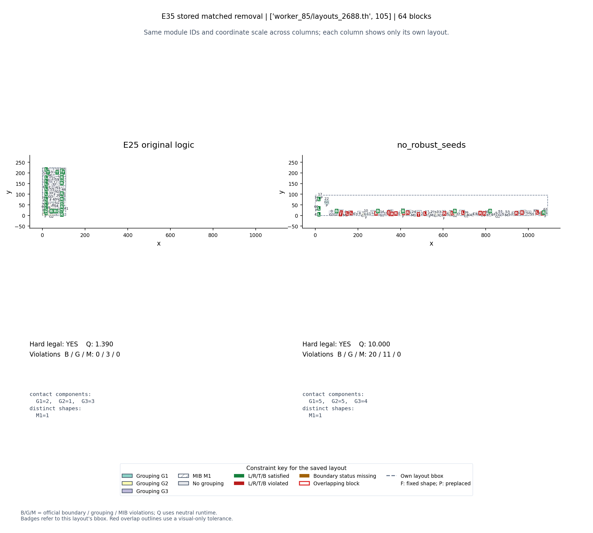
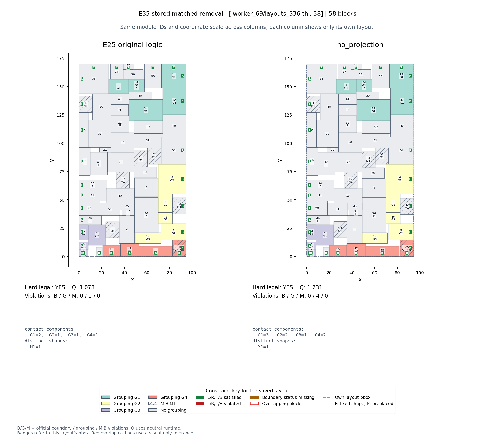
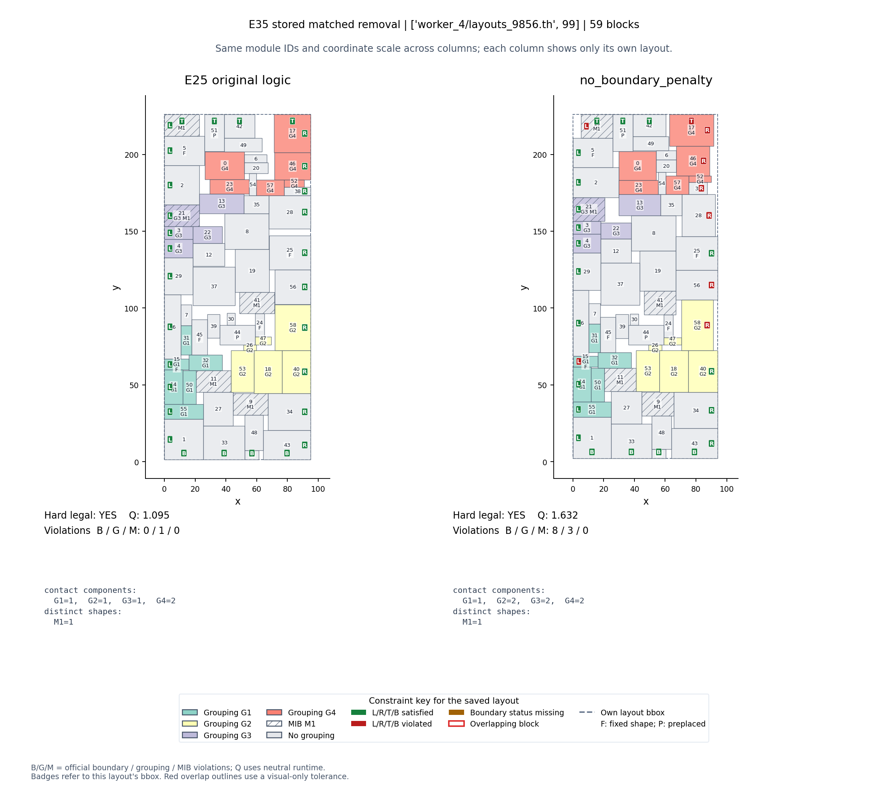

# 机制补充：微小移动、硬守卫和反例

仅分析已保存布局，没有新增求解。模块函数的输入/输出几何统计包含递归调用，不能和主流程候选表直接相加。块单位为中心位移除以该块公开面积的平方根。

| 函数 | 有布局输入/输出的调用 | 几何有变调用 | 移动块次 >1e-6块单位 | 移动块次 >1e-12块单位 | 最大中心位移/块单位 |
|---|---:|---:|---:|---:|---:|
| canonicalize | 897 | 792 | 1060 | 51420 | 4.499e-05 |
| negative_roundoff_guard | 897 | 13 | 0 | 14 | 5.059e-11 |
| shape_solve | 687 | 687 | 44553 | 45536 | 9.015 |
| fixed_shape_projection | 104 | 104 | 1490 | 7006 | 0.9391 |
| certified_polish | 100 | 2 | 0 | 5 | 5.955e-09 |
| packed_seed | 2 | 2 | 103 | 103 | 5.589 |

硬守卫调用计数：{'rejected': 294, 'accepted': 705}。其中包括每个递归返回的最终断言，不把所有通过次数解释为修复次数。

认证微调的有效案例：

- index=402，n=41，Q 1.297280→1.220992，软违反2→1，最大中心位移5.955e-09块单位。
- index=329，n=64，Q 1.448892→1.385907，软违反4→3，最大中心位移2.328e-12块单位。

极小几何变化也可能跨越精确接触边界，显著改变分组连通性；用大位移阈值统计会把有效微调误计为零。canonical化的局部前后差只解释实际函数作用，不替代关闭该模块后的全流程消融。

## no_robust_seeds：index=329，n=64

Q 1.390355→9.999999；两者硬合法=True/True。

## no_projection：index=332，n=58

Q 1.077934→1.231420；两者硬合法=True/True。

## no_boundary_penalty：index=337，n=59

Q 1.094806→1.632236；两者硬合法=True/True。

[精确机制记录与来源字节校验](mechanisms.json)
