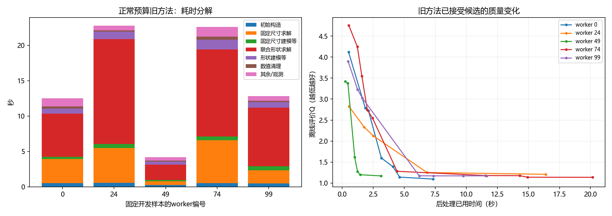

# E8首轮研究：短预算方案尚未达到质量目标

范围：固定dev_quality中的worker0/24/49/74/99，共5例；E7 attention_geometry冻结。同一份草稿供全部后处理重放。没有训练、没有测试张量读取。后续轮次复用首轮草稿与正常预算结果，仅保存引用，不重复推理或复制坐标。

## 已得到的结论

1. **不能直接截短旧方法。** 正常预算Q均值1.157900、最大值1.209775；截到约1.5秒后平均Q为8.028286。虽然约快9.7倍，质量目标明显失败。

2. **仅减少约束或面积切线也不够。** 稀疏约束、形状优先和线性面积松弛在部分样本上有所改善，但仍有退化到差保底解的案例，不晋级完整100例候选评价。

3. **发现可证明的排列矛盾。** 5例、两种模式共10个初始方向图都存在预放置锚点路径矛盾；原始草稿不做MIB协调时也有10/10。证书只使用公开规格及模型几何。例：一条链要求固定位置≥110.34，而公开固定位置为104。不能仅凭此将责任完全归于模型：方向选择、形状协调及草稿都需要后续区分。

4. **跳过这些子问题保住了质量，但没有数量级加速。** certified120五例Q逐例与旧方法一致；单轮观测均值14.49秒，对照14.98秒。差异小，尚不作为可靠加速结论。

5. **矛盾链驱动的直接构造也不能直接替代主流程。** 它能快速处理部分例子，但当前贪心改方向会停在局部死路，并且软规则/布局质量不足；1.5秒与3秒版本均未通过质量门槛。

这些是代码排错和机制反例，不能用于声称dev100达标或泛化改善。5例未触发最终守卫回退，不能据此解释此前测试尾部的两次回退。

## 同5例结果

| 配置 | 平均Q | 最大Q | 平均后处理秒 | 硬合法 |
|---|---:|---:|---:|---:|
| control120 | 1.157900 | 1.209775 | 14.975 | 5/5 |
| control_short | 8.028286 | 9.999999 | 1.549 | 5/5 |
| sparse_short | 9.999999 | 9.999999 | 1.483 | 5/5 |
| dense_short | 8.240024 | 9.999999 | 1.492 | 5/5 |
| shape_first | 6.524206 | 9.999999 | 1.373 | 5/5 |
| shape_first_3s | 4.768720 | 9.999999 | 2.695 | 5/5 |
| linear_area | 8.287332 | 9.999999 | 1.290 | 5/5 |
| linear_area_3s | 8.272656 | 9.999999 | 2.457 | 5/5 |
| certified120 | 1.157900 | 1.209775 | 14.492 | 5/5 |
| certified_short | 7.249182 | 9.999999 | 1.546 | 5/5 |
| topology_short | 6.832055 | 9.999999 | 0.621 | 5/5 |
| topology_3s | 5.423926 | 9.999999 | 0.915 | 5/5 |

时间包括观测包装开销；后续轮次的正常预算数据为明确引用的既有对照，非每轮重测。子进程启动耗时另列，最终速度声明仍需同配置不带观测包装的计时核对。全部异常、差保底和失败均保留，未按成功子集报告。

## 下一步

先完成冻结E7草稿的完整dev100正常预算诊断，建立平均、质量尾部和耗时尾部的共同参照，并捕获守卫拒绝原因。当前短预算失败配置停止扩测。随后优先研究同时协调形状与排列方向的构造，以及能保留质量的早期合法解；不继续围绕当前贪心方向或切线数量反复调参。模型需求暂为“避免与公开锚点冲突的方向/形状组织”这一待验证假设，不据五例启动训练。

## 证据入口

- [20261017_routeA_pilot5_seed0_r2](../20261017_routeA_pilot5_seed0_r2/analysis.md)
- [20261017_shape_first_pilot5_seed0](../20261017_shape_first_pilot5_seed0/analysis.md)
- [20261017_linear_area_pilot5_seed0](../20261017_linear_area_pilot5_seed0/analysis.md)
- [20261017_certified_pilot5_seed0](../20261017_certified_pilot5_seed0/analysis.md)
- [20261017_topology_repair_pilot5_seed0](../20261017_topology_repair_pilot5_seed0/analysis.md)
- [方向矛盾证书](../20261017_precedence_audit_seed0/results.json)
- [原始草稿对照](../20261017_precedence_audit_seed0/raw_draft_check.json)
- [既有dev10只读审计](../20261017_saved_dev10_audit_seed0/results.json)

以上五项完成研究运行实际墙钟合计335.8秒；重复引用的旧对照没有重新计入。启动前一次CuBLAS确定性环境配置错误保留在初始运行，无求解结果，修复后使用新目录重新开始。
