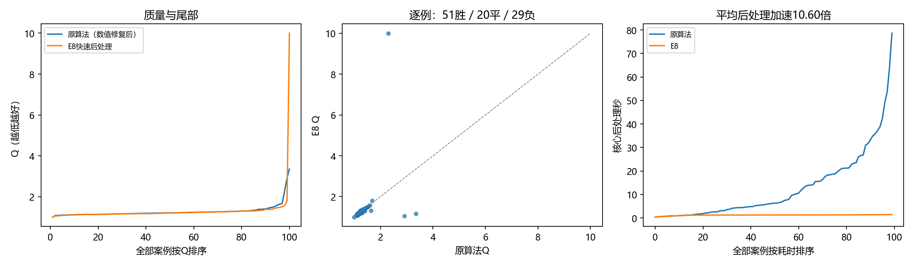

# E8快速后处理完整对照

面板：confirm100，100例。E7 attention_geometry冻结；Q为官方中性时间质量分，越低越好。参考只用于事后计分。

| 指标 | 原算法（已修复数值回退） | E8选定配置 |
|---|---:|---:|
| 平均Q | 1.280117 | 1.311713 |
| 块数加权Q | 1.366404 | 1.223830 |
| Q P95 | 1.599979 | 1.469371 |
| 最大Q | 3.353213 | 9.999999 |
| 最差10%平均Q | 1.938835 | 2.343264 |
| 平均后处理秒 | 12.710490 | 1.199327 |
| P95后处理秒 | 38.965992 | 1.383332 |
| 最长后处理秒 | 78.662316 | 1.425693 |

新配置硬合法100/100，执行异常0。
后处理加速10.60倍，模型推理＋后处理加速10.46倍。
相对修复后参照，逐例51胜、20平、29负；平均Q差0.031596。
配对均值差的描述性bootstrap 95%区间为[-0.092272, 0.222931]；开发选择/数据生成相关性使其不能当作最终泛化保证。

两种算法均在同一常驻公开输入子进程在线运行，取消原算法观测器，只评分末端。含模型推理、文件I/O与worker墙钟的配对加速为9.96倍。
完整命令交替执行两种算法，并含加载与评分，不能把其墙钟直接当作其中一种算法独立跑完的耗时。

## 机制与质量来源

一次锥求解精确约束凸面积下界，保留原保守上界与尺寸调整范围，避免反复补面积切面。密集线长先用IRLS构造二次上界，再分解成单模块项，降低稠密矩阵填充；官方线长与评分仍计算全部连线。公开边界、接触树、兼容MIB、固定尺寸和预放置均保留。候选用公开输入代理选择，终末独立硬检查。
质量不是逐例不降；软违反、线长与面积的变化见comparison.json。原几何变量/连续惩罚、曼哈顿锥模型、完整二次模型和分解模型的受控筛选见[五例机制对照](../20261018_conic_diagonal_diagnostic5_seed0/analysis.md)。五例是回顾挑选，不是额外泛化证据。

## 复现与证据

[配置与实际命令](config.json)、[完整统计](results.json)、[逐例坐标/分解](cases.jsonl)、[可恢复源码](source_snapshot.zip)、[比较数据](comparison.json)。
选定入口为../../optimizer.py，等同conic_diagonal：1.3秒目标、保留上界切面、约束约简、单模块二次线长、最多24轮。目标预算不是严格实时上界，表内实际最大时间完整报告。
没有启动训练、读取封存local_test或改变冻结split/workset/官方评分。单一开发面板的最大Q是经验最差值，不是未知输入的数学保证。
