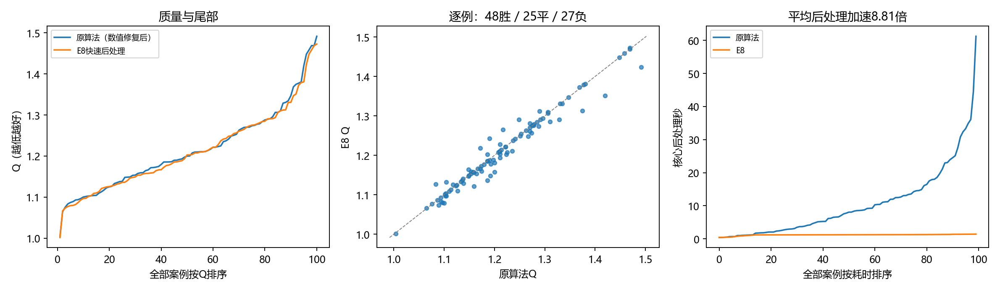

# E8快速后处理完整对照

面板：dev100，100例。E7 attention_geometry冻结；Q为官方中性时间质量分，越低越好。参考只用于事后计分。

| 指标 | 原算法（已修复数值回退） | E8选定配置 |
|---|---:|---:|
| 平均Q | 1.215598 | 1.211556 |
| 块数加权Q | 1.148511 | 1.147240 |
| Q P95 | 1.421267 | 1.382808 |
| 最大Q | 1.491825 | 1.472866 |
| 最差10%平均Q | 1.425798 | 1.410205 |
| 平均后处理秒 | 10.466443 | 1.188182 |
| P95后处理秒 | 32.399626 | 1.395190 |
| 最长后处理秒 | 61.241027 | 1.424589 |

新配置硬合法100/100，执行异常0。
后处理加速8.81倍，模型推理＋后处理加速8.69倍。
相对修复后参照，逐例48胜、25平、27负；平均Q差-0.004042。
配对均值差的描述性bootstrap 95%区间为[-0.008099, -0.000176]；开发选择/数据生成相关性使其不能当作最终泛化保证。

原算法质量列复用既有末端数值修复的缓存重放（2例重评、98例原结果）；原算法时间列仍是原在线运行，未冒充修复后的新在线计时。原始未修复参照平均Q=1.276534、最大Q=5.379855。
本轮研究命令实际墙钟264.30秒。复用草稿时本轮不重新执行其模型前向；端到端速度使用每例已测模型时间＋本轮实际求解时间之比，不拿研究脚本墙钟比冒充完整应用加速。

## 机制与质量来源

一次锥求解精确约束凸面积下界，保留原保守上界与尺寸调整范围，避免反复补面积切面。密集线长先用IRLS构造二次上界，再分解成单模块项，降低稠密矩阵填充；官方线长与评分仍计算全部连线。公开边界、接触树、兼容MIB、固定尺寸和预放置均保留。候选用公开输入代理选择，终末独立硬检查。
质量不是逐例不降；软违反、线长与面积的变化见comparison.json。原几何变量/连续惩罚、曼哈顿锥模型、完整二次模型和分解模型的受控筛选见[五例机制对照](../20261018_conic_diagonal_diagnostic5_seed0/analysis.md)。五例是回顾挑选，不是额外泛化证据。

## 复现与证据

[配置与实际命令](config.json)、[完整统计](results.json)、[逐例坐标/分解](cases.jsonl)、[可恢复源码](source_snapshot.zip)、[比较数据](comparison.json)。
历史conic_diagonal：1.3秒目标、保留上界切面、约束约简、单模块二次线长、最多24轮。
目标预算不是严格实时上界，表内实际最大时间完整报告。已复用的原算法结果/耗时在逐例reused_from中标明，不冒充本次在线重测。
没有启动训练、读取封存local_test或改变冻结split/workset/官方评分。单一开发面板的最大Q是经验最差值，不是未知输入的数学保证。
