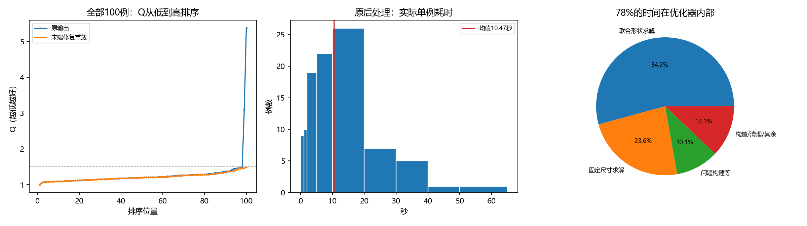

# 完整dev100结论：先修复尾部回退，再重设加速研究重点

2026-10-18。E7 attention_geometry冻结，固定dev_quality100、100个worker；结果100/100完整，无执行错误、无测试数据读取。Q为官方中性时间质量分，越低越好。

## 质量与合法性

| 指标 | 原完整运行 | 修复末端后的缓存重放 |
|---|---:|---:|
| Q算术均值 | 1.276534 | 1.215598 |
| 官方块数加权Q | 1.260211 | 1.148511 |
| Q的P95 | 1.458853 | 1.421267 |
| 最大Q | 5.379855 | 1.491825 |
| 最差10例平均Q | 1.999589 | 1.425798 |
| Q>1.5 | 2 | 0 |
| 硬合法 | 100/100 | 100/100 |

**右列是缓存末端重放，不是重新运行100次求解。** 只有2个被守卫拒绝的候选发生变化并重新执行官方/独立硬检查；其余98例坐标及评分直接引用原结果。另检查3个未变化的软约束尾部案例，归零函数保持其坐标和Q逐值不变。没有新增模型前向或LP求解，修复后的在线耗时未重新测量。

## 两个极端差解的原因

worker45与worker65的候选中分别有1个、2个坐标为−1.45519×10⁻¹¹。内部容差接受它们，最终严格非负守卫拒绝它们，于是替换成质量差的保底布局。候选没有其他面积、固定规格或重叠问题。

| 案例 | 原回退Q | 微小负坐标归零并复核后的Q |
|---|---:|---:|
| dev:worker_45/layouts_0.th:108 | 5.379855 | 1.221403 |
| dev:worker_65/layouts_6720.th:8 | 3.101454 | 1.166311 |

修复仅限可移动位置中[-1e-9,0)的数值误差。归零后仍须通过原严格守卫，预放置规格不动，面积与重叠容差不改；修复失败仍使用原有回退。实现位于实验内guard.py，在线配置名为safe120；原control120及frozen源码保持不变。

## 速度瓶颈

- 整次墙钟1209.8秒，约20.2分钟；核心后处理均值10.466秒，P95为32.400秒，最长61.241秒。
- 固定尺寸求解246.63秒，联合形状求解567.67秒，共占核心后处理77.8%。其余包含建模、构造、清理与观测开销。
- 即使完全消除求解器外开销，理想加速仅约1.29倍。事后已知“最后一次有效代理改善”而立即停下的理想化诊断也仅约1.33倍，不能支撑8–10倍目标。该停止点需要未来信息，不能当作可部署策略。
- 8–10倍对应平均约1.05–1.31秒/例。旧长预算轨迹在1.3秒处的严格合法候选平均Q约2.481；这只是离线轨迹前缀诊断，不是短预算算法实测。
- 93/100例最初草稿固定尺寸的子问题出现不可行。固定方向后反复调整形状、再投影的位置/形状交替过程是应重点替换的计算结构。

## 后续短探针及决策

在同一批已访问的5个诊断样本（worker37/45/59/65/73）上，测试保留多个方向修改分支的构造机制。1.3秒配置平均Q为3.607177，最大Q为9.999999；3秒配置没有改善质量。该机制仍把困难样本退化成差保底，停止扩测。诊断样本为事后选取，不能称均衡验证或泛化结论。

下一轮优先检验**位置、形状和分离方向共同调整的表示**，例如以中心坐标与宽高比直接进行联合几何优化、让面积由表示保证，再执行少量严格合法化。要检验能否替代昂贵的多轮形状LP与面积补切，不继续靠Python优化、缩短旧预算或增加固定形状方向枚举来凑8倍。先固定5例做机制反例；有质量信号才进入dev100。模型继续冻结。

## 质量目标的可达边界

软违反不全是可修复错误。worker37的同形组面积为48、72、90、160、440、528，各自合法面积范围互不相交；若按真实宽高一致判断同形，就至少有5个MIB违反。官方软约束分母为26，对应工程质量参照exp(2×5/26)=1.469049，正好等于该例现有Q。官方实际按宽高四位小数计同形，本轮没有对任意退化长宽比与舍入组合做全局最优证明，因此不把这一面积兼容性诊断称为官方Q的无条件数学下界。后续训练目标需要同时核验真实尺寸、评分精度与可达性，不默认每例都能接近Q=1。

这不表示所有MIB违反都无法改善。例如worker73含多个面积35的组成员，仍有合并尺寸类别的潜在空间。后续区分可修复软违反和规格导致的下界，再决定训练目标。上述下界只检查了5个诊断样本，未宣称覆盖全部100例。

## 证据与边界

- [原始完整dev100结果](../20261018_stageA_dev100_seed0/results.json)、[逐例记录](../20261018_stageA_dev100_seed0/cases.jsonl)
- [末端重放配置](config.json)、[重放结果](results.json)、[发生变化的两例](changed_cases.jsonl)
- [方向分支探针](../20261018_beam_diagnostic5_seed0/analysis.md)

原完整运行的config、results、坐标、日志与源码快照保持原样。新修复单独留证；模型、训练数据、冻结划分和评分器均未改。当前质量尾部已有具体修复，8–10倍加速仍未实现。
