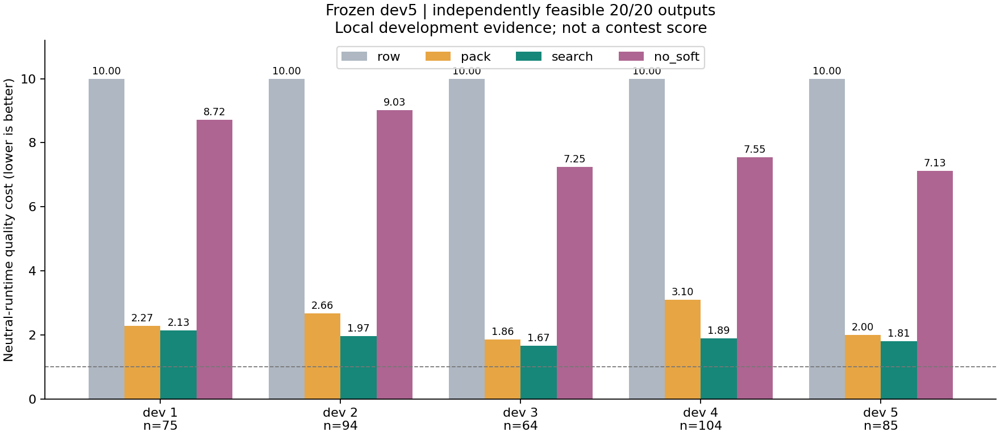
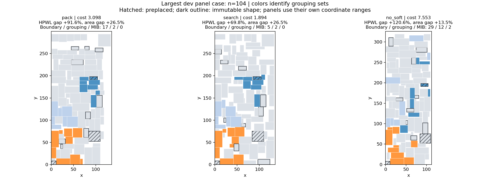

# 无训练硬约束基线

当前保留的唯一研究起点。使用合法输入构造布局，再在硬约束可行域中进行有限搜索；实现包含 [optimizer.py](optimizer.py) 与 [packing.py](packing.py)，方法见 [design.md](design.md)。官方 SA 未实现 fixed/preplaced 处理的原因与证据见 [诊断](diagnostics.md) 和 [版本核查](version_check.md)。

此实现通过独立的障碍感知构造和可行搜索补齐约束支持；上游官方 SA 原件保持不变。后续研究可以从本基线重新设计，不继承已删除方向的架构、参数或计划。

## 已有五例开发结果

固定 `protocol/split_v1.json` 的 dev_smoke_panel，模块数依次 75、94、64、104、85；seed=0、CPU 1 线程，所有策略使用相同合法输入与同一面板。

| 策略 | 硬合法 | 加权中性时间质量分↓ | 平均求解时间 |
|---|---:|---:|---:|
| row：一行可行对照 | 5/5 | 9.999999 | 0.0026 s |
| pack：约束感知构造 | 5/5 | 2.795912 | 1.2255 s |
| search：构造后可行搜索 | 5/5 | 1.909019 | 14.9932 s |
| no_soft：移除软约束感知 | 5/5 | 7.918962 | 14.9975 s |

20/20 输出通过官方与独立硬约束核验。显式使用官方 runtime=median_runtime=1 作本地质量对照，实际时间另列；该分数不是正式比赛成绩。软约束机制整组移除后退化，只支持这五例上的机制必要性；不能归因为某一个子模块，也不证明泛化。

search 的五例 HPWL gap 仍约 +51% 至 +86%，平均 bbox gap 约 +16.57%；约 15 秒预算停止不代表收敛。不可行样本不得从后续主指标中剔除，不能只与失效模板或一行对照比较来宣称优秀质量。

[唯一完整结果与坐标](runs/stage1_dev_run1/results.json) · [配置](runs/stage1_dev_run1/config.json) · [日志](runs/stage1_dev_run1/run.log)。历史运行记录中的原路径和哈希保持不变；当前入口如下。源码快照只保留本基线相关实现，已去除废弃设计文档。

## 运行与复核

在工作区根目录，激活现有独立环境。新检查必须使用新输出目录，默认最多 5 例；以下完整命令仅作为用户执行入口，不自动启动。

```powershell
python -B experiments/baseline/run.py --strategies row pack search no_soft --seconds 15 --seed 0 --output experiments/baseline/runs/new_dev5
# 只重画已有结果，不推理、不读数据：
python -B experiments/baseline/plot.py experiments/baseline/runs/stage1_dev_run1/results.json
# 复核原版已保存输出的公开五例，不重跑 SA：
python -B experiments/baseline/audit.py --output-dir experiments/baseline/runs/new_audit
```

求解子进程只接收官方七参数中的合法输入；标签、参考布局与 baseline metrics 只留在评分侧。wall-clock 搜索会受调度影响，seed 不保证跨机器逐位复现；实际步数、预算和设备必须记录。

## 原版与诊断证据

- [原版完整 100 例](runs/full100_clean_cu128_seed0/run/results.json)：0/100 可行、无执行异常，只作为原版失败对照。
- [五例因果审计](runs/five_case_final/audit.json)：原版 0/5、参考布局和仅输入合法对照均 5/5，定位 fixed/preplaced 处理缺失。
- [模板来源与版本记录](runs/template_version_check/)：排除当时的误下载与版本混用。
- `run_official.py` 仅用于显式复现原版，要求 `--test-id` 或 `--all-cases`，不默认全量；预计超过 20 分钟只交用户命令。




