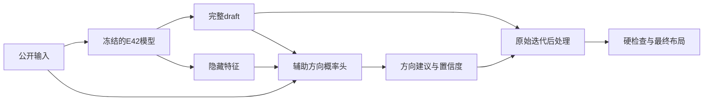

# E47：保留完整draft的全局关系与置信度研究

2026-10-24，用户授权4小时内自主研究，质量优先，向加权Q≤1.01和单例2秒推进。原E42编码器/坐标头及完整draft保持不变，辅助关系只指导原迭代，不从结构重新生成布局。E25/E42与冻结划分原件保留，测试封存。

**当前：机制、来源与预算对照完成；8,996参数辅助头已训练并冻结best24，[唯一终末500例已完成](runs/20261024_reference_probe_terminal500/summary.json)，辅助候选未通过质量/时间联合要求，未升级E25。** 特权辅助成绩不是部署模型结果，终末Q不参与换checkpoint、调阈值或续训。

## 方法与边界



[confidence.py](confidence.py)维护软几何先验和可撤销group接触；[global_information.py](global_information.py)隔离全局分离关系的信息价值。历史见证、原参考和辅助形状均是明确标注的特权诊断，不是最优上界。

[head.py](head.py)和[learned_guidance.py](learned_guidance.py)输出四个非互斥分离方向概率。不确定边继续原动态迭代，预测成环则推迟辅助，不换成货架起点。它学习原参考方向有效性，尚不是优化收益置信度。

[head_train.py](head_train.py)冻结原模型，完整v5成员、batch32、四档LR/保护期/早停、best/latest及可恢复预算；训练和监测不调用后处理。温度只用整分片train校准子集。[learned_run.py](learned_run.py)仅评价唯一best一次，指导不读取参考或见证，新增头CPU推理计时，逐例文件避免坐标副本。

v1漏计共同prepare_problem前端，已审计标为求解段；v2补齐。离线见证成本不冒充模型推理成本；真实学习阶段计入实际新增头。2秒是软预算，救援/求解器超支如实报告，不宣称严格实时保证。

## 证据入口

| 运行 | 定位 |
|---|---|
| [软先验五例](runs/20261024_information_gate5/analysis.md) | oracle不稳定胜过打乱，保留失败 |
| [可撤销接触五例](runs/20261024_commit_gate5/analysis.md) | 164有局部收益 |
| [group接触100](runs/20261024_commit_screen100/analysis.md) | 局部接触不足以保护全局 |
| [全局信息五例](runs/20261024_global_information_gate5/analysis.md) | 443选择性改64/630条关系抑制膨胀 |
| [全局信息100](runs/20261024_global_information_screen100/analysis.md) | 特权混合关系通过初筛 |
| [原参考五例](runs/20261024_reference_information_gate5/analysis.md) | 原参考不等于MIB兼容结构 |
| [原生来源100](runs/20261024_label_sources_screen100/analysis.md) | 历史见证与本轮control不可混用 |
| [冻结400](runs/20261024_global_information_confirm400/analysis.md) | 六例严重退化，未通过 |
| [原生合并500](runs/global_information_combined500/analysis.md) | 引用父结果，无坐标副本 |
| [计时修正五例](runs/20261024_timing_accounting_gate5/analysis.md) | v2补齐前端，旧JSON不改写 |
| [形状首版排错](runs/20261024_shape_structure_gate5/analysis.md) | 中心保持混杂，不作因果结论 |
| [形状×关系五例](runs/20261024_shape_structure_gate5_v2/analysis.md) | 相容性耦合，不能无条件叠加 |
| [同五例2秒](runs/20261024_shape_structure_quality2s_gate5/analysis.md) | 时间可替代部分形状辅助 |
| [2秒来源100](runs/20261024_quality2s_label_sources_screen100/analysis.md) | 参考辅助Q1.00937，但尾部/逐例时间未过 |
| [训练与校准](runs/20261024_reference_structure_probe_seed0/analysis.md) | 29轮早停、best24；代理不等于Q |

完整事前登记、修订与停止/恢复约束保留在[design.md](design.md)。来源见[provenance.json](provenance.json)，总上限见[runs/budget.json](runs/budget.json)。检查证据：[代数](runs/implementation_checks.json)、[接触](runs/commit_checks.json)、[全局关系](runs/global_checks.json)、[辅助头](runs/head_checks.json)。

## 运行与复核

项目独立环境`.conda/envs/iccad2026`；四数值线程、一个CPU求解进程。训练用CUDA，终末完整延迟用CPU逐例计算。权重SHA锁定，只在当前任务授权内执行。

```powershell
# 只重建已有原生500统计。
& ./.conda/envs/iccad2026/python.exe -B -m experiments.E47_draft_topology_confidence.combine
# 只审计机制结果、调用统一visualization绘图。
& ./.conda/envs/iccad2026/python.exe -B -m experiments.E47_draft_topology_confidence.audit
# 终末完成后只重建报告，不重评模型。
& ./.conda/envs/iccad2026/python.exe -B -m experiments.E47_draft_topology_confidence.report --tag 20261024_reference_probe_terminal500
```

未完成运行在同源码/配置/权重/预算下追加`--resume`，完成后不重复评价。源码变化须审核并记录兼容迁移；首次训练初始值JSON错误的恢复见[state_fix_migration.json](runs/20261024_reference_structure_probe_seed0/state_fix_migration.json)，参数/优化器/游标/RNG和预算均保留，未重做缓存。

Ctrl+C在安全边界保存；实验`runs/STOP`或对应运行`STOP`可停，另有绝对截止。数据、完整坐标、特征缓存、checkpoint与源码压缩快照留在本地；Git仅保存源码、设计、身份/成员元数据和必要小型证据。
