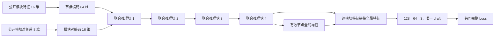

# 第一版 draft 的生成器设计与原结构对比

日期：2026-11-08。当前状态：**核对 E65 历史后撤回本版模块对候选的推荐，不推进实施或训练。** 原始设计与参数核算保留供核对；没有实现新模型、读取训练/验证/测试样本或启动训练。参数核算只实例化了原模型的 CPU 参数，并按新结构的线性层及 LayerNorm 定义计算数量。

用户随后澄清核心期望是“中间不生成坐标，最后才生成坐标”。该方向现单独保留为 [v2 首稿生成器](first_draft_generator_v2_20261108.md)，删除独立模块对消息和持续边状态；本页候选仍撤回。

## 历史复核与撤回决定（同日更新，优先于下方原提案）

用户提醒已尝试模块对方案，并明确不希望再次尝试缺少明显差异的方案。复核 E65 的模型源码、预登记计划、完成报告及 E69 保存的用户原话后，本版 206,467 参数候选撤回推荐；不建立实施、训练或调参队列。

此前遗漏了最直接的已完成前作：[E65 几何消息](../history/20261029_model_research_consolidation/experiments/E65_geometry_messages/README.md)。该方案在 96×12 主干每层加入 24 维模块对向量，由接收/发送节点特征和公开关系/当前几何共同生成，经学习的注意力加权聚合后投影回节点。其 feature_message 对照还屏蔽了显式几何通道，保留同参数形状；隐藏状态仍含原主干几何，不能称为完全没有几何的网络。

| 机制 | 已完成 E65 | 本版原提案 |
|---|---|---|
| 两端节点特征和关系共同生成模块对向量 | 已有 | 重复 |
| 模块对向量加权聚合并回传节点 | 已有 | 重复 |
| 屏蔽显式几何的模块对消息对照 | 已有，但主干仍用当前坐标 | 移除全部中间预测坐标依赖 |
| 跨块保留独立模块对隐藏状态 | 没有，每层重新生成消息 | 新增 16 维持续状态 |
| 使用范围 | 十二块逐层更新，最终输出训练 | 四轮隐藏推理，唯一首稿训练 |

持续关系状态和取消中途坐标是实际结构差异，不能把两个模型说成完全相同。但“关系参与向量消息内容”并不是新机制；仅凭持续状态更灵活的直觉，尚不足以支持重新优先尝试模块对路线。首稿独立训练和延后坐标读出可与模块对分支分开研究，无须以重试这一消息机制为前提。

E65 完成报告的同协议结果：E64 baseline 的固定 dev500 G 为 0.368244，geometry_message 为 0.351731，feature_message 为 0.357486；完整 dev2000 成对交面积均值分别为 7.146%、6.241%、6.495%。因此历史不能概括成“完全无效”：两种新增消息分支相对 E64 有数值改善，但显式几何相对 feature 对照仅使 dev500 G 降 1.61%、dev2000 G 降 0.59%，共同早期更新数也不占优，没有完成整体基线升级。该旧 G、数据和任务与 E114 后新口径不同，不跨协议比较绝对 Loss。

[E69 README](../history/20261101_research_consolidation/experiments/E69_case_loss_statistics/README.md) 保存了用户 2026-10-28 原话：“感觉在draft的观感上，E65和E42并没有很大差别，仍然没有达到要求。” 数值门槛通过不等于用户视觉要求通过，不能用较弱 E64 对照上的改善替代这一判断。

决定：本次撤下模块对候选；保留“重点设计首稿生成器、砍掉后续网络、只比较共同 Loss”的研究目标。没有重试 E65，也没有启动下方原提案。下方内容仅为撤回前的设计原稿。

## 研究问题

用户认为，现有重复布局块可能更擅长在相对关系已经较好的草稿上减小重叠、改善留白；E115 的首稿网络不足以检验更强首稿生成器的价值。下一步只保留首稿生成器，全部生成器参数联合训练，只在唯一输出上比较共同 Loss，不接后续修稿器或后处理。

这是值得优先研究的假设，不把当前层间观察提升为已证实机制。用户关于 4+12 可能不如 1+12/2+12 的想法本次只保留，不设计验证实验。

E114 的“4+12”指十二个块中的第 4、12 次输出接受监督，并不是十六个块。这里的“第一层”指一个完整的首稿生成阶段，内部允许有多个 Attention 块；这与原源码中单个 RectangleBlock 的粒度不同。

## E115 实际检验了什么

原源码核对：

- E114：16→64 输入编码；十二个独立 64 维 RectangleBlock；共享 64→64→3 头；每块前将当前三维预测嵌回隐藏状态，当前预测矩形也参与 Attention 几何偏置。
- E115：前九个同类块；首块后的读出改成 64→256→256→256→3，中间两次 256→256 构成残差支路。大头有 148,995 个参数。初始第零次预测仍用原小头。
- 大头只逐模块计算。输入编码加四次大头线性变换，可以称这条路径有五次 FC，但其中并没有新增模块间消息交互。
- E114 前四块已有四轮模块间交互，E115 首块到首稿只有一轮。FC 深度与跨模块交互深度不能相互替代；读出头可以重组已有上下文，不能直接执行新一轮模块间协商。
- E115 同时变化了整网块数、首头与监督位置，且首稿接受下游末层梯度。因此，最终性能差异不能单独归因为 FC 深度，也不能据此否定强首稿路线。

## 参数基准

都计入生成相应首稿实际需要的编码、头和反馈参数；共享参数只计一次。不把整套 61 万参数与一个首稿生成器比较。

| 首稿路径 | 输入编码 | 图块 | 状态反馈嵌入 | 小头 | 大头 | 合计 |
|---|---:|---:|---:|---:|---:|---:|
| E114 前四块至第 4 稿 | 1,216 | 202,160 | 256 | 4,355 | 0 | **207,987** |
| E115 首块至第 1 稿 | 1,216 | 50,540 | 256 | 4,355 | 148,995 | **205,362** |

原 RectangleBlock 每块 50,540 参数。E114 完整模型 612,307，E115 完整模型 609,682。上述前缀计数不表示已有“只训练前缀”的完成结果。

E115 首稿路径中，约 72.6% 参数属于大头，约 24.6% 属于交互块。与 E114 前四块相比，首稿参数总量接近，但预算分配明显不同。

## 原提案结构（已撤回推荐）：联合推理模块状态与模块对状态，最后输出一次首稿

核心选择是保留四轮模块间 Attention，把预算用于尚无可靠草稿时的关系组织。在隐藏状态中保存并更新模块对关系，四轮结束后才第一次产生中心和形状；中途不生成矩形、计算预测间距或反馈坐标。

### 1. 输入与两个状态

节点输入复用当前公开 16 维特征，包括原始面积、允许的固定尺寸/预放置规格、F/P/边界标志、分组规模、连接强度和压缩端口信息。输入编码保持 Linear(16,64)→SiLU→LayerNorm(64)。

每个有效模块对建立 8 维公开描述：行归一化模块连接权重、是否同 G 分组、log 面积比、双方 F 标志、双方 P 标志、双方边界需求交集的位数除以 4。它们均由已有公开输入确定，不读取自由 reference，也不增加输入信息权限。

Linear(8,16) 生成初始模块对状态 e_ij。节点状态 h_i 为 64 维，模块对状态 e_ij 为 16 维。模块对状态随四个块持续更新，不在每块重新编码后丢弃；四块的更新权重各自独立。

不用模块编号或原始分组整数 ID 的专属嵌入。模块置换同步作用于节点、关系及输出，保持排列等变；padding 节点与无效模块对在更新、softmax 和池化中遮罩。

### 2. 每块先更新模块对状态

令 u_i=LN(h_i)，执行：

    t_ij = LN_edge(e_ij) + U_source(u_i) + U_target(u_j)
    e'_ij = e_ij + MLP_16→32→16(t_ij)

两次线性变换之间使用 SiLU。源、目标节点各先投影到 16 维再广播，不拼接出 128 维的全模块对张量。边残差 MLP 不额外添加 Dropout。

这一步让同一连接或分组关系根据两端已积累的上下文更新。例如，强连接、边界需求和预放置条件可以在多轮里共同影响关系表示；这只是表达能力，不是已学成的方向分类或硬约束保证。

### 3. Attention 同时使用关系的权重和内容

保持 64 维、4 个 Attention 头，普通 Q/K/V 来自 u。模块对状态通过 Linear(16,4) 生成四个头的加性偏置：

    alpha_ij[a] = softmax_j(q_i[a]·k_j[a]/sqrt(16) + bias(e'_ij)[a])

同时把 16 维 e'_ij 切为四个 4 维分片，每个头聚合对应分片：

    node_message_i[a] = sum_j alpha_ij[a] * v_j[a]
    relation_message_i[a] = sum_j alpha_ij[a] * e'_ij[a]
    h'_i = h_i + Dropout(W_o concat_a(node_message_i[a])
                        + W_e concat_a(relation_message_i[a]))

W_o 为 64→64，W_e 为 16→64。节点仍有完整的全局 Attention，未连通模块也可以交互；没有将图限制为线网邻居。

相比原结构，这里的关系不只改变“看谁”，还可以改变“向节点传递什么”。原来的邻接/分组均值拼接线性分支移除，其预算用于可学习的模块对更新与向量消息；不能把这称为单独加深 Attention 或 FC 的消融。

### 4. 节点非线性与一次读出

每块在第二次节点 LayerNorm 后执行 64→216→64 的 SiLU FFN，并以残差更新 h。FFN 隐层 Dropout .1、节点残差 Dropout .05 沿用当前规则。四块结束后，对有效 h 取全局均值，与每个 h_i 拼接成 128 维，经 128→64→3 输出中心 cx/cy 和 log 宽高比。

全局池化本身无参数。它向唯一输出头显式提供同题整体上下文，不声称原 Attention 完全没有全局信息。形状仍由原始公开面积和预测宽高比解码；全部模块均预测位置与形状，不覆盖 F/P 输出。保留当前共同解码语义，以免将解码变化混入结构比较。

这里没有中间坐标、几何反馈或中间 draft Loss。四块都为唯一首稿服务；它们也不是固定旧四个修稿块后只重训一个头。

## 精确参数预算

Linear(a,b) 计 a×b+b，LayerNorm(d) 计 2d。模块对数量影响计算和激活量，不增加可训练参数。

| 单个联合推理块 | 参数 |
|---|---:|
| 两个节点 LayerNorm(64) | 256 |
| QKV：64→192 | 12,480 |
| Attention 输出：64→64 | 4,160 |
| 源/目标节点各 64→16 | 2,080 |
| 模块对 LayerNorm(16) | 32 |
| 模块对残差 MLP：16→32→16 | 1,072 |
| Attention 偏置：16→4 | 68 |
| 模块对消息输出：16→64 | 1,088 |
| 节点 FFN：64→216→64 | 27,928 |
| **单块** | **49,164** |

| 完整首稿生成器 | 参数 |
|---|---:|
| 节点输入编码 | 1,216 |
| 初始公开模块对编码 | 144 |
| 四个独立联合推理块 | 196,656 |
| 拼接全局上下文后的输出头 | 8,451 |
| **总计** | **206,467** |

相对 E114 前四块 207,987，少 1,520，**−0.731%**。相对 E115 首稿路径 205,362，多 1,105，+0.538%。FFN 中间宽度 216 是在固定 64 维节点、16 维模块对及四轮交互后填充预算的工程选择，不是经 Loss 筛选得到的最佳宽度。

这些是完整层定义下的静态参数核算，尚未实现并核对新模型的实际运行参数、梯度或速度。机器账本见 [参数账本](first_draft_generator_budget_20261108.json)。

## 三种首稿路径的本质差别

| 方面 | E114 前四块 | E115 首块＋大头 | 推荐结构 |
|---|---|---|---|
| 首稿路径参数 | 207,987 | 205,362 | 206,467 |
| 输出前跨模块 Attention 轮数 | 4 | 1 | 4 |
| 中途是否预测并反馈坐标 | 是 | 有第零次预测，随后首块 | 否 |
| 模块对表示 | 每块根据当前矩形重算；无持续隐藏状态 | 同左，仅一块 | 持续更新的 16 维隐藏状态 |
| 关系如何进入消息 | 几何/关系影响偏置；另有邻接/分组均值线性分支 | 同左，预算集中于大头 | 同时改变 Attention 偏置及关系向量消息 |
| 最终读出 | 64→64→3 | 64→256→256→256→3 | 拼接全局上下文，128→64→3 |
| 本次用途 | 参数与结构参考 | 参数与结构参考 | 专门生成唯一首稿的提案 |

更强首稿可能需要更多轮协调，也可能需要比原几何反馈更合适的表示。推荐结构给出的是这一完整假设的候选实现；即使成功，也只能先归因于整体结构，不能事后把收益全算给持续模块对状态、移除早期坐标或某个 FFN 宽度。

## 只比较 Loss 时的共同口径

训练目标直接使用唯一输出的 E114/E115 共同 base_per_case 完整 Loss，不乘旧首稿辅助权重 .2：

    L = position + .25*shape
        + .08975162861857286*(penetration + module_load_mean + module_max_excess10)
        + .3336832108335229*(.5*(wirelength + compactness) + 2*soft)

soft 只含边界和 G 分组，归一化继续排除 MIB。反传、train/dev 监测、best、LR 和早停共用这一个目标。总 Loss 是唯一选模口径，分项只用于解释拟合与取舍，不另开候选选择标准。

按当前新实验默认使用冻结 random_reference16k，保留原始面积、无 MIB、全模块预测；轴交换 P=.5、Dropout .1/.05、AdamW decay .0003 等现行条件保持。当前 E114/E115 实际已使用这些增强，不能把本次结构改进写成首次启用增强。

如后续比较原结构，应比较“单独训练、只监督自身唯一首稿”的版本：原四块生成器输出其第 4 稿，E115 首稿路径输出其第 1 稿，新结构输出唯一 draft。旧模型 0.2L4+0.8L12 与 0.2L1+0.8L9 的 own-Loss 总值不适合作为这轮首稿 Loss 的直接基准；它们还使用了历史 36k 和下游联合梯度，不能仅截取旧结果就声称同条件优劣。

这一定义只是为了明确结构比较含义，不建立三候选训练队列。当前没有登记新实验号、修改运行授权或启动任何训练。此次任务不调用后处理或计算 Q；Loss 更低也不能提前声称已获得更好最终 Q。

## 最值得保留的反例与代价

- 不依赖初稿几何，可以避免围绕不可靠矩形过早修正；也可能失去对实际间隙、穿透等有效信息的利用。四轮关系推理不保证一定比原动态几何反馈好。
- 显式模块对状态让关系直接参与向量消息，但带来 N² 的激活和计算。batch32、N120、FP32 时，一份 N×N×16 状态约 29.5 MB；反传还需其他中间量，四块总显存和吞吐不能由这一个数推出。
- 参数接近不等于计算量、每轮时间或更新量相同。相较原小几何偏置 MLP，模块对残差 MLP 更贵；不能承诺比 E114/E115 更快。
- Attention 与全局池化不能自动打破完全相同输入和关系的图对称性，也不保证分组连通、零重叠或固定规格满足。当前提案不以任意模块编号位置嵌入来制造假区分。
- 模块对状态是学到的潜变量，没有新增方向标签、伪坐标、固定吸引排斥或解析几何更新。不要把它的某个通道预先解释为已经正确的左右/上下关系。

## 核对来源

- `experiments/E114_supervision_placement/model.py`：原 RectangleBlock、反馈、共享头及解码。
- `experiments/E114_supervision_placement/features.py`、`batches.py`：公开 16 维输入、端口摘要、无 MIB 与全模块预测边界。
- `experiments/E114_supervision_placement/loss.py`、`loss_config.py`、`simple_loss.py`：共同单稿目标与层权重区别。
- `experiments/E115_first_head_supervision/model.py`、`README.md`：独立大首头、九块及初始化身份。
- `protocol/research_training16k_v1.json`：新实验默认冻结 16k。
- `protocol/model_prediction_boundary_v1.json`：全部模块预测，公开规格仅作条件。

没有读取历史 checkpoint 或任何样本载荷来形成新结构结论；没有新增性能测量。这里提供的是可审阅、参数预算明确的首稿生成器设计。
