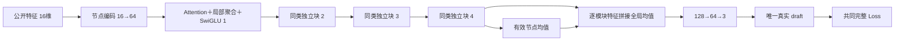

# 首稿生成器 v2：四轮隐藏推理，最后一次几何读出

日期：2026-11-08。状态：设计提案与静态参数核算；未实现模型、未读取样本或 checkpoint、未启动训练/评价。

同日后续：用户已明确授权准备对照，现已落实为 [E116](../experiments/E116_first_draft_comparison/README.md)，与原结构前4层分别独立训练首稿的入口齐备。实际参数209891/207987已核对，同五训练成员前后向/CUDA图检查通过，零Adam更新；训练开关关闭、STOP保留。上句为原提案写作时状态，下文保留设计说明。

## 核心目标与上一版的取舍

用户澄清的核心目标是：网络中间不生成预测坐标，只在最后生成坐标；早期减少对自身不可靠几何预测的依赖，把计算用于隐藏特征的表达与模块间组织。独立训练首稿生成器，砍掉全部后续修稿网络，只比较共同 Loss。

上一版将“模块对向量消息”放到了过于突出的位置，历史 E65 已尝试过这类机制。本版保留四轮模块间交互、全局上下文读出和一次输出的思路，删除独立模块对向量、跨层边状态及其更新 MLP。上一版 206,467 参数候选仍撤回，不因本版恢复实施。

需要区分源码事实与研究假设：旧模型的 64 维 h 原本就在层间持续存在，没有在每层被压缩成三维坐标；原共享头也没有强制清空 h。取消中间预测，消除的是其坐标嵌入和预测矩形几何对后续计算的影响，并延后具体几何读出。它不会自动增加隐藏宽度，也不保证函数表达能力严格超过旧结构。更好的首稿 Loss 是待验证结果。

## 结构总览

四块各自有独立权重，节点宽度 64、Attention 四头。初始节点编码和四块之间均无预测头；只有第四块之后调用一次最终头。所有模块、所有位置/形状预测通道都可训练，所有块联合接受最终输出 Loss。

## 公开条件输入

节点复用现有 E114 的公开 16 维特征：原始面积、允许的固定尺寸和预放置规格、F/P 标志、L/R/T/B 标志、G 分组规模、连接强度、压缩端口权重及中心。节点编码为 Linear(16,64)→SiLU→LayerNorm(64)。

公开预放置位置、固定尺寸和端口中心继续作为条件输入；它们不是网络中间生成的自由坐标。不读自由 reference、目标形状或评分分母，不加入 MIB，不改变端口完全压缩规则。

模块之间只保留现有的公开连接矩阵 A 和 G 分组矩阵：A 按行归一化；G 的按行归一化版本用于局部均值聚合，同组布尔标记 J 用于 Attention 标量偏置。没有将节点特征两两组合成新向量消息，也没有 N×N×d 的可更新关系状态。

## 单个推理块

### 模块间交互

以 u=LayerNorm_1(h) 同时计算 Q/K/V 与局部聚合。每个头的 Attention 分数为：

    score_ij[a] = q_i[a]·k_j[a]/sqrt(16)
                  + beta_wire[a]*A_ij + beta_group[a]*J_ij

每块四个头各有两个关系系数，共 8 个参数。系数初值固定为 .01，避免零范数参数在现有相对步长保护下难以学习；不是经验证集搜索得出的初值。

公开关系仅对现有 Attention 分数增加标量偏置。Q/K 随节点上下文在四轮中更新，因而注意力仍是动态的，并非四次固定矩阵平滑。连接之外的模块也参与全局 Attention。

    attention_message = W_o Attention(Q(u), K(u), V(u))
    local_message = W_local concat(A@u, G@u)
    h_bar = h + Dropout(attention_message + local_message)

W_local 为 128→64，保留原结构已有的连接/分组聚合。局部消息也使用 u，区别于 E114 源码直接聚合未归一化 h 的路径。它没有额外节点两两联合编码器，不能与 E65 的 PairMessage 分支混称。

### 单模块门控非线性

令 v=LayerNorm_2(h_bar)，采用：

    content = W_content(v)      # 64→128
    gate = SiLU(W_gate(v))      # 64→128
    f = W_down(Dropout(content * gate))  # 128→64
    h_next = h_bar + Dropout(f)

这是 SwiGLU FFN，乘性门在每个模块内部选择和组合已有上下文。FFN 隐层 128，与原 64→192→64 SiLU FFN 参数相近，每块只多 64 个参数。它不是加深大输出头，也不增加独立模块对分支。

FFN 隐层 Dropout .1、节点残差 Dropout .05；全局和局部交互及 FFN 都有残差路径。SwiGLU 是已有技术，项目 E105 组合设计也使用过，因此这里只把它作为预算接近的组件选择，不声称首次采用或已单独证明有效。

四块间传递完整 64 维 h。不生成 cx/cy、log 宽高比或任何预测矩形；不运行 decode、间距/穿透提取、state_embed、坐标辅助监督、解析几何更新或固定位置覆盖。

## 唯一输出

第四块结束后：

    context = masked_mean(h4, valid_nodes)
    state_i = Linear_64→3(SiLU(Linear_128→64(concat(h4_i, context))))

输出归一化中心 cx/cy 与 log 宽高比。全局均值无参数，为最终头显式提供同题整体上下文；不声称旧 Attention 没有全局信息。不新增全局/分组 token 交互，避免把 E67 路线一并加入。

整个网络只调用这一处三维预测头。之后才由原始公开面积和预测宽高比按共同解码函数得到矩形。F/P 模块仍预测位置与形状，不强制覆盖；公开约束的最终满足仍属于后处理，但本次首稿研究不接后处理或 Q 评价。

## 与现有结构、旧模块对研究的差异

| 项目 | E114 前四块至第4稿 | E115 首块至第1稿 | 本版 |
|---|---|---|---|
| 生成该稿所需参数 | 207,987 | 205,362 | **209,891** |
| 输出前全局 Attention 轮数 | 4 | 1 | **4** |
| 中间预测及几何反馈 | 有第零稿和逐块输出反馈 | 有第零稿反馈 | **无** |
| Attention 几何条件 | 自身预测中心、尺寸、间距/穿透等 | 同类，一块 | **公开连接/分组标量条件；其余由节点上下文表达** |
| FFN | 64→192→64 SiLU | 同左 | **64→128 的内容/门两路＋128→64** |
| 最终读出 | 64→64→3 | 64→256→256→256→3 | **模块＋全局上下文，128→64→3** |
| E65式独立模块对向量消息 | 无 | 无 | **无** |
| 持续模块对状态 | 无 | 无 | **无** |

E65 的 feature_message 虽屏蔽显式几何边通道，其原主干仍每层预测、反馈坐标并使用预测几何。本版移除所有中间预测反馈，且没有 E65 新增的 PairMessage 分支。新的核心问题是延后几何读出，不是重新检验模块对消息。

本版同时采用门控 FFN、全局读出和局部路径归一化，属于围绕首稿目标的完整候选设计。未来即使 Loss 改善，也不能只凭这一组就将收益单独归因于取消中间几何。

## 参数核算

Linear(a,b)=a×b+b；LayerNorm(d)=2d。所有线性层带 bias，除 Attention 的公开关系系数没有额外 bias。

| 每个独立推理块 | 参数 |
|---|---:|
| 两个 LayerNorm(64) | 256 |
| QKV，64→192 | 12,480 |
| Attention 输出，64→64 | 4,160 |
| 连接/分组聚合输出，128→64 | 8,256 |
| 公开关系每头两系数 | 8 |
| SwiGLU 两个 64→128 | 16,640 |
| SwiGLU 输出 128→64 | 8,256 |
| **每块** | **50,056** |

| 整个首稿生成器 | 参数 |
|---|---:|
| 输入编码 | 1,216 |
| 四块 | 200,224 |
| 唯一输出头，128→64→3 | 8,451 |
| **合计** | **209,891** |

对照原四块 207,987，多 1,904，**+0.915%**；属于相近参数预算，不称逐参数完全相等。参数数量由明确层定义静态核算，尚未通过新模型实现核对。账本见 [v2 参数账本](first_draft_generator_v2_budget_20261108.json)。

取消原几何偏置 MLP、换成公开关系系数，每块约节省 548 参数；移除共享 state_embed 只节省 256 参数。因此，取消反馈不会释放十几万参数。预算主要重新分配在同量级的门控 FFN和带全局条件的最终头，真正的研究变化是推理期间不承诺具体预测几何。

参数接近不等于等计算量或吞吐。取消逐块 decode 和 N² 几何偏置 MLP 后，相关计算路径变短，但全局 Attention 仍为 N²；实际更新吞吐、显存和训练用时均未测量，不能预称加速。

## 训练与比较口径

只训练本首稿生成器，从头初始化，四块及编码/输出头联合更新；不读取旧模型权重，不冻结旧前缀，不接后续模型。唯一输出用现有共同 base_per_case 完整 Loss：

    L = position + .25*shape
        + .08975162861857286*(penetration + module_load_mean + module_max_excess10)
        + .3336832108335229*(.5*(wirelength + compactness) + 2*soft)

不乘旧首稿辅助监督系数 .2，没有中间层 Loss。反传、固定 train/dev 监测、best、LR 和早停使用同一个目标；分项辅助解释，不按另一项重选权重。只比较 Loss，不运行后处理、Q 或测试。

按当前默认冻结 random_reference16k，原始面积、无 MIB、全模块预测；轴交换 P=.5、AdamW decay .0003 及既有 Dropout/FP32/batch32 和数值门禁保持。训练预算、来源和最终运行配置需随未来实际授权登记，本提案不派发训练队列，也不展开 4+12 对 1+12/2+12 实验。

旧 E114/E115 联合训练 own-Loss 总值不是独立首稿训练的同条件结果；其 36k 数据与下游梯度身份应保留。未来若比较，只能使用共同单稿 Loss、同数据与匹配训练口径，不能拿旧 0.2L4+0.8L12 和 0.2L1+0.8L9 总值直接排名。

## 需要承认的风险

推迟坐标生成可能帮助避免错误早稿牵引，也可能使真实空间关系较晚才被利用。SwiGLU 和四轮 Attention 不能保证更低 Loss；全部几何任务由唯一输出头与最终 Loss 完成，对优化可能更难。无任意模块 ID 嵌入，完全相同公开输入及关系的图对称性仍可能造成输出重合。

本版给出的是可审阅的候选结构与参数预算，没有获得任何新训练性能证据。研究重点是“先做完整隐藏推理，最后生成首稿”，并保持模块对路线撤回状态。
