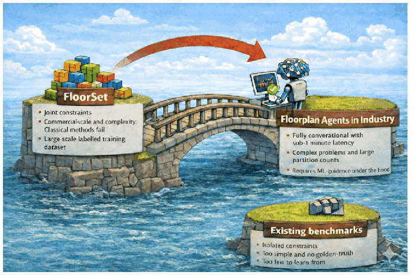

# The FloorSet Challenge: Data-Driven SoC Floorplanning

> ICCAD 2026 Problem C，v10，官方英文题目的 Markdown 阅读版。来源：[工作区原 PDF](C_20260522.pdf) / [官网下载副本](C_20260522.pdf)，两者 SHA-256 一致。
>
> 保留原文章节顺序、定义、公式 (1)–(4)、表格、图 1 和脚注信息；恢复排版断词，公式重排为 LaTeX。参考文献 [1]–[46] 单独列于[参考文献](problem_references.md)。页码标题仅用于回查 PDF，不代表重新划分原文章节。原文的疑点不在正文中静默修正；最新澄清及代码差异见[中文研究导读](../../docs/research_guide.zh-CN.md)和[官方 Q&A 全文](official_qa.md)。

## Organizers — PDF p.1

- Uday Mallappa, AI Research Scientist (Sr. Staff), Intel
- Sachin Bhat, AI Solutions Engineer, Intel
- Pei Chun Ch’ng, Principal Engineer, Intel
- Somdeb Majumdar, Director, AI Lab, Intel
- Yuan Lu, PhD Student, UC San Diego
- Yusu Wang, Professor, UC San Diego

## Background — PDF p.1

Fixed-outline floorplanning is an NP-complete combinatorial optimization problem that has been extensively studied in the literature. In industrial System-on-Chip (SoC) design, this problem becomes significantly more complex due to hard constraints on block shapes and locations. The objective is to arrange blocks (also called modules) on a 2D canvas such that a multi-objective cost function is minimized while all constraints are satisfied.

SoC floorplanning differs from traditional bin packing in several key ways. Blocks may have flexible shapes but must adhere to predefined area budgets. Certain blocks are subject to specific placement constraints. Blocks are interconnected through nets and often require connectivity to external terminals on the canvas boundary, creating spatial dependencies that directly influence total wirelength—a primary optimization objective. The cost function is inherently multi-objective, aiming to simultaneously minimize chip bounding-box area and total wirelength while satisfying all placement constraints.

## Motivation — PDF pp.1–2

Reducing the time-to-convergence for high-complexity designs while navigating multi-dimensional constraint spaces has become a critical bottleneck in the physical design back-end flow. The objective of this competition is to identify highly efficient methodologies capable of addressing these industry-scale challenges.

The primary goal is to shift the design paradigm from manual iterations—which currently span several days—to automated cycles completed within minutes. We hypothesize that this transition is best achieved through machine learning (ML)-guided optimization. However, the effectiveness of such models depends critically on the availability of high-fidelity, labeled datasets. To address this gap, we provide a comprehensive suite of benchmark datasets derived from realistic industrial scenarios. By releasing these datasets (e.g., FloorSet), we challenge the community to develop ML-driven solutions that scale to industrial requirements.

*Figure 1: This contest is the catalyst for agentic systems that can solve industrial floorplanning problems in seconds.*

Our underlying hypothesis is that ML guidance enables rapid exploration of the solution space, serving as a foundational component for agentic AI and conversational floorplanning agents. We envision a long-term design environment where architects interact with floorplanning agents via natural language, achieving design iterations with sub-one-minute latency.

## Related Work — PDF p.2

Fixed-outline floorplanning [6, 14] under diverse placement constraints [17, 25, 41, 42, 43] represents a mature yet increasingly complex challenge within the physical design landscape. While the community has historically relied on legacy benchmarks such as MCNC and GSRC [8, 27] to validate a wide array of solvers—ranging from classical meta-heuristics to recent hybrid learning frameworks [1, 2, 5, 7, 22, 23, 34, 36, 39, 40]—these datasets lack the rigor required for modern machine learning validation. Specifically, they fail to provide ground-truth optimal solutions, which are standard in the broader machine learning field, and often treat constraints in isolation rather than integrating them into a holistic design problem. In contrast, our proposed dataset FloorSet [26] bridges this gap by providing millions of layout solutions where area and wirelength are demonstrably optimal, and all placement constraints are strictly satisfied. By leveraging a reverse-engineering methodology that ensures near-optimality by construction, these benchmarks establish a definitive ground-truth reference that enables precise quantification of the optimality gap for any proposed solver. Recognizing that the full industrial complexity of rectilinear partitions and soft blocks poses a steep entry barrier for neural architectures, we introduce FloorSet-Lite. This curated subset focuses exclusively on hard blocks, providing a streamlined yet high-fidelity environment for evaluating the next generation of machine learning-driven EDA tools.

## Proof of Concept — PDF p.3

Our preliminary experiments indicate that traditional heuristic methods, even with massive parallelism such as distributed SA [28], struggle with the FloorSet-Lite dataset. Even for moderate-sized test cases (e.g., 60 partitions), execution times often exceed 10 minutes without reaching optimality, exhibiting at least a 10% gap in wirelength or area.

Our internal experiments using a diffusion model serves as a counterpoint, achieving high-fidelity solutions in sub-minute intervals. Although the provided dataset is intended for ML training, the contest objective is performance-oriented rather than methodologically restrictive. We invite the application of any algorithmic paradigm, whether purely stochastic, data-driven, or hybrid, that effectively addresses the trade-off between solution quality and runtime.

## Problem Statement — PDF pp.3–5

### Contest Repository

[IntelLabs/FloorSet — iccad2026contest](https://github.com/IntelLabs/FloorSet/tree/main/iccad2026contest)

### Inputs

- $B=\{b_1,b_2,\ldots,b_k\}$ denotes the set of $k$ blocks, where each block $b_i$ is a soft-block, constrained by its predetermined area target from $A=\{a_i\mid i=1,2,\ldots,k\}$.
- $T=\{t_1,t_2,\ldots,t_r\}$ represents $r$ terminals, which are predefined fixed points on the 2D plane used for external interfacing. Terminal locations are provided in the input and remain fixed throughout the contest.
- **Inter-module connectivity:** weighted adjacency matrix $W^{(\mathrm{int})}\in\mathbb{R}^{k\times k}$, where $W^{(\mathrm{int})}_{ij}$ is the weight of the net connecting $b_i$ to $b_j$. A weight of zero indicates no connection.
- **External connectivity:** weighted adjacency matrix $W^{(\mathrm{ext})}\in\mathbb{R}^{k\times r}$, where $W^{(\mathrm{ext})}_{ij}$ is the weight of the net connecting $b_i$ to terminal $t_j$. A weight of zero indicates no connection.

**Soft constraints** (for the purpose of this contest, violations incur a penalty but do not disqualify the solution or make it infeasible):

- **Grouping:** $B^P_{\mathrm{grouping}}$ defines $P$ groups of blocks that should be physically abutted (i.e., share a common edge segment of non-zero length, with zero gap). A group is satisfied if all its blocks form a single connected component through shared edges.
- **Multi-Instantiation Blocks (MIB):** $B^Q_{\mathrm{mib}}$ defines $Q$ groups where blocks should share identical dimensions (width and height). These represent instances of the same master cell that must have uniform shape.
- **Boundary constraints:** $B_{\mathrm{boundary}}$ specifies blocks that should be placed such that at least one edge touches the bounding-box boundary (for edge constraints) or such that two edges touch the bounding-box corner (for corner constraints). The specific edge or corner requirement is provided per block in the input.

**Hard constraints** (violations that make the solution infeasible for that test case):

- **Area Targets and Dimensionality:** The dimensions of all blocks must strictly adhere to their specified requirements. For preplaced and fixed-shape blocks, the input dimensions $w_i$ and $h_i$ are immutable. For all other blocks (soft blocks), the realized width $w_i$ and height $h_i$ must satisfy the target area $a_i$ within a 1% relative error threshold:

$$
\left|\frac{w_i h_i-a_i}{a_i}\right|\le 0.01. \tag{1}
$$

Any solution that deviates from the fixed dimensions (for preplaced and fixed-shape blocks) or exceeds the 1% area tolerance for soft blocks is classified as infeasible.

- **Overlap-Free Constraint:** The solution must be strictly overlap-free. For any two distinct blocks $b_i$ and $b_j$ ($i\ne j$), the area of their intersection must be zero:

$$
\operatorname{Area}(b_i\cap b_j)=0.
$$

Any intersection between block geometries, regardless of magnitude, renders the solution infeasible. Note: Blocks may share an edge (touch) without overlapping.

- **Fixed-Shape Immutability** [original footnote 1]: For each block $b\in B_{\mathrm{fixed}}$, the solution dimensions must exactly match the input specification. The target area $a_b$ is ignored—only the specified width and height matter. A solution is infeasible if, for any fixed-shape block:

$$
w_b\ne w_b^{\mathrm{input}}\quad\text{or}\quad h_b\ne h_b^{\mathrm{input}}.
$$

- **Preplaced Immutability** [original footnote 2]: For each block $b\in B_{\mathrm{preplaced}}$, both the location and dimensions must exactly match the input specification. The target area $a_b$ is ignored—only the specified location, width, and height matter. A solution is infeasible if, for any preplaced block:

$$
(x_b,y_b)\ne(x_b^{\mathrm{input}},y_b^{\mathrm{input}})
\quad\text{or}\quad
(w_b,h_b)\ne(w_b^{\mathrm{input}},h_b^{\mathrm{input}}).
$$

Infeasible solutions receive a fixed penalty cost of $M=10$ for that test case, as defined in the Objective Function (Equation 2). This ensures that any feasible solution, regardless of quality, scores better than an infeasible one.

Original footnotes 1–2: Previously treated as a soft constraint; updated to hard constraint in both the documentation and the evaluation code.

### Expected Output

**Overlap-free block locations:**

$$
L=\{(x_i,y_i)\mid i=1,2,\ldots,k\},
$$

where $(x_i,y_i)$ are the coordinates of the **lower-left corner** of block $b_i$. The coordinate system has its origin $(0,0)$ at the lower-left corner of the canvas, with $x$ increasing to the right and $y$ increasing upward. For preplaced blocks, the coordinates $(x_i,y_i)$ are immutable and must match the input specification exactly.

**Block dimensions:**

$$
D=\{(w_i,h_i)\mid i=1,2,\ldots,k\},
$$

where $w_i$ is the width (extent in the $x$ direction) and $h_i$ is the height (extent in the $y$ direction) of block $b_i$. Thus, block $b_i$ occupies the rectangular region $[x_i,x_i+w_i]\times[y_i,y_i+h_i]$.

**Output format:** Solutions must be submitted in the format specified in the [FloorSet repository](https://github.com/IntelLabs/FloorSet). See the repository documentation for file format details and submission instructions.

## Objective Function — PDF pp.5–8

We use the following multi-objective cost function:

$$
\mathrm{Cost}=\begin{cases}
\min\!\left(\left(1+\alpha(\mathrm{HPWL}^{\mathrm{gap}}+\mathrm{Area}_{\mathrm{bbox}}^{\mathrm{gap}})\right)
e^{\beta\,\mathrm{Violations}_{\mathrm{relative}}}
\max(0.7,\mathrm{RuntimeFactor}^{\gamma}),\ M-10^{-6}\right),&\text{if feasible},\\
M,&\text{if infeasible}.
\end{cases}\tag{2}
$$

Where:

- A solution is infeasible if it violates any hard constraint (block overlap, area tolerance violation, fixed-shape dimension mismatch, or preplaced location/dimension mismatch). Infeasible solutions receive a fixed penalty cost of $M=10$ for that test case, as defined in Equation 2. Feasible costs are capped at $M-10^{-6}$, to guarantee that any feasible solution, regardless of quality, always scores strictly better than an infeasible one.
- $\alpha=0.5$ weights the quality metrics (HPWL and bounding-box area gaps).
- $\beta=2.0$ controls the exponential violation penalty.
- $\gamma=0.3$ dampens the runtime factor.
- $\max(0.7,\cdot)$ caps the runtime benefit at 30%.
- $\mathrm{HPWL}^{\mathrm{gap}}$ is the relative gap between the achieved wirelength and the baseline (optimal) wirelength.
- $\mathrm{Area}_{\mathrm{bbox}}^{\mathrm{gap}}$ is the relative gap between the achieved bounding-box area and the baseline (optimal) area.
- $\mathrm{Violations}_{\mathrm{relative}}\in[0,1]$ quantifies soft-constraint violations.
- $\mathrm{RuntimeFactor}=\frac{\text{Your Runtime}}{\text{Median Runtime of All Submissions}}$.

Original footnote 3: This metric is computed independently for each test design, using that individual test case’s median runtime as the sole reference point.

### Interpretation — PDF p.6

- Feasible solutions have costs typically in the range $[0.7,7.4]$:
  - Best case: perfect quality, 0 violations, fast → approximately 0.7.
  - Worst feasible case: poor quality, 100% soft violations, slow → capped at $M-10^{-6}<10$.
- Infeasible solutions receive $M=10$, which is higher than any reasonable feasible solution, but not so extreme that a single failure dominates the entire score.
- Example impact on Total Score: With 100 test cases and exponential weighting, a participant who fails 1 large test case (e.g., 120 blocks) will be significantly penalized due to the high weight of larger instances. A participant who fails 1 small test case (e.g., 21 blocks) will be penalized less severely.
- Exponential violation penalty: The $e^{\beta V}$ term creates rapidly increasing penalties:

| Violations relative | Cost multiplier |
|---|---|
| 0.0 | ×1.00 |
| 0.25 | ×1.65 |
| 0.5 | ×2.72 |
| 1.0 | ×7.39 |

**Capped runtime factor** [original footnote 4]:

| RuntimeFactor | Effect (negative is better) |
|---|---|
| ≤ 0.31 (approximately 3×+ or more faster) | −30% (capped) |
| 0.5 (2× faster) | −19% |
| 1.0 (median) | baseline |
| 2.0 (2× slower) | +23% |
| 4.0 (4× slower) | +51% |

Original footnote 4: Runtime penalties for slowness are uncapped, while the benefit for speed are subject to a fixed upper limit.

**Example scores:**

| Scenario | Cost |
|---|---:|
| Perfect solution, 10× faster | 0.70 |
| Perfect solution, approximately 3× faster | 0.70 |
| Perfect solution, median runtime | 1.00 |
| 10% gaps, 25% violations, 10× faster | 1.24 |
| 50% soft violations, median runtime | 2.72 |
| 100% soft violations, 2× slower | 9.09 |
| Infeasible (any hard constraint violation) | 10.00 |

Lower cost is better. Hard constraint violations result in a fixed penalty of $M=10$, ensuring infeasible solutions are always worse than feasible ones while allowing partial credit across the 100 test cases.

### Half-Perimeter Wirelength (HPWL) — PDF p.7

HPWL sums the weighted Manhattan distances between centroids of connected blocks and terminals. Inter-module HPWL (computed using Manhattan distance between block centroids):

$$
\mathrm{HPWL}_{\mathrm{int}}=\sum_{i=1}^{k}\sum_{j>i}W^{(\mathrm{int})}_{ij}
\left(|c_i^x-c_j^x|+|c_i^y-c_j^y|\right),\tag{3}
$$

where $c_i^x=x_i+w_i/2$ and $c_i^y=y_i+h_i/2$ are the centroid coordinates of block $b_i$.

External connections (computed using Manhattan distance from block center to terminal):

$$
\mathrm{HPWL}_{\mathrm{ext}}=\sum_{i=1}^{k}\sum_{j=1}^{r}W^{(\mathrm{ext})}_{ij}
\left(|x_i+w_i/2-x_{t_j}|+|y_i+h_i/2-y_{t_j}|\right),
$$

where $(x_{t_j},y_{t_j})$ denotes the coordinates of terminal $t_j$.

**Gap-based normalization:**

$$
\mathrm{HPWL}^{\mathrm{gap}}=\frac{(\mathrm{HPWL}_{\mathrm{int}}+\mathrm{HPWL}_{\mathrm{ext}})-\mathrm{HPWL}^{\mathrm{baseline}}}{\mathrm{HPWL}^{\mathrm{baseline}}}.
$$

A value of 0 means the solution matches the baseline wirelength exactly. A value of 0.15 means the solution is 15% worse than baseline.

### Bounding-Box Area — PDF p.7

For floorplan $\mathcal{M}=\{(x_i,y_i,w_i,h_i)\mid i=1,\ldots,k\}$:

$$
x_{\min}=\min_i x_i,\quad y_{\min}=\min_i y_i,
$$

$$
x_{\max}=\max_i(x_i+w_i),\quad y_{\max}=\max_i(y_i+h_i),
$$

$$
\mathrm{Area}_{\mathrm{bbox}}=(x_{\max}-x_{\min})(y_{\max}-y_{\min}).
$$

**Gap-based normalization:**

$$
\mathrm{Area}_{\mathrm{bbox}}^{\mathrm{gap}}=\frac{\mathrm{Area}_{\mathrm{bbox}}-\mathrm{Area}_{\mathrm{bbox}}^{\mathrm{baseline}}}{\mathrm{Area}_{\mathrm{bbox}}^{\mathrm{baseline}}}.
$$

A value of 0 means the solution matches the baseline area exactly. A value of 0.05 means the solution uses 5% more area than baseline.

### Violation Cost — PDF pp.7–8

Violations are computed differently depending on the constraint type [original footnote 5]:

- **Per-block constraints (Boundary):** Each block either satisfies (0) or violates (1) its constraint.
- **Per-group constraints (Grouping, MIB):** Violations are counted per group based on the degree of fragmentation (connected components − 1) or shape inconsistency (distinct shapes − 1).

$$
\mathrm{Violations}_{\mathrm{relative}}=\frac{V_{\mathrm{grouping}}+V_{\mathrm{boundary}}+V_{\mathrm{mib}}}{N_{\mathrm{soft}}}.\tag{4}
$$

Where $N_{\mathrm{soft}}$ is the normalization factor computed as:

$$
N_{\mathrm{soft}}=|B_{\mathrm{boundary}}|+\sum_{p=1}^{P}(|G_p|-1)+\sum_{q=1}^{Q}(|M_q|-1).
$$

Here, $|G_p|$ is the number of blocks in grouping group $p$, and $|M_q|$ is the number of blocks in MIB group $q$. This normalization ensures that $\mathrm{Violations}_{\mathrm{relative}}\in[0,1]$.

Original footnote 5: Updated to exclude fixed and preplaced from soft constraints.

**Boundary violations** (block does not touch the required edge or corner of the bounding box):

$$
V_{\mathrm{boundary}}=\sum_{b\in B_{\mathrm{boundary}}}\mathbf{1}_b,
\quad\mathbf{1}_b=\begin{cases}1,&\text{if }b\text{ does not touch its specified edge or corner},\\0,&\text{otherwise}.\end{cases}
$$

**Grouping violations:** Let $P$ be the number of groups, $G_p$ the set of blocks in group $p$, and $c_p$ the number of connected components formed by blocks in $G_p$ (where two blocks are connected if they share an edge). A perfectly satisfied group has $c_p=1$. The maximum violation for a group of $|G_p|$ blocks is $|G_p|-1$ (when all blocks are isolated):

$$
V_{\mathrm{grouping}}=\sum_{p=1}^{P}(c_p-1).
$$

**Multi-instantiation violations:** Let $Q$ be the number of MIB groups, and $s_q$ the number of distinct $(w,h)$ pairs among blocks in group $q$. A perfectly satisfied MIB group has $s_q=1$. The maximum violation for a group of $|M_q|$ blocks is $|M_q|-1$ (when all blocks have different shapes):

$$
V_{\mathrm{mib}}=\sum_{q=1}^{Q}(s_q-1).
$$

## Dataset — PDF p.8

Machine learning has advanced rapidly with scalable transformers leveraging large pretrained datasets. However, SoC floorplanning lacks such datasets for supervised learning. We provide the FloorSet-Lite dataset (rectangular blocks with a fixed rectangular outline) containing optimal-by-construction layouts:

- **Training:** 1M samples with optimal solutions for sizes ranging from 21 to 120 blocks. Participants may use this data for training ML models or analyzing problem structure. Available at [Hugging Face](https://huggingface.co/datasets/IntelLabs/FloorSet). Use `get_training_dataloader()` from `iccad2026_evaluate.py` for automatic downloading and data access.
- **Validation:** 100 samples (one per size from 21 to 120 blocks), accessible to contestants for validating solution generalizability. Available at [Hugging Face](https://huggingface.co/datasets/IntelLabs/FloorSet). Use `get_validation_dataloader()` from `iccad2026_evaluate.py` for automatic downloading and data access.
- **Test:** 100 samples (one per size from 21 to 120 blocks), hidden from candidates. Used for final submission evaluation.
- The repository includes PyTorch DataLoaders, score evaluators, infeasibility checks, and plotting utilities. We strongly recommend using the provided evaluator to verify solutions before submission.
- Baseline values ($\mathrm{HPWL}^{\mathrm{baseline}}$, $\mathrm{Area}_{\mathrm{bbox}}^{\mathrm{baseline}}$) for each test case are provided in the dataset.

## Total Score (Cost) — PDF p.9

The total score is the weighted average of benchmark costs over 100 test examples (hidden from the candidates), with exponentially increasing weight for larger instances:

$$
\mathrm{TotalScore}=\sum_{i=21}^{120}\mathrm{Cost}[i]\,
\frac{e^{n_i/12}}{\sum_{j=21}^{120}e^{n_j/12}}.
$$

Where:

- $\mathrm{Cost}[i]$ is the cost (computed using Equation 2) for test case $i$.
- $n_i$ is the number of blocks in test case $i$ (i.e., $n_i=i$ for this dataset).
- Equivalently, we are multiplying the cost of each testcase $i$ with a normalized weight $\lambda_i=e^{n_i/12}/Z$, where $Z=\sum_{j=21}^{120}e^{n_j/12}$ is the normalization constant and $\sum_{i=21}^{120}\lambda_i=1$:

$$
\mathrm{TotalScore}=\sum_{i=21}^{120}\lambda_i\,\mathrm{Cost}[i].
$$

This exponential weighting scheme ensures that larger, more challenging instances contribute more heavily to the final score.

**Lower Total Score is better.** A perfect solution achieving baseline metrics on all test cases with median runtime would have a Total Score close to **1.0**.

Baseline metrics and a live leaderboard are provided on the [leaderboard page](https://github.com/IntelLabs/FloorSet/blob/main/intel_testsuite_lite.md).

## Incentivizing Machine Learning Solutions — PDF p.9

In this contest, we incentivize data-driven ML-guided solutions in the following ways [original footnote 6]:

- **Efficiency-Focused Scoring:** Runtime is explicitly integrated into the scoring function, and the exponential weighting by block count penalizes methods that scale poorly with problem size.
- **Scalability Barriers:** Larger instances present significant challenges for classical methods, which struggle to scale efficiently as runtime penalties increase. ML methods that learn from training data can potentially generalize to larger instances more efficiently.

Original footnote 6: Submissions found to be reverse-engineering the dataset generator rather than developing genuine algorithmic solutions will be disqualified.

## References — PDF pp.9–13

All 46 entries, in original order: [problem_references.md](problem_references.md).
