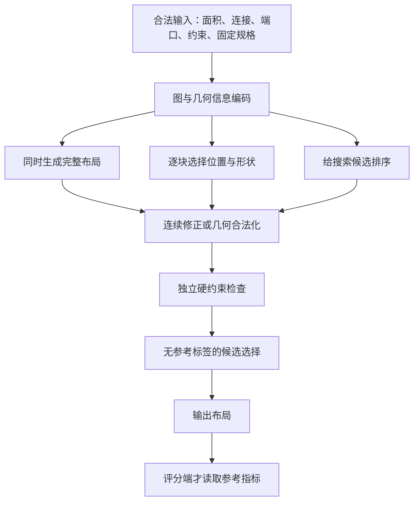

# 面向 ICCAD 2026 Problem C 的 ML 布局规划文献综述

阅读与检索日期：2026-10-16（北京时间）。本轮新增下载 10 篇，结合已有 FloorSet 共 11 篇。完整题名、版本、原始来源和本地 PDF 见 [论文索引](README.md)，文件大小、SHA-256、读取页数与核对范围见 [manifest.json](manifest.json)。

本文阅读了主要方法、核心实验，并重点核对影响结论的数据、候选选择、合法化与预算附录；不是逐页翻译。下文页码均为**本地 PDF 从 1 开始的页号**。所有论文性能数字均为**作者报告，未在本工作区复现**；“对本题的启发”是本地分析，不代表论文已经支持比赛全部规则。本轮没有运行训练、求解或读取封存测试数据。

## 1. 先用五分钟建立全局认识

这些论文回答的是同一个大问题的不同部分：**模型负责提出哪些决策，几何算法负责保证哪些条件，有限时间花在哪里最有效。**

| 路线 | 学习对象 | 典型代表 | 优点来自哪里 | 最应警惕的问题 |
|---|---|---|---|---|
| 同时生成全部布局 | 给定连接图后的布局分布 | ChipDiffusion、DiffPlace、FlowPlace、Trinity | 离线学习跨实例规律，一次提出全局方案，可采样多个解 | 低重叠率不等于硬合法；后处理可能贡献大部分改善 |
| 顺序构造布局 | 当前状态下下一个块的位置/形状 | MaskPlace、RulePlanner | 在动作空间中排除部分非法选择，直接利用几何信息 | 前面的选择可能让后面无处可放；离散网格影响接边与形状精度 |
| 离线学习构造策略 | 从优质布局轨迹学习放置决策 | ChiPFormer | 用已有轨迹减少新设计上的在线探索 | 最佳结果通常还包含新实例微调，不能和零样本推理混称 |
| 学习改进完整解 | 候选邻居的长期价值、接受/拒绝策略 | Learn to Floorplan | 集中搜索预算到更有希望的候选 | 生成并精确评价候选本身可能比网络更贵 |
| 结构化约束处理 | 等式补全、约束修正；或专门修复动作 | DC3、PARSAC | 让部分规则由表示或求解流程承担 | 不同约束的保证范围不同，不能概括成“全部天然合法” |

可以把共同流程理解为下面这张图。三条 ML 分支是备选，不是要求全部串起来。

### 1.1 本题与常见 macro placement 的差别

按 [赛题](../official/problem_statement.md)、[官方 Q&A](../official/official_qa.md)和[比赛 README](../../third_party/FloorSet/iccad2026contest/README.md)：

- 输入是 21–120 个模块、加权块间连接和固定端口连接；官方所谓 HPWL 在这里是模块中心/端口之间的加权 Manhattan 距离之和。
- 普通块只有面积目标，允许改变宽高比；fixed 块尺寸不可改，preplaced 块的位置和尺寸均不可改。
- 无重叠、普通块面积误差不超过 1%、固定规格保持，是硬约束。grouping、MIB、boundary 是软约束，不能为满足它们而破坏硬约束。
- grouping 按接边连通分量计数；MIB 要相同 `(w,h)`；boundary 对应**输出布局包围盒**的指定边/角。它们分别不同于“距离近”“宽高比相同”“靠近某个端口”。
- 比赛没有固定 outline，也没有普通块的强制宽高比范围。许多旧论文解决的是固定画布、固定尺寸块，要先改问题定义才能比较。
- 运行时间进入正式评分，且大实例按 `exp(n/12)` 获得更大权重。作者的平均耗时、批处理吞吐和比赛单实例耗时需要区分。

### 1.2 读论文前认识这些词

| 术语 | 在这里的含义 |
|---|---|
| 条件生成 | 输入连接图和约束，生成满足这些条件的布局候选 |
| Diffusion | 训练去噪网络，推理时从噪声逐步恢复布局 |
| Flow matching | 训练一个速度场，把简单分布中的样本逐步搬运到布局分布；步数和质量仍需实测 |
| Guidance | 推理时额外利用线长、重叠等目标的梯度改变生成轨迹 |
| Refiner | 生成结束后继续做连续优化，降低目标或约束残差 |
| Legalizer | 把草稿变成经过几何检查的可行布局；可能明显改变线长与面积 |
| NFE / best-of-N | NFE 是网络求值次数；N 是生成的候选数。两者都消耗预算 |
| Zero-shot / fine-tuning | 新实例只推理 / 针对新实例继续更新权重，必须分开报告 |

## 2. 建议阅读顺序

先看本文第 3 节的 11 张阅读卡，再选择原文。每张卡都回答“学什么、怎么做、证据是什么、如何迁移”。

| 优先级 | 论文 | 建议先看的本地页码 | 带着什么问题读 |
|---|---|---|---|
| 必读 | FloorSet | 1、3–8 | 数据标签和约束的来源是什么？原始数据性质与比赛规则有什么区别？ |
| 必读 | Trinity | 4–8、25、37–38、58、85 | 形状怎么表示？生成、修正、合法化分别贡献多少？参考信息在哪里被使用？ |
| 必读 | FlowPlace | 3–6 | 如何把几何投影放进生成过程？少步采样的收益是否包含投影代价？ |
| 必读 | RulePlanner | 3–8、21 | 位置和形状怎样共同决策？规则矩阵与本题的计数规则是否一致？ |
| 对照 | ChipDiffusion | 3–7、12 | 图网络为什么要结合全局注意力？引导之后到底有多合法？ |
| 对照 | Learn to Floorplan | 2–4、6–7 | 学习搜索能否减少总评价次数，而不只是增加一个模型？ |
| 对照 | PARSAC | 4–7 | 为什么只加罚项会卡住？锚定和专用修复动作怎样工作？ |
| 扩展 | MaskPlace | 4–7 | 如何从几何状态生成可行动作掩码和线长增量图？ |
| 扩展 | ChiPFormer | 3–8 | 静态布局如何变成训练轨迹？零样本与 300/2000 次 rollout 的区别是什么？ |
| 扩展 | DiffPlace | 5–9、13 | 目标条件与局部约束引导如何分工？最终合法化是否仍然必要？ |
| 扩展 | DC3 | 3–7 | 哪些等式可以消元，哪些不等式仍需额外修正与验证？ |

## 3. 逐篇阅读卡

### 3.1 FloorSet：理解我们的数据从哪里来

[本地 PDF](FloorSet_2405.05480.pdf) · [原始页面](https://arxiv.org/abs/2405.05480) · 本地版本为 arXiv v4，2024-08-01。

**一句话。** 这是一篇数据集论文：提供具有现实约束统计的合成布局，让监督学习有大规模训练样本。

**方法。** 作者先抽取真实 SoC 的形状、连接、端口和约束统计，再构造布局并标注连接与约束。Prime 以可接边的直角多边形分区为主；Lite 以矩形为主，通过 SA 做紧凑排布，再采样端口、连接和约束。连接概率与几何接近程度有关，标签是由该流程产生的优质参考布局。（第 3–8 页，图 5、算法 1–6。）

**证据怎么读。** 第 8 页图 10 展示传统 SA 在选定样本上的质量与违反情况；图 11 对比若干分布。这支持数据集有研究难度、部分统计接近真实设计，但不能由此推断每个标签都是经过精确优化证明的唯一全局最优解。

**对本题的启发。** 可以同时利用布局监督与规则监督：前者学习统计规律，后者处理标签未完全满足的软规则。论文原始固定 outline 和约束分类，要以比赛更新为准。Q&A A4 明确允许训练标签存在软违反，因此标签不能作为零软违反答案直接照抄。

**边界。** 了解生成过程用于理解数据分布；不能据此制作针对生成器特例的逆向答案恢复器，赛题明确禁止这类做法。已有 PDF 原件保留，未重新下载或修改。

### 3.2 Trinity：把同一套几何函数用于训练、修正与诊断

[本地 PDF](Trinity_2610.04957v1.pdf) · [原始页面](https://arxiv.org/abs/2610.04957v1) · 2026-10-04 的预印本，85 页含大量附录。

**一句话。** 它最有价值的地方，是把生成器、连续修正器、最终合法化分开测量，并在训练中加入与后处理一致的几何目标。

**方法。** 每块用中心坐标和 `log(w/h)` 表示；面积由解码公式保证。图条件 Transformer 预测干净布局，以 flow matching 目标训练；额外加入重叠、grouping 接触间隙、MIB、boundary、线长和面积六类几何函数。推理后用同一组函数做 Adam 修正，再提取块对的方向关系、求解位置 LP，并做接边修正。（第 4–6 页，图 2。）

固定尺寸和预放置通道会被覆盖回输入值；MIB 还有组内形状处理。LP 失败时分层放松软规则、调整与预放置冲突的方向关系，最后采用可行兜底。所谓“一个 LP”背后还有修复轮次和形状调整，不能省略其工程成本。（第 25、37–38 页。）

**证据怎么读。** 第 8 页表 5 中，无物理训练项的版本在原始样本上明显较差，但经过 400 步共享修正后与完整版本的 soft cost 很接近。这说明训练项对短预算、原始草稿有价值，也说明长后处理会抹平部分生成器差异。表 6 交换生成器与修正循环，是比只看最终分数更有解释力的对照。

**三项必须保留的限定。**

1. 第 85 页说明训练与内部评估使用 **MIB-consistent 数据变体**，将原始组内形状调整为一致。作者给出的原始不一致比例为其报告，本地没有复核。官方把 MIB 定义为软约束，这不意味着原数据的软违反计数没有定义；我们不能静默替换原始输入和参考指标。
2. 第 58 页 K.6 明确说明，best-of-N 使用官方 hard cost 选择候选，读取了该实例的参考线长与面积，且没有评估无参考信息选择规则。于是表 52 的 mean=1.0144、加权 total=1.0213、1.63 s/case 是**带参考信息候选选择的作者实验数字**，不能作为可直接提交的无泄漏成绩。
3. 这些 cost 没有复现正式跨提交时间因子；mean 与指数加权 total 也不同。该表使用 NFE=8、400 步修正、48 个候选，硬件为 RTX 5090 并配有 CPU 并行合法化。其他方法则是移植到统一表示/训练条件后的版本，不等同于原论文完整发布流程。（第 6、25、58、83–85 页。）

**对本题的启发。** 借鉴保面积表示、分阶段归因、生成器×修正器交叉对照。候选选择必须独立解决：只能使用输入可计算的目标、约束和在 train/dev 固定的规则；参考指标只在评分端使用。

### 3.3 ChipDiffusion：图条件扩散的清晰起点

[本地 PDF](ChipDiffusion_ICML2025.pdf) · [ICML 2025 正式页面](https://proceedings.mlr.press/v267/lee25y.html)。

**一句话。** 把整个布局当成一个样本，利用连接图条件同时预测所有模块的位置。

**方法。** 块的宽高是已知输入，输出只含二维位置。去噪网络交替使用 GNN、全局注意力和 MLP，并使用二维位置编码。采样过程中，线长和带符号间距构成可微引导目标；还通过类似拉格朗日权重更新的方式平衡合法性与线长。（第 3–5 页。）

**证据怎么读。** 第 7 页表 3 移除注意力会明显损害合法性，支持局部连接信息与全局几何信息互补。表 4 中，clustered IBM 数据上的 legality 从 v2 未引导时的 0.8835 升至引导后的 0.9970。但该指标是有效并集面积占总块面积的比例，**不是 99.7% 的实例硬合法率**，更不能视作严格零重叠。

**对本题的启发。** 图局部传播与全局交互值得做独立消融；采样时的梯度引导可能改善布局，但必须计入额外计算。它的合成数据分布实验也提醒我们：在小规模训练后，不能默认对更多模块仍泛化良好。（第 5–7 页。）

**边界。** 原文主要处理固定尺寸位置、画布与重叠，不覆盖本题全部软规则。附录第 12 页采用 1000 步 DDPM 与每步额外优化设置，不适合作为未经改造的短时限方案。原文通过合成数据扩充解决数据稀缺；我们已有固定训练池，不能把重新制造数据当作默认必要步骤。

### 3.4 FlowPlace：在生成轨迹中加入几何投影

[本地 PDF](FlowPlace_2604.23658v2.pdf) · [原始页面](https://arxiv.org/abs/2604.23658v2) · arXiv v2，论文标注 DAC 2026。

**一句话。** 用 flow matching 产生位置，再在采样过程中把预测的最终布局投影到可行网格位置。

**方法。** 网络预测速度场，骨干交替使用 GATv2 与自注意力。每步先外推最终位置，再做贪心网格合法化，再把修正后的终点带回轨迹。作者同时改变了训练数据中的边界偏好，以及初始分布，采用更贴近画布的均匀先验。（第 3–4 页，图 2。）

**证据怎么读。** 作者在 8 个 ICCAD 2015 电路与 6 个 OpenROAD 设计上评测，报告少步采样与无重叠结果；第 6 页表 3、4 分别考察数据先验和初始分布。因此其收益由训练数据、流模型、投影共同构成，不能全部归于“flow 比 diffusion 好”。其 PPA 结果还包含后续标准单元放置或完整设计流程。（第 4–6 页。）

**对本题的启发。** 比较两种机制：只在末尾合法化，或在中间采样步骤就注入可行几何。要同时记录模型求值、投影耗时、布局位移和最终质量。

**边界。** 原文预测固定尺寸 macro 的位置，不直接解决本题的形状、MIB、接边连通和动态包围盒边界。固定网格上的贪心投影还需要证明有可行位置、如何处理预放置障碍和网格精度。论文中的“布局靠边给标准单元留空间”先验，也不一定适合本题紧凑 bbox 目标。

### 3.5 DiffPlace：把目标条件与局部约束引导分开

[本地 PDF](DiffPlace_2510.15897v2.pdf) · [原始页面](https://arxiv.org/abs/2510.15897v2) · arXiv v2。本地首页的期刊模板仍有卷期占位符，本轮不据此认定正式期刊发表。

**一句话。** 用相对几何向量做消息传递，以目标质量为条件生成布局，再用局部约束梯度和传统合法化修复。

**方法。** 消息中显式加入相对位置 `(x_j-x_i)`；全局目标通过相对能量条件及 CFG 引导，重叠/拥塞通过额外梯度处理。算法 1 最后仍有 sequence-pair 方向约束求解和 Tetris 贪心网格放置。（第 6–7 页。）

**证据怎么读。** 原文在 IBM、ISPD 和若干 TILOS 电路上报告结果，兼有合成数据和留出电路的轨迹数据。第 4 页比较表的脚注承认部分电路不能保证零重叠，因此正文中泛化的“保证合法”措辞要谨慎理解。第 13 页的运行时间单位是**分钟**，也不能从“同步生成”推导出本题需要的秒级求解。

**对本题的启发。** 分开研究“偏好更好的目标区域”与“局部几何修复”是否更稳定；相对几何消息可作为图编码候选。原文以分析松弛得到的能量基准作条件，实际迁移仍须逐项审查是否仅依赖合法输入，并计入求解基准的成本。

**边界。** 它依然主要预测位置，不支持本题全部规则；接近零的重叠不等于严格可行。我们有固定端口和预放置，整体平移/旋转也需要同步变换锚点，不能把相对向量带来的性质扩大成任意输入增强都正确。

### 3.6 MaskPlace：让网络只在可行位置中选择

[本地 PDF](MaskPlace_NeurIPS2022.pdf) · [NeurIPS 2022 正式页面](https://papers.nips.cc/paper_files/paper/2022/hash/97c8a8eb0e5231d107d0da51b79e09cb-Abstract-Conference.html)。

**一句话。** 把布局状态表示成几张图，让 CNN 策略在有效网格位置中逐块放置。

**方法。** Position mask 表示无重叠的候选位置；wire mask 表示把当前块放在每处会带来的线长增量；view mask 表示现有占用。网络融合局部与全局信息，用 PPO 学习位置选择，并查看下一块的信息。密集奖励是逐步线长增量的相反数，放置顺序主要由启发式决定。（第 4–6 页，图 4。）

**证据怎么读。** 第 7 页表 3 对比保守占用与放松取整：硬版本重叠为零，放松版本线长较好但产生重叠。这个对照直接说明几何保证与质量之间的取舍，也说明模型奖励不能取代占用检查。作者评测 24 个公开电路，但任务仍是固定画布上的 macro placement。（第 6–7 页。）

**对本题的启发。** 把预放置当作初始障碍；对候选位置直接计算几何可行性；用可计算的线长增量辅助决策，可以降低策略自己学习几何规则的负担。

**边界。** 网格取整不能改变 fixed/preplaced 的真实尺寸。保守扩大占用可以帮助避免碰撞，但不能把扩大的几何作为比赛输出。无重叠掩码只保证当前动作，不能保证剩余块仍能完成，也不能自动保证接边连通。原文面向每个电路的在线 RL 成本需单独计算。

### 3.7 RulePlanner：把接边和形状纳入动作

[本地 PDF](RulePlanner_2601.22476v2.pdf) · [原始页面](https://arxiv.org/abs/2601.22476v2) · arXiv v2，元数据标注 ICML 2026。

**一句话。** 在 MaskPlace 的思想上扩展规则矩阵，并同时学习离散位置和连续宽高比。

**方法。** 相邻端口矩阵描述块边到端口的距离，相邻块矩阵描述共享边长度；与无重叠、层间对齐等矩阵结合，形成动作掩码。CNN 编码规则图，Transformer 编码连接图，Hybrid PPO 学习位置和形状。一个容易漏看的实现细节是：本步先决定当前块位置，同时预测**下一块**的宽高比，以便下一状态计算尺寸相关的掩码。（第 3–6 页，图 2。）

**证据怎么读。** 在 MCNC/GSRC 的 8 个电路、多个约束任务、5 个种子上评测；第 8 页表 6 把规则图作为输入特征、作为动作约束分别消融，比只展示最终效果更有解释力。其 grouping 主要报告接边长度，boundary 主要报告块到端口距离，这些不是本题的连通分量计数与 bbox 边界计数。（第 6–8 页。）

**对本题的启发。** 这是位置和形状联合构造的重要参考。可以借鉴“规则特征 + 硬规则掩码 + 软规则偏好”的分工，并通过当前合法输入构造接边候选。

**边界。** 原文是固定 outline 的 3D 场景，含层间对齐；第 21 页参数使用两个 128×128 die 和 `[1/2,2]` 的宽高比范围。我们没有这些限制，MIB 也不在原文的规则列表中。把所有软规则都相乘成硬掩码，可能在存在冲突时排除全部动作；本题要允许软违反并保留可行兜底。

### 3.8 ChiPFormer：从离线轨迹学习跨设计策略

[本地 PDF](ChiPFormer_ICML2023.pdf) · [ICML 2023 正式页面](https://proceedings.mlr.press/v202/lai23c.html)。

**一句话。** 先模仿已有优质放置轨迹，再用少量在线 rollout 适应新电路。

**方法。** 使用图变分自编码器得到 circuit token，将状态图、历史动作和 circuit token 送进因果 Transformer。离线阶段最大化专家动作概率，使用掩码排除非法位置；新电路阶段用回报加权回归与熵目标继续探索。它不要求照搬标准 Decision Transformer 的 return-to-go token，而用电路表征作为条件。（第 3–5 页。）

**证据怎么读。** 离线数据来自 12 个电路、每个 500 条 MaskPlace 轨迹；评估包括公开与工业共 32 个电路。第 7 页表 2 明确区分 ChiPFormer(1)、(300)、(2k)，分别对应零样本和不同 rollout 预算。更好的数字常来自后两者；mixed-size 的结果还包含 DREAMPlace 后续流程。（第 6–8 页。）

**对本题的启发。** FloorSet 静态标签可以尝试转换为构造训练样本，减少从头 RL 的探索成本。但“有最终布局”不自动等于“有优质轨迹”：顺序、动作候选及中间可行性都需要明确定义。

**边界。** 原文使用 84×84 网格、固定尺寸位置与启发式放置顺序。面向新实例的在线微调属于运行成本；如果目标是快推理，应把不微调版本单列，并从一开始检验其质量。

### 3.9 Learn to Floorplan：学习选择搜索邻居

[本地 PDF](LearnToFloorplan_ICCD2020.pdf) · [作者托管原文](https://personal.hkust-gz.edu.cn/yuzhema/papers/C16-ICCD2020-RLF.pdf) · ICCD 2020。

**一句话。** 模型不输出坐标，而在一批候选布局中选择下一步去哪里。

**方法。** 使用 sequence pair 编码块间左右/上下关系，通过交换、插入、旋转等操作产生邻居。输入是当前/候选代价、历史最好值、受影响块数和搜索进度等少量特征，MLP-DQN 估计候选动作价值。为了控制巨大动作空间，只评价抽样邻居，并允许拒绝移动。（第 2–4 页。）

**证据怎么读。** 小规模 MCNC 上的综合 cost 与耗时有改善，但第 7 页表 V 中 n200 的综合 cost 比 SA 差，n300 耗时也更长，不能概括为学习搜索总能胜出。第 6 页的 profiling 说明，候选的线长和 packing 评价占主要时间。因此“网络很小”不等于整个求解很快。

**对本题的启发。** 可以学习候选排序或操作选择，并与相同候选池、相同时间预算的随机/贪心策略对照。若模型只是重新编码已计算出的候选代价，必须证明长期策略确有额外收益。

**边界。** 原文不覆盖本题完整约束；旋转 fixed 块、移动 preplaced 块会直接非法。其特征中的 baseline 是初始搜索状态能量，而非比赛参考答案；迁移时应保持这种输入合法性。

### 3.10 PARSAC：约束处理可以比换网络更关键

[本地 PDF](PARSAC_2405.05495v3.pdf) · [原始页面](https://arxiv.org/abs/2405.05495v3) · arXiv v3，2024。

**一句话。** 它是传统方法，但解释了为什么仅提高违反罚项经常解决不了约束问题。

**方法。** 在 B*-tree SA 中加入专门修复边界的动作，并用 anchored blocks 在解码时保持预放置位置。grouping、outline 用罚项处理；MIB 通过同步调整组内宽高比处理。多个 CPU worker 独立搜索，收集面积和线长的 Pareto 前沿。（第 4–6 页。）

**证据怎么读。** 第 4 页图 3 给出“修复一个边界会破坏另一边界”的局部陷阱；第 7 页图 5 在各 336 次试验中对比违反分布。固定位置的偏差由锚定消除，比“把位置罚项变大”更直接。经典 n100/200/300 结果用 112 个 worker、每个 1000 万 SA 步，耗时约 9.3/31.2/67.8 分钟，不能与秒级、单核候选直接比较。

**对本题的启发。** 为关键规则设计动作和解码结构；ML 可以学习何时使用修复动作，但硬规则自身仍要由确定性机制维护。也应保留有实际约束处理能力的非学习对照。

**边界。** 论文中部分规则比比赛更严格，MIB 文字是同宽高比，而本题要求同宽高；不同面积下二者不等价。第 6 页还说明未提供 MIB/shape 的独立实验结果。PARSAC 论文方法也不等于我们保存的官方简化 SA 模板，不能混称为已复现。

### 3.11 DC3：先通过表示消掉一部分约束

[本地 PDF](DC3_2104.12225.pdf) · [原始页面](https://arxiv.org/abs/2104.12225) · 本地 PDF 为 v1，正文标注 ICLR 2021。

**一句话。** 网络只预测部分自由变量，通过等式补全剩余变量，再在等式流形附近修正不等式违反。

**方法。** Completion 利用显式公式或隐式求解满足等式；correction 沿不等式违反的梯度更新，训练时也经过这些步骤，使网络理解修正过程，而不是只在测试时临时补救。（第 3–5 页，图 1、算法 1。）

**证据怎么读。** 作者在 QP、非凸优化和 AC 最优潮流上实验。第 7 页表 1 的消融显示，去掉等式补全或训练时修正会破坏可行性或质量。但其 78 倍加速是相对 qpth；同表 DC3 比 OSQP 更慢，并非普遍快于经典求解器。第 5 页也明确说明一般非凸情形的梯度修正没有无条件收敛保证。

**对本题的启发。** 面积和固定规格适合尽量从预测自由度中消除；重叠和接触关系另行处理。它提供的是建模方法，不是可直接套用的布局模型。

**边界。** 矩形无重叠含有离散方向选择，连续修正不能自动解决所有拓扑；有限步修正仍须独立检查。不能把 DC3 的线性约束结论推广成本题全局可行性证明。

## 4. 把论文连接起来：对本题最有用的五个认识

### 4.1 同时回归四个数，会把容易保证的条件也交给模型猜

Trinity 与 DC3 共同启发我们，先减少网络不必要的自由度。对普通软块，可以预测中心与对数宽高比 `rho`，并用

$$
w_i=\sqrt{a_i}\exp(\rho_i/2),\qquad
h_i=\sqrt{a_i}\exp(-\rho_i/2)
$$

解码。这样实数算术下恒有 `w_i*h_i=a_i`，最终仍检查浮点输出。fixed/preplaced 用合法输入规格覆盖，不能把其面积目标代入上述公式取代真实尺寸。这一选择只处理面积/规格，不处理重叠或软约束。

**MIB 不能无条件绑定。** 若同组两个普通块面积分别为 100、200，要求完全相同 `(w,h)` 与各自 1% 面积误差就不兼容。MIB 是软约束，应保留违反并优化取舍；把同组 `rho` 设相同也只保证同宽高比，不保证同宽高。类似地，不能改原始面积来制造零违反。

### 4.2 好布局有多解，坐标均方误差可能产生坏的“平均解”

一个最小例子：两个同尺寸块有“左 A 右 B”和“左 B 右 A”两个可行布局；若缺少区分信息，直接坐标平均会把它们放在同一位置。这解释了生成建模的价值，也提示可以先学离散关系。固定端口/锚点会排除部分对称性，实际是否多模态应在 train/dev 检查，不能只凭这个例子宣布生成模型一定胜出。

建议保留一个简单确定性图回归对照，用相同表示和合法化流程比较；若长后处理后差异消失，就不应继续把改善全部解释为生成分布更强。

### 4.3 无重叠包含离散拓扑，关系确定后几何更容易求

两个矩形不重叠要求至少满足下列一项：

$$
x_i+w_i\le x_j\ \lor\ x_j+w_j\le x_i\ \lor\
y_i+h_i\le y_j\ \lor\ y_j+h_j\le y_i.
$$

难点包含“选哪一个方向”。若尺寸、方向关系已定，位置约束可以成为线性不等式，结合锚点求 LP/最长路；尺寸变化、接边树和边界选择仍需额外处理。固定形状下的 LP 经验，不能直接称为整个可变形问题已经凸化。

这连接了 sequence pair 搜索、DiffPlace 的尾部合法化、Trinity 的关系提取。值得探索“模型学关系，几何算法解坐标”，但逐对独立预测可能产生方向环或锚点冲突，必须处理一致性。

### 4.4 软代理必须检验是否改善官方计数

| 软代理 | 容易出现的反例 | 最终该检查什么 |
|---|---|---|
| 同组中心互相拉近 | 组内块仍有缝隙或发生重叠 | 无重叠前提下的非零公共边、连通分量 |
| 最大化接边总长度 | 两个子团内部接边很长，但子团不连通 | 每组是否形成一个接边连通分量 |
| 同组宽高比一致 | 面积不同导致实际宽高不同 | 不同 `(w,h)` 数量，保留硬面积约束 |
| 靠近端口/固定画布边缘 | 输出 bbox 被另一块撑大，该块不再触边 | 最终 bbox 的指定边和角 |
| 平均重叠面积趋近零 | 仍存在一对轻微相交 | 每个输出的官方与独立硬合法检查 |

这些是我们从规则和方法推导的反例，不是声称所有原文实现都会犯同一错误。连续代理适合训练和优化；官方计数适合判断目标是否真正改善。

### 4.5 候选选择和预算必须算进方法

多采样有价值的前提，是能用合法信息挑选。参考 HPWL/bbox 只属于评分端；即使它们对同一设计是常量，也会影响多目标相对权重、gap 截断及候选排序，不能以“只是归一化”作为传入求解器的理由。

可以研究用输入可计算的归一化线长、bbox、软违反与 Pareto 规则选候选，在 train/dev 冻结权重；这只是待验证代理，不承诺复现参考指标选择的结果。若比较 oracle selection，只能另列为诊断，不能放入主结果。

同时记录候选数量 N、网络求值 NFE、连续修正步数、几何求解次数、端到端耗时。批量生成的 GPU 吞吐、并行 CPU legalizer、冷启动排除规则都应注明。网络前向更快，不代表完整求解更快。

## 5. 从文献形成四个待验证假设

下面是后续可选择的研究问题，本轮只整理文献，不代表已经决定实现。它们共享数据和官方评分接口；若落地，各实验独立维护模型、Loss 和求解算法，遵守当前工作区约定。

| 候选 | 预期机制 | 最小关键对照 | 什么观察会否定它 |
|---|---|---|---|
| A：图条件生成 + 规则训练 + 合法化 | 学习多个全局候选，减少大范围修复 | 相同表示/后处理的确定性回归；去掉规则训练项；分别量原始/修正/最终输出 | 相同总预算下最终质量无优势，或候选无法无参考信息挑选 |
| B：图模型预测拓扑 + 几何求解 | 将学习集中在方向、顺序或接触关系 | 相同几何求解器下，手工/随机关系 vs 学习关系 | 冲突修复频繁，LP/兜底破坏大量线长与面积 |
| C：规则掩码的混合构造策略 | 几何算子提供候选，模型选块、形状或位置 | 相同候选集的启发式选择；规则只作特征 vs 只作掩码 | 空候选或后续死局频繁，网格误差阻碍接边，策略不胜简单选择 |
| D：学习引导可行搜索 | 用少量决策集中搜索预算 | 相同候选池、初始解和 wall time 的随机/贪心选择 | 枚举与计分成本占主导，网络增加开销而没有更快改善 |

建议先用 A/B/C 中机制不同的候选做短预算可行性论证，同时把 D 作为较低模型复杂度的参照。读过 Trinity 并不意味着应直接训练其最大模型；先确认表示、输入边界、候选选择和几何处理能成立，再决定投入哪条路线。

每条候选至少记录：硬合法率、HPWL gap、bbox gap、grouping/MIB/boundary 三类计数、真实耗时及各阶段预算。关键消融保持相同输入与预算；默认只在冻结 dev5 做轻量机制检查，五例不能证明泛化。长训练/推理按 [执行协议](../../docs/protocol.md)交付用户命令，本地测试保持封存。

## 6. 检索范围、取舍与继续追踪

本轮用 `FloorSet diffusion/flow matching`、`Chip Placement with Diffusion Models`、`Generalizable Floorplanner corner block list`、`ChiPFormer offline decision transformer`、`FlowPlace`，以及上一轮已定位的硬约束与学习搜索文献作为入口，沿官方参考文献和新论文引用扩展；优先下载 arXiv、PMLR、NeurIPS 和作者托管全文。**这是围绕本题的精选阅读集，不是穷尽性的系统综述。**

- `Generalizable Floorplanner through Corner Block List Representation and Hypergraph Embedding` 和 `GraphPlanner` 仍值得继续追踪，但本轮未取得并核读其全文，因此不写成已读论文。
- ASP-DAC 的 MdpoPlanner 搜索结果指向 20 页演示稿，核对后未将它作为正式论文收录，避免把 slides 当成完整证据。
- HouseDiffusion 等建筑平面生成工作可提供多解、几何关系建模启发，但与芯片的面积、端口、固定规格和计分存在较大差别，首轮优先级较低。
- 模型源码、权重和额外训练数据不属于本轮下载范围。原文开源声明不等于本地已安装、可运行或复现。

下一轮搜索可聚焦：`learned partial order floorplanning`、`preplaced sequence pair legalization`、`soft block shape optimization abutment`、`reference-free solution selection multiobjective optimization`、`constraint-aware flow matching`。检索时同时追踪反例、消融和负结果，避免只按摘要中的最佳数字筛选。
